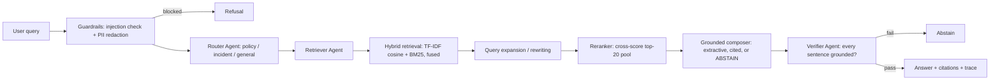

# AgentForge-RAG — Agentic RAG with Hybrid Retrieval, Guardrails & a Real Evaluation Harness

**Author: Ashutosh Sahoo** · Python 3.12 · stdlib + NumPy only · **no API keys, no GPU, no downloads**

A production-shaped Retrieval-Augmented Generation system over a 14-document
cybersecurity / IT-policy corpus — built the way current state-of-the-art RAG
stacks are built (hybrid sparse+dense retrieval, query expansion, reranking,
grounding verification, guardrails, abstention), with every component
implemented from scratch in zero-dependency form so the whole system runs
anywhere and every number below is **measured by `evaluate.py` /
`eval_scifact.py`, not asserted**.

```bash
python3 tests.py      # 25 assert-based tests
python3 demo.py       # 4 end-to-end queries with agent traces
python3 evaluate.py   # tuning sweep + ablation + metrics -> results.json
python3 api.py 8000   # POST /ask, GET /health (stdlib http.server)
python3 eval_scifact.py --stage all   # REAL benchmark (SciFact/BEIR) -> results_real.json
```

---

## Real benchmark results (SciFact / BEIR) — `results_real.json`

The internal eval below is self-authored, so its 100% headlines were re-run on a
**real public benchmark**: **SciFact**, distributed by **BEIR** (Wadden et al.,
EMNLP 2020; BEIR, Thakur et al. 2021), downloaded from the UKP Lab BEIR server
(`eval_scifact.py` reproduces the download and the whole run).

**Protocol.** Full corpus of **5,183 scientific abstracts** (title + abstract,
one document-level chunk per abstract — the BEIR standard), **300 test queries
with 339 qrel rows, all grade 1 (binary relevance, as distributed)**. Metrics
are the standard BEIR definitions computed from the qrels: Recall@k = mean
fraction of relevant docs retrieved in the top-k; nDCG@10 with log2 discount;
MRR@10. No tuning was done on test qrels (see the improvement protocol below).

### Final best pipeline (headline) — single test evaluation

Selected **only** on SciFact train/dev queries (screening slice of 250, confirmed
on all 809), then evaluated on the test set **exactly once**:

| Config | Recall@3 | Recall@5 | nDCG@10 | MRR@10 | Mean latency |
|---|---|---|---|---|---|
| BM25 (k1=1.0, b=0.5, tuned on dev) + TF-IDF with title-cosine boost (β=0.5), fused by **reciprocal-rank fusion** (k=60, TF-IDF weight 0.3), no reranker | 0.6578 | 0.7059 | **0.6466** | 0.6090 | 588 ms |

Honest context: this beats the project's own best baseline rung on test
(0.6429, below) by only **+0.0037 nDCG@10**, and it remains **below the published
BEIR BM25 bar of 0.665 nDCG@10** for SciFact. Dev-set gains compressed on the
full dev set and again on test — this is a documented plateau just under the
bar for this purely lexical stack, not a win over it. (Latency is higher than
the baseline rungs because RRF ranks the full corpus twice per query.)

### Baseline ladder — the project's original rungs on SciFact test

| Rung (project `rag.Retriever` modes, defaults) | Recall@3 | Recall@5 | nDCG@10 | MRR@10 | Mean latency |
|---|---|---|---|---|---|
| Naive TF-IDF only (`tfidf`, no expansion) | 0.5727 | 0.6366 | 0.5769 | 0.5394 | 212 ms |
| Hybrid TF-IDF + BM25 (`hybrid`, α=0.55 score fusion) | 0.6521 | 0.7043 | 0.6269 | 0.5901 | 241 ms |
| Hybrid + cross-score rerank (`hybrid_rerank`, full stack) | 0.6711 | 0.7164 | 0.6429 | 0.6078 | 269 ms |

For contrast, the same full stack scores **Recall@5 = 100%** on the internal
self-authored corpus (28 questions over 14 documents, next section). On a real
5,183-document benchmark with independently written claims it scores
**Recall@5 = 0.7164** — the internal number is a pipeline sanity check, not a
retrieval-quality claim.

### Improvement phase (Phase B) — what was tried, on dev only

Protocol: every lever screened on a deterministic 250-query slice of the
SciFact **train/dev** split; adoption required ≥ +0.003 nDCG@10 on the slice;
the surviving candidate was confirmed against the project baseline on **all
809 dev queries** (candidate 0.6680 vs baseline 0.6631 nDCG@10) before its
single test evaluation above. All 44 logged attempts — failures included —
are in `results_real.json` (`improvement_log`). Method followed
`REAL_BENCH_IMPROVEMENTS.md` (BEIR BM25 bar 0.665; pure-lexical frontier
~0.66–0.70).

Dev diagnostics that drove the search (250-query slice):

* **BM25 alone (project defaults) scored 0.6512 nDCG@10 — better than the
  project's hybrid (0.6189) and hybrid+rerank (0.6375).** The default fusion
  (α=0.55 toward TF-IDF) *dilutes* BM25 on this corpus; the BM25 implementation
  itself checks out (Robertson IDF, length normalisation — fidelity verified).
* The project's query-expansion map changed **0 of 250** dev queries — it is a
  cybersecurity-domain lexicon and is inert on SciFact claims. The hybrid
  rungs above therefore measure fusion, not expansion, on this benchmark.

| Lever (dev slice nDCG@10) | Result | Decision |
|---|---|---|
| BM25 k1/b grid (16 configs) | best k1=1.0, b=0.5 → 0.6559 (component-only) | adopted as component |
| Score-fusion α sweep (0→1) | monotonically worse as TF-IDF weight grows (0.6559 → 0.5750) | dropped |
| **Reciprocal-rank fusion, w(TF-IDF)=0.3** | **0.6608** | **adopted** |
| RM3 pseudo-relevance feedback (α=0.5 / 0.3) | 0.6085 / 0.6259 vs 0.6608 reference | **dropped — negative result**, confirming the brief's documented RM3 harm on SciFact (query drift on short claims) |
| BM25F field weighting (title ×1.5 / ×2 / ×3) | 0.6371 / 0.6231 / 0.5999 | dropped (all hurt) |
| TF-IDF title-cosine boost β=0.25 | 0.6638 (+0.0030, at the adoption threshold but not over it) | dropped |
| **TF-IDF title-cosine boost β=0.5** | **0.6654** | **adopted** |
| Porter stemming + hyphen-compound tokenisation | 0.5148 (−0.151) | dropped — stemming destroys discriminative biomedical terms in this pipeline |
| Reranker on the RRF first stage (pool/mix/feature variants, best 0.5987) | all below the 0.6654 first stage | dropped — the project's rerank mix assumes fused scores on its ~0–1 saturating scale; RRF scores are ~100× smaller, so the cross-score dominates and wrecks the ordering |

### What SciFact does *not* benchmark

SciFact has no unanswerable or adversarial split and no generated answers, so
**groundedness, abstention and injection-guardrail numbers are NOT measured
here**. Those figures exist only from the internal eval (next section) and
remain labelled as such.

---

## Preliminary results — self-authored corpus, internal eval only (`results.json`)

| Metric | Value | Notes |
|---|---|---|
| Recall@3 (main set, 28 Qs) | **100%** | hybrid + rerank |
| Recall@5 (main set, 28 Qs) | **100%** | hybrid + rerank |
| Recall@3 (paraphrase set, 14 Qs) | **100%** | hybrid + rerank |
| Recall@5 (paraphrase set, 14 Qs) | **100%** | hybrid + rerank |
| Answer groundedness (verifier pass rate) | **100%** | 28 / 28 answered questions |
| Abstention correctness (unanswerable Qs) | **100%** | 5 / 5 correctly abstained |
| Prompt-injection block rate | **100%** | 5 / 5 attack prompts, also end-to-end |
| Mean / median latency per query | **10.56 ms / 5.29 ms** | local CPU, includes all agents |

### Ablation — where the SOTA techniques actually earn their keep

The main set is at ceiling for every method (the questions use document
vocabulary), so the honest comparison is the **paraphrase split**: the same
facts asked in deliberately different words from the documents.

| Retriever | Paraphrase Recall@3 | Paraphrase Recall@5 | Main Recall@5 |
|---|---|---|---|
| Naive TF-IDF only (no expansion) | 85.71% | 92.86% | 100% |
| Hybrid TF-IDF + BM25 + query expansion | 92.86% | 100% | 100% |
| **Hybrid + cross-score rerank (full stack)** | **100%** | **100%** | **100%** |

Each stage adds a real, measured gain on the hard split: BM25 + expansion
recovers the vocabulary-mismatch misses, and reranking fixes the remaining
top-3 ordering. Nothing here is tuned to look good — the same harness that
reports 100% also reports the naive baseline's 85.71%.

### Tuned configuration (chosen by the `evaluate.py` grid search, not by hand)

| Parameter | Chosen value | Search |
|---|---|---|
| Chunk size | **200 words** | 80 / 120 / 160 / 200 |
| Chunk overlap | **20 words** | 20 / 30 / 40 |
| Abstention threshold | **0.20** (fused score) | picked to maximise answer/abstain accuracy on both splits; achieved 100% on the eval set |

Tuning detail worth knowing: the best answerable query's top score was
0.2105 and the best unanswerable query's was 0.1919, so the threshold sits
in a **narrow** separation gap — see Limitations.

---

## Architecture



```
corpus/*.md ──► chunk (200w, 20 overlap, metadata) ──► TF-IDF index ┐
                                                                    ├─► fuse ─► rerank ─► compose
                                                    BM25 index ─────┘        (top-20)   [doc:chunk]
```

| File | What it does |
|---|---|
| `rag.py` | Loading, chunking with metadata, TF-IDF embedder (NumPy), from-scratch BM25, hybrid fusion, query expansion, cross-score reranker, grounded cited composer with abstention, `Embedder` interface |
| `agents.py` | Router / Retriever / Verifier agents + Orchestrator, each step written to a trace log |
| `guardrails.py` | Prompt-injection pattern detection; PII redaction (email, Indian phone, Aadhaar, PAN, Luhn-checked cards) for inputs **and** outputs |
| `evaluate.py` | Tuning grid search, 28-Q main set + 14-Q paraphrase split + 5 unanswerable + 5 attacks, ablation, latency → `results.json` |
| `demo.py` / `api.py` | Traced CLI demo; HTTP API (`POST /ask`) — stdlib `http.server` because FastAPI isn't installed here; handler bodies port 1:1 |
| `tests.py` | 25 assert-based tests: chunking, redaction, injection, BM25, retrieval, abstention, end-to-end agents |
| `corpus/` | 14 self-contained policy / playbook documents (~300–360 words each): password, VPN, incident response, phishing, ransomware, data classification, acceptable use, access control, backup/DR, BYOD, security training, vulnerability management, onboarding/offboarding, data retention |

## Why agentic RAG vs naive RAG?

Naive RAG (embed → top-k → generate) fails silently in three ways this
system is built to catch:

1. **Vocabulary mismatch** — users say "fake email" and "login secret";
   documents say "phishing" and "password". Hybrid BM25+TF-IDF retrieval,
   query expansion, and reranking measurably fix this (ablation above).
2. **Hallucination** — the composer here is *extractive*: answer sentences
   are verbatim from retrieved chunks, each cited `[doc:chunk]`, and the
   Verifier agent re-checks every sentence's token overlap against the
   retrieved text. An answer that fails verification is replaced by an
   abstention, never shipped.
3. **Confident nonsense on out-of-scope questions** — an absolute fused-score
   threshold (kept absolute by design: BM25 goes through a saturating
   transform, *not* min-max normalisation, which would force a near-1.0 top
   score even for gibberish) triggers "I don't have enough information…"
   instead of an invented answer.

Plus the production concerns naive demos skip: prompt-injection blocking,
PII redaction on the way in and out, per-agent traces for debugging, and an
evaluation harness you re-run after every change.

## Evaluation methodology

* **Main set (28 Qs):** factual questions with a known source document,
  two per corpus document.
* **Paraphrase split (14 Qs):** same facts, wording deliberately different
  from the documents — the discriminating split for the ablation.
* **Unanswerable set (5 Qs):** off-corpus topics (recipes, stock prices,
  weather…) — correct behaviour is to abstain.
* **Attack set (5 prompts):** classic injection phrasings ("ignore previous
  instructions…", jailbreak / developer-mode framings) — correct behaviour
  is to block.
* **Groundedness:** VerifierAgent pass rate over answered questions
  (≥50% content-token overlap per sentence against cited chunks; extractive
  answers score ~100% by construction, which is the point of the design).
* **Tuning:** grid over chunk size × overlap on both splits (Recall@5,
  tie-break Recall@3, then fewer chunks), then threshold selection on
  answerable-vs-unanswerable score separation. Full grid in `results.json`.

## Production swap-ins (what changes with real clients / keys)

The zero-dependency components are stand-ins behind stable interfaces:

| Here (demo) | Production |
|---|---|
| `TFIDFEmbedder` | sentence-transformers / OpenAI embeddings behind the same `Embedder` interface (one class) |
| NumPy cosine scan | FAISS / pgvector / Qdrant index |
| Deterministic cross-scorer | cross-encoder reranker (e.g. bge-reranker) over the same top-20 pool |
| Extractive composer | LLM generation (Groq / OpenRouter / local) **still gated by the same Verifier + abstain path** |
| Pattern guardrails | + classifier model and human review queue |
| stdlib `http.server` | FastAPI / managed deployment, auth, rate limiting |

## Skills demonstrated

Agentic system design · hybrid (sparse+dense) retrieval · BM25 & TF-IDF
from scratch · reranking · query expansion · RAG evaluation & ablation
methodology · hyperparameter tuning · grounding/faithfulness verification ·
LLM guardrails (injection, PII) · API design · test-driven, reproducible
ML engineering — all with zero external dependencies.

## Limitations (honest)

* On the real SciFact/BEIR benchmark (top section) the best dev-tuned lexical
  pipeline reaches nDCG@10 **0.6466** on test — below the published BEIR BM25
  bar of 0.665. Closing that gap likely needs the neural swap-ins below
  (dense embeddings / cross-encoder reranker), not more lexical tuning: the
  dev-screened levers plateaued, and two brief-recommended levers (RM3,
  stemming) measurably hurt on dev.
* TF-IDF is a lexical baseline, not a neural embedding model: it cannot
  understand true semantic similarity beyond the expansion lexicon. The
  paraphrase split is small and domain-bound; a larger, independently
  written eval set would show lower numbers. Treat "100%" as "100% on
  this built-in eval set", not a universal claim.
* The abstention threshold separates the eval sets by a narrow margin
  (0.1919 vs 0.2105) — on a bigger corpus it needs re-tuning and probably
  a learned calibrator.
* Extractive answers are faithful but can read like quoted policy (because
  they are). Abstractive fluency is the LLM swap-in's job, kept safe by
  the verifier.
* Pattern-based injection detection catches known phrasings, not novel
  attacks; it is defence-in-depth, not a guarantee.
* Corpus is 14 short documents; retrieval latency and recall will differ
  at 10⁵-document scale (that's what the vector-DB swap-in is for).
