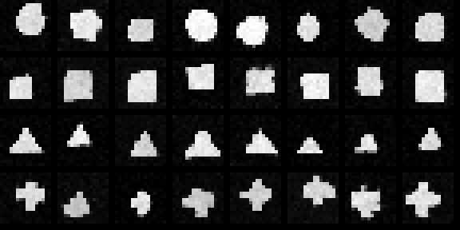
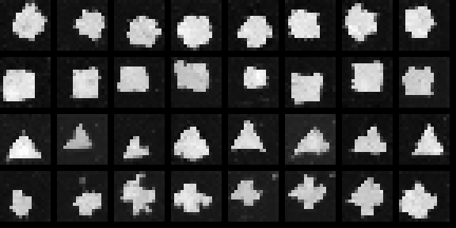
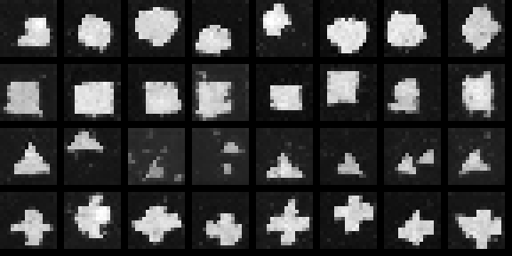

# DiffusionForge

## DDPM, DDIM and Classifier-Free Guidance from Scratch: A Verified Implementation of Modern Diffusion Models in Pure PyTorch

---

**Author:** Ashutosh Sahoo
**Programme:** M.Tech (Artificial Intelligence), NIT Silchar
**Date:** November 2026
**Project type:** Advanced AI / ML project -- research and development (generative AI, diffusion probabilistic models)

**Result headline:** A from-scratch diffusion model (179,281 parameters, T = 300, cosine schedule) generates class-conditioned 16x16 shapes with 98.44% class fidelity under full DDPM sampling; DDIM cuts sampling time 6.5x (87.4 s to 13.4 s per 64 samples) at 85.94% fidelity; and the classifier-free guidance sweep peaks at w = 1.5 -- over-guidance at w = 3.0 measurably hurts (54.69%).

---

## Abstract

Diffusion models are the generative engine behind modern text-to-image systems such as Stable Diffusion and the DALL-E family. Their core ideas are mathematically elegant -- a fixed Markov chain that gradually destroys data with Gaussian noise, and a learned reverse chain that removes that noise step by step -- but the published machinery hides several places where a small implementation choice decides whether samples look like data or like static: the noise schedule, the parameterisation of the reverse mean, the exponential moving average (EMA) of the weights, and the strength of classifier-free guidance. This report presents DiffusionForge, a complete, self-contained implementation of that machinery in pure PyTorch -- no `diffusers` library, no pretrained weights, no dataset downloads -- built so that every mechanism is visible in code and every claim is backed by a measurement.

The project implements both the linear noise schedule of the original DDPM paper and the cosine schedule of Improved DDPM; the closed-form forward process q(x_t | x_0); a small conditional U-Net (179,281 parameters) with sinusoidal time embeddings and learned class embeddings, including a learned NULL embedding so that one network serves both the conditional and unconditional models required by classifier-free guidance (training drops the label with probability 0.1); ancestral DDPM sampling in the numerically stable posterior-mean form with predicted-x_0 clamping; and deterministic DDIM sampling on a 50-step subsequence. The model is trained on a synthetic, fully reproducible dataset of 2,000 code-drawn 16x16 shapes in four classes (circle, square, triangle, cross), chosen deliberately so the entire pipeline trains and verifies on a CPU in about seventeen minutes.

Evaluation is designed around a validity-checked proxy metric: a small CNN classifier trained only on real data reaches 99.75% accuracy on the real test split, so its verdicts on generated samples are trustworthy; class fidelity is the fraction of generated samples it assigns to the class the generator was conditioned on. The headline findings are fourfold. First, full DDPM sampling (300 steps, guidance 1.5) reaches 98.44% class fidelity (63 of 64 samples) with diversity at 92.7% of the real data's level. Second, DDIM with 50 steps reaches 85.94% fidelity in 13.4 seconds versus 87.4 seconds -- a 6.5x speedup for a 12.5-point fidelity cost, quantifying the standard speed/quality trade-off on a single checkpoint. Third, the guidance ablation is non-monotonic: w = 0 (unconditional) sits at 28.12%, near the 25% chance level, exactly as theory predicts; w = 1.5 peaks at 85.94%; w = 3.0 falls to 54.69%, because extrapolated noise predictions push a deterministic sampler off the data manifold. Fourth -- and the report treats this as a first-class result -- two genuine engineering bugs were found by measurement and fixed: an EMA decay of 0.999 over a short run left the sampling weights dominated by the random initialisation, and the textbook epsilon-parameterised DDPM step drifted off-manifold (fidelity at chance) until the sampler was rewritten in posterior-mean form with x_0 clamping, after which the same checkpoint scored 98.44%. Every number in this report is taken from the project's results.json, reproduced in full in Appendix A. A learning guide with a concept checklist, thirteen interview questions with model answers, and extension exercises closes the report.

**Keywords:** diffusion models; DDPM; DDIM; classifier-free guidance; noise schedule; U-Net; EMA; generative AI; ELBO; PyTorch; evaluation design; class fidelity.

---

## Table of Contents

1. Introduction
2. Background and Theory
3. System Design and Architecture
4. Implementation -- A File-by-File, Function-by-Function Walkthrough
5. Dataset
6. Experiments
7. Results and Analysis
8. Discussion, Limitations and the Scale-Up Path
9. Conclusion and Future Work
10. Learning Guide
11. How to Run
12. References
Appendix A -- Full results.json
Appendix B -- File Listing
Appendix C -- Real-Data Addendum (MNIST)

---

# 1. Introduction

## 1.1 The problem: generating data by removing noise

Generative modelling asks a deceptively simple question: given examples drawn from some distribution -- photographs, drawings, audio waveforms -- can a machine learn to produce *new* examples from the same distribution? The difficulty is that real data distributions are high-dimensional, sharply structured, and impossible to write down. A 16x16 greyscale image already lives in a 256-dimensional space, and almost all of that space is noise; the actual images occupy a thin, curved manifold inside it. A generative model must somehow represent that manifold and sample from it.

Diffusion models answer the question with an unusual trick. Instead of learning the data distribution directly, they learn to *reverse corruption*. Take a real image and add a little Gaussian noise; repeat a few hundred times. By the end nothing remains but static -- and pure static is trivial to sample. Now train a neural network to predict, at each level of corruption, the noise that was added. If the network can do that, it can walk a sample of pure noise backwards, removing a little predicted noise at a time, until an image emerges. Generation becomes iterated denoising.

This idea -- published as DDPM in 2020 -- turned out to be remarkably robust, and its descendants (DDIM, Improved DDPM, classifier-free guidance, latent diffusion) now power the best-known image generators. But the robustness is not automatic. The gap between "implements the DDPM equations" and "actually generates recognisable samples" is filled with details that the equations state quietly or not at all: how fast the noise schedule destroys signal, whether the sampler uses the algebraically equivalent but numerically different form of the reverse step, whether the averaged weights used for sampling have actually averaged anything yet, and how hard the guidance knob can be turned before it destroys the very samples it is meant to improve.

## 1.2 Why build it from scratch

A practitioner can generate images today with three lines of code against a pretrained model. That teaches API usage; it teaches nothing about why the machinery works or where it breaks. DiffusionForge takes the opposite route: every component -- both noise schedules, the forward process, the U-Net, both samplers, the guidance combination, the evaluation classifier -- is implemented directly in PyTorch from the defining equations, on a dataset small enough to train on a CPU in about seventeen minutes. The payoff of that discipline appeared during the project itself: the two most instructive events of the build (Section 7.6) were bugs that a library would have silently hidden, found only because every intermediate quantity could be measured -- training loss healthy while samples were pure noise in one case; one sampler at chance level while another, on the *same checkpoint*, was near-perfect in the other. Diagnosing those two failures teaches more about diffusion than a flawless run would have.

## 1.3 Objectives

The project was scoped around five objectives:

- **O1 -- Correctness from first principles.** Implement the forward process, the noise-prediction training objective, and both reverse samplers directly from the published mathematics, with no diffusion library anywhere in the dependency tree.
- **O2 -- Conditioning and guidance.** Support class-conditional generation and classifier-free guidance with a single network (label dropout during training), and measure -- not assume -- how guidance strength affects sample quality.
- **O3 -- The speed/quality trade-off, quantified.** Compare full DDPM ancestral sampling against DDIM step-skipping on one checkpoint with one metric, and report both fidelity and wall-clock time.
- **O4 -- Evaluation you can defend.** Build the fidelity metric on a classifier whose own accuracy on real held-out data is measured first (99.75%), report a diversity statistic alongside fidelity so that mode collapse cannot hide, and disclose chance levels next to every ablation number.
- **O5 -- A scale-up path with no redesign.** Structure the code so that moving from 16x16 synthetic shapes to MNIST/CIFAR-10 latent diffusion on a free GPU changes the dataloader and the channel counts, not the diffusion machinery.

## 1.4 Contributions

- A complete, readable, single-author implementation of DDPM + DDIM + classifier-free guidance in six files (about 700 lines including the evaluator), verified end-to-end on CPU.
- A controlled, single-checkpoint comparison of two samplers and three guidance weights under a validity-checked metric -- the kind of ablation table that library demos rarely publish.
- A documented error analysis of two real failure modes (EMA/run-length mismatch; epsilon-form DDPM drift), each with the measurement that exposed it, the root cause, and the fix -- including the uncomfortable before numbers.
- A reproducible training/evaluation protocol: fixed seeds throughout, all metrics written to a single results.json, and a report (this document) whose every number traces to that file.

## 1.5 How to read this report

Chapter 2 develops the theory from first principles, with the formulas the code implements. Chapter 3 gives the architecture. Chapter 4 walks every file and function. Chapter 5 describes the synthetic dataset and defends the choice. Chapter 6 states the experimental protocol precisely enough to reproduce it. Chapter 7 presents and analyses the results, including the failure analysis. Chapter 8 discusses limitations honestly and lays out the Kaggle scale-up. Chapters 9-11 conclude, teach, and document execution. Readers in a hurry can read the cover panel, the glance page, and Sections 7.1-7.3 -- but the project's real lessons live in Section 7.6.

---

# 2. Background and Theory

This chapter develops every idea the code depends on, in the order the code uses it: the forward process and its closed form, noise schedules, the reverse process and why predicting noise is the right objective, the two samplers, guidance, the U-Net inductive bias, EMA, and finally the evaluation concepts (fidelity and diversity) that Chapter 7 reports.

## 2.1 The forward process: destroying data on a schedule

Fix a clean image x_0 drawn from the data distribution. The forward (diffusion) process is a Markov chain of T steps. At step t it keeps a fraction of the current image and replaces the rest with fresh Gaussian noise:

```
q(x_t | x_{t-1}) = N( x_t ; sqrt(1 - beta_t) * x_{t-1} ,  beta_t * I )
```

The scalars beta_1 ... beta_T are the **noise schedule**: small positive numbers, increasing with t, that decide how fast signal is destroyed. Define alpha_t = 1 - beta_t and abar_t = alpha_1 * alpha_2 * ... * alpha_t (the cumulative product; the code calls it `alphas_bar`). Because each step is Gaussian with a scaled mean, the chain can be collapsed: the distribution of x_t given the *original* image has a closed form,

```
q(x_t | x_0) = N( x_t ; sqrt(abar_t) * x_0 ,  (1 - abar_t) * I )
x_t          = sqrt(abar_t) * x_0 + sqrt(1 - abar_t) * eps ,   eps ~ N(0, I)
```

This is the single most useful equation in the project. It says any noise level can be reached in *one* step from clean data, so training never has to simulate the chain: pick a random t, draw a random eps, mix them with the closed-form coefficients, and the network sees an honest sample from q(x_t | x_0). In `diffusion.py` this is `q_sample`, and the two square-root coefficient arrays are precomputed once in the `Diffusion` constructor. By the final step, abar_T is close to zero, so q(x_T | x_0) is close to N(0, I) regardless of x_0 -- which is what makes the reverse chain's starting point (pure noise) legitimate.

## 2.2 Noise schedules: linear versus cosine

The schedule decides *where in t* the interesting destruction happens. The original DDPM paper used a **linear schedule**: beta rising linearly from 1e-4 to 0.02 over T = 1000 steps. For large images this works well, but the tail of the linear schedule destroys signal very quickly -- for many steps near the end, x_t is already essentially noise and the network wastes capacity distinguishing indistinguishable inputs; for small images the effect is worse, because there is less signal to begin with.

Nichol and Dhariwal (Improved DDPM, 2021) proposed the **cosine schedule**, which defines abar_t directly through a squared-cosine curve (with a small offset s = 0.008 to avoid a singularity at t = 0) and derives beta_t = 1 - abar_t / abar_{t-1}, clipped to [0.0001, 0.999]. Signal then decays smoothly and spends more steps in the informative middle range. DiffusionForge implements both (`linear_beta_schedule`, `cosine_beta_schedule`) and trains with the cosine schedule at T = 300 -- an educational-scale T chosen so a full DDPM sampling pass is slow enough to make the DDIM speedup worth measuring, but fast enough to run on a CPU.

## 2.3 The reverse process and the noise-prediction objective

Generation needs the reverse chain p_theta(x_{t-1} | x_t). Its true form (conditioned on x_0) is also Gaussian and is known exactly:

```
q(x_{t-1} | x_t, x_0) = N( x_{t-1} ; mu_tilde(x_t, x_0) , beta_tilde_t * I )

mu_tilde = [ sqrt(abar_{t-1}) * beta_t / (1 - abar_t) ] * x_0
         + [ sqrt(alpha_t) * (1 - abar_{t-1}) / (1 - abar_t) ] * x_t
beta_tilde_t = beta_t * (1 - abar_{t-1}) / (1 - abar_t)
```

The problem is that at generation time x_0 is exactly what we do not have. The DDPM insight is that x_0 can be *estimated* from x_t if we know the noise that was mixed in -- rearrange the closed form of Section 2.1:

```
x0_hat = ( x_t - sqrt(1 - abar_t) * eps_theta(x_t, t) ) / sqrt(abar_t)
```

So the learning problem reduces to training a network eps_theta to predict the added noise eps. The full variational (ELBO) derivation shows that each reverse step contributes a KL divergence between two Gaussians; after the standard reparameterisation and the simplification Ho et al. found to work best (dropping the ELBO's per-timestep weighting), training becomes plain mean-squared error on noise:

```
L = E_{x_0, eps, t}  || eps - eps_theta( sqrt(abar_t) x_0 + sqrt(1 - abar_t) eps , t ) ||^2
```

That is the entire training loss in `train.py`: `F.mse_loss(pred, noise)`. Two consequences matter for Chapter 7. First, the loss has an interpretable floor: it is the expected squared error of noise prediction, and it falls from about 0.70 (epoch 1 -- close to the variance scale of the task at high noise) to 0.0613 in this project. Second, the loss measures *average* noise-prediction quality across all t; it says nothing directly about what happens when 300 of those predictions are chained together at sampling time. Sampling errors compound -- the input at each step is the previous step's imperfect output, slightly off the distribution the network was trained on -- which is why a healthy loss can coexist with bad samples (Section 7.6, Bug 2), and why honest evaluation must measure *samples*, not just loss.

A practical addition to the reverse process in this project is **x_0 clamping**: the predicted x0_hat is clamped to the data range [-1, 1] before it is used. DDIM does this naturally in the implementation here; the final DDPM sampler does it too, and Section 7.6 shows the clamp was the difference between chance-level and 98.44% fidelity.

## 2.4 DDPM sampling: ancestral, stochastic, slow

DDPM sampling starts from x_T ~ N(0, I) and applies the learned reverse step T times. Each step predicts eps, forms x0_hat, computes the posterior mean mu_tilde(x_t, x0_hat) from the formula in Section 2.3, and -- except at t = 0 -- adds fresh Gaussian noise with variance beta_tilde_t. The fresh noise is not a defect: it makes the sampler *ancestral* (it samples from the chain rather than following its mean), maintains diversity, and partially decorrelates accumulated prediction errors. The cost is obvious: T network evaluations, one per step, cannot be parallelised because each depends on the previous sample. At T = 300, generating 64 small images takes 87.4 measured seconds on this project's CPU -- the direct motivation for DDIM.

## 2.5 DDIM: the same model, a deterministic shortcut

Song et al. (2021) observed that the DDPM training objective only constrains the *marginals* q(x_t | x_0), not the joint chain. A different, non-Markovian reverse process can share exactly those marginals -- and therefore can use the *same trained network* -- while taking a much more direct path. DDIM parameterises a family of samplers by a stochasticity parameter eta; at eta = 0 the update is deterministic:

```
x_{t'} = sqrt(abar_{t'}) * x0_hat + sqrt(1 - abar_{t'}) * eps_theta(x_t, t)
```

for any subsequence of timesteps t' < t. In words: estimate the clean image, then re-noise it to the *next* (lower) noise level using the same predicted noise direction. Determinism has two consequences. Positively, the trajectory is a smooth interpolation rather than a random walk, so far fewer steps are needed -- 50 in this project, and production systems routinely use 20-50. Negatively, there is no fresh noise to wash out errors: a biased prediction is followed faithfully, which is precisely why over-guidance (Section 2.6) damages DDIM samples more visibly than DDPM samples (Section 7.4). Note what DDIM is *not*: it is not a different model, a distilled model, or an approximation flag -- `sample_ddim` and `sample_ddpm` in this project call the same checkpoint.

## 2.6 Conditioning and classifier-free guidance

A generator that produces *a* shape is a curiosity; a generator that produces the shape you asked for is a tool. Conditioning gives the network the class label y alongside (x_t, t). The earliest guidance method trained a separate classifier on noisy images and nudged samples toward higher classifier scores; classifier-free guidance (Ho and Salimans, 2022) removed the extra model with a training trick: with some probability p (0.1 here), replace the label with a learned NULL label during training. The one network then represents both eps_cond = eps_theta(x_t, t, y) and eps_uncond = eps_theta(x_t, t, NULL). At sampling time the two predictions are combined by extrapolation:

```
eps_guided = eps_uncond + w * (eps_cond - eps_uncond)
```

w is the **guidance weight**. w = 0 gives purely unconditional sampling; w = 1 is plain conditional sampling; w > 1 amplifies whatever distinguishes the conditional prediction from the unconditional one -- samples adhere more strongly to the requested class, at the cost of diversity and, past a point, of realism, because the extrapolated eps is no longer the noise prediction of *any* real distribution. This predicts a non-monotonic fidelity curve with an interior optimum, and it predicts that the optimum depends on the sampler (a deterministic sampler has no noise injection to correct extrapolation errors). Chapter 7.4 measures exactly that curve on DDIM: 28.12% at w = 0, 85.94% at w = 1.5, 54.69% at w = 3.0. The w = 0 number deserves emphasis: it is not a failure. An unconditional sampler asked (by the evaluator) to have produced class y will match y about one time in four -- chance for four classes -- and 28.12% is close to that. It is the control condition that proves the conditioning signal, not the classifier, is doing the work at higher w.

## 2.7 Why a U-Net, and why these conditioning injections

The noise predictor needs two properties that fight each other: fine local detail (edges of a shape at 16x16) and global context (which shape, centred where). The U-Net resolves this with an encoder-decoder hourglass and skip connections: the down path (16x16 -> 8x8 -> 4x4) builds global context at low resolution; the up path restores resolution; skip connections concatenate encoder features into the decoder so detail never has to survive the bottleneck. Residual blocks with GroupNorm and SiLU activations are the standard modern block design (GroupNorm, unlike BatchNorm, does not depend on batch statistics -- important when sampling uses different batch compositions than training). Conditioning enters *additively in every residual block*: the timestep is encoded with fixed sinusoidal features passed through a small MLP, the class label with a learned embedding, the two are summed, and a per-block linear projection adds the result to the block's hidden channels. Additive injection at every scale means the noise level and the class can influence both coarse structure and fine detail -- a single injection at the input, by contrast, tends to be washed out by the time features reach the bottleneck.

Sinusoidal time embeddings deserve one line of justification: t is a single integer, but the network's behaviour must vary smoothly and non-monotonically with it (early steps remove structure, late steps polish detail). A Fourier-style encoding -- sin/cos at geometrically spaced frequencies, as in the Transformer -- gives the MLP a representation in which similar t are similar vectors and periodic structure is easy to express.

## 2.8 EMA: the weights you sample from are not the weights you trained

Exponential moving average (EMA) keeps a shadow copy of the parameters, updated each step as ema = decay * ema + (1 - decay) * params. Sampling from the EMA weights is standard practice in diffusion (and in much of deep learning) because the average sits in a flatter, more typical region of weight space than the final noisy iterate. The catch is arithmetic: the shadow's memory of the initialisation after n steps is decay^n. At decay 0.999, after 280 steps that factor is about 0.76 -- the "averaged model" is still three-quarters random init. At decay 0.99 over this project's 630 steps it is about 0.002 -- the init is forgotten and the average is meaningful. EMA decay is therefore not a constant to copy from a paper (large runs do 10k-100k steps, where 0.999 is right); it is a quantity that must be matched to run length. Section 7.6, Bug 1, is this paragraph learned the hard way.

## 2.9 Evaluation concepts: fidelity, diversity, and metric validity

How do you score a generator? The field's standard answers (FID, Inception Score, CLIP score) all require large pretrained backbones and real image datasets -- unavailable and meaningless at 16x16 with four shape classes. This project uses two direct statistics instead:

- **Class fidelity.** Train a classifier *only on real data*, then ask what fraction of generated samples it assigns to the class the generator was conditioned on. Fidelity conflates two things -- sample realism and class adherence -- which is acceptable here because the guidance ablation *wants* that conflation visible, and because the classifier's own competence is measured first: 99.75% on the real test split. A fidelity number is only as meaningful as that validity check; without it, a weak classifier could flatter or slander the generator arbitrarily. (In `evaluate.py`, a below-chance-looking fidelity of about 25-28% also has a precise interpretation: the unconditional control, Section 2.6.)
- **Diversity.** The mean pairwise L2 distance between generated samples, compared against the same statistic on real data. Fidelity alone can be gamed by a mode-collapsed generator that emits one perfect circle forever; its diversity would crater toward zero. Here DDPM diversity is 10.76 against the real data's 11.60 -- 92.7% retained -- so the fidelity is not bought with collapse.

Two honest caveats travel with these metrics into Chapter 8: at 64 evaluation samples, a single sample is worth 1.56 points of fidelity, so differences of a few points are within noise; and both metrics describe *this* distribution (four synthetic shapes), not image generation in general.

## 2.10 SOTA context: the lineage this project implements

| Year | Method | Contribution |
|---|---|---|
| 2020 | DDPM (Ho et al.) | Noise-prediction objective; ancestral sampling; the framework itself |
| 2020 | DDIM (Song et al.) | Non-Markovian deterministic sampling; 10-50x fewer steps, same network |
| 2021 | Improved DDPM (Nichol & Dhariwal) | Cosine schedule; learned variance; better likelihoods |
| 2022 | Classifier-Free Guidance (Ho & Salimans) | Guidance without a classifier; the default conditioning mechanism in text-to-image |
| 2022 | Latent Diffusion (Rombach et al.) | Run diffusion in a VAE's latent space with cross-attention text conditioning -- Stable Diffusion |

DiffusionForge implements the first four rows at educational scale, from scratch, and its scale-up path (Chapter 8) is precisely the fifth row: keep the `Diffusion` class, move it into a learned latent space, and replace the class embedding with cross-attention. Understanding why that works requires exactly the machinery measured here -- schedules, parameterisation, guidance -- which is the report's claim for the project's educational value.

---

# 3. System Design and Architecture

## 3.1 Design principles

Three principles shaped the system. **(1) The maths is the spec.** Each file corresponds to one layer of the theory of Chapter 2, and each formula appears in code close to verbatim, so the report and the code can be read against each other. **(2) Zero hidden machinery.** The dependency list is `torch`, `numpy` and `Pillow` -- no diffusion library, no pretrained weights, no downloads -- so every behaviour of the system is attributable to code in the repository. **(3) One checkpoint, many questions.** Training happens once; the samplers, the guidance sweep and the evaluator all interrogate the same checkpoint, which is what makes the comparisons of Chapter 7 controlled rather than anecdotal.

## 3.2 Module map

| File | Layer of the system | Contents |
|---|---|---|
| `data_gen.py` | Data | Analytic synthetic shape dataset (seeded) |
| `diffusion.py` | Process maths | Schedules, forward process, DDPM + DDIM samplers, CFG combination |
| `model.py` | Network | Conditional U-Net (time + class embeddings, residual blocks) |
| `train.py` | Training | Noise-prediction loop, CFG label dropout, EMA, checkpointing |
| `sample.py` | Generation | Loads EMA weights; writes the five sample grids |
| `evaluate.py` | Measurement | Fidelity classifier, held-out MSE, diversity, ablations -> results.json |

Data flows in one direction: `data_gen` produces tensors; `train` consumes them and writes `checkpoint.pt` (raw + EMA weights) and `train_history.json`; `sample` and `evaluate` consume the checkpoint; `evaluate` additionally trains its own classifier on the same real data and writes `results.json`, the single source of every number in this report.

## 3.3 The network at a glance

```
x_t (1 x 16 x 16) -> conv_in (1->16)
  -> ResBlock(16->16)  @16x16  = skip s1
  -> down1 (stride-2 conv)     -> ResBlock(32->32) @8x8 = skip s2
  -> down2 (stride-2 conv)     -> ResBlock(32->32) @4x4 (mid)
  -> up2 (transpose conv)      -> ResBlock(64->32) on concat(up, s2) @8x8
  -> up1 (transpose conv)      -> ResBlock(32->16) on concat(up, s1) @16x16
  -> GroupNorm -> SiLU -> conv (16->1) = predicted noise eps_hat

t     -> sinusoidal embedding (128-d) -> 2-layer MLP --+
class -> learned embedding (5 entries incl. NULL) -----+-> summed;
        projected per-block and added inside every ResBlock
```

Total parameters: **179,281** (from results.json). The model is deliberately small: at 16x16 with four shape classes, capacity is not the bottleneck -- sampler correctness and guidance behaviour are, and a small model keeps the full train/sample/evaluate cycle inside a CPU budget.

## 3.4 The two runtime paths

**Training path.** For each batch: sample t uniformly per image; noise the batch with `q_sample`; drop labels to NULL with probability 0.1; predict noise; MSE against the true noise; AdamW step; EMA update. One epoch is 7 batches (1,600 images, batch 256); 90 epochs is about 630 optimiser steps and took 1,040.8 s on the project CPU.

**Sampling path.** Both samplers start from the same object -- x_T ~ N(0, I) -- and call the same EMA model. They differ only in the update rule of Sections 2.4-2.5 and in how many network evaluations they perform (300 vs 50). The guidance combination lives in one shared helper (`_guided_eps`), so DDPM and DDIM can never silently diverge in how conditioning is applied -- a design decision that mattered when the samplers' *results* diverged and the bug had to be localised (Section 7.6).

---

# 4. Implementation -- A File-by-File, Function-by-Function Walkthrough

## 4.1 `diffusion.py` -- schedules, forward process, samplers

**`linear_beta_schedule(T, 1e-4, 0.02)`** returns `torch.linspace(beta_start, beta_end, T)` -- the original DDPM schedule, implemented for completeness and comparison even though training uses cosine.

**`cosine_beta_schedule(T, s=0.008)`** builds abar_t from the squared-cosine curve, normalises by its value at t = 0, derives betas as successive ratios, and clamps them to [0.0001, 0.999]. The clamp prevents a single step from being either a no-op or a total wipeout at the ends of the curve.

**`sinusoidal_embedding(timesteps, dim=128)`** computes the Fourier-style encoding of Section 2.7: frequencies exp(-ln(10000) * i / half) for i in the first half-dimension, then concatenates sin and cos parts. It is a pure function of t -- no learned parameters -- and lives in `diffusion.py` even though the model consumes it, because it belongs to the process maths, not the architecture.

**`class Diffusion`** precomputes every quantity the samplers need, exactly once: `betas`, `alphas`, `alphas_bar` (cumulative product), `sqrt_ab`, `sqrt_1m_ab`, `sqrt_recip_alpha`, and `posterior_var` (beta_tilde_t of Section 2.3, built by prepending abar = 1 for the t = 0 boundary). Precomputation matters beyond speed: it guarantees the training path and both sampling paths use bit-identical coefficients, eliminating a whole class of "the sampler used a different schedule" bugs.

**`_extract(a, t, shape)`** gathers per-example coefficients and reshapes them to broadcast against an image batch -- the small helper that keeps every formula in the file one line long.

**`q_sample(x0, t, noise=None)`** is the closed-form forward process of Section 2.1: returns sqrt(abar_t) * x_0 + sqrt(1 - abar_t) * eps together with the eps used, so the training loop can regress against it.

**`predict_x0(x_t, t, eps)`** inverts that relation (Section 2.3). Note that the *samplers* clamp its output; the function itself stays a pure formula so callers decide.

**`_guided_eps(model, x, t, y, guidance, null_label)`** is the single point where classifier-free guidance is applied. If guidance is exactly 1.0 (or there are no labels), it makes one model call and returns the conditional prediction -- an important fast path, since it halves the cost of unguided sampling. Otherwise it runs the model twice, once with the true labels and once with every label replaced by NULL, and returns eps_uncond + w * (eps_cond - eps_uncond). Both samplers call it with an integer timestep and a full batch.

**`sample_ddpm(model, y, guidance, null_label, shape)`** implements Section 2.4 *in posterior-mean form* -- this is the fixed version, and the code comment records why. For each t from T-1 down to 0: get the guided eps; form x0_pred and **clamp it to [-1, 1]**; compute the posterior mean as coef_x0 * x0_pred + coef_xt * x with

```
coef_x0 = sqrt(abar_{t-1}) * beta_t / (1 - abar_t)
coef_xt = sqrt(alpha_t) * (1 - abar_{t-1}) / (1 - abar_t)
```

then, if t > 0, add sqrt(posterior_var[t]) * z with fresh z ~ N(0, I). The final result is clamped to [-1, 1]. Section 7.6 (Bug 2) documents the earlier epsilon-form version -- algebraically equivalent, numerically disastrous over 300 steps -- and the measurement that convicted it.

**`sample_ddim(model, y, steps=50, guidance, null_label, shape)`** implements Section 2.5 with eta = 0. It builds the timestep subsequence with `torch.linspace(0, T-1, steps)` (reversed, so T-1 first), and at each step computes x0_pred (clamped), then either finishes (last step: x = x0_pred) or re-noises toward the next level: sqrt(abar_next) * x0_pred + sqrt(1 - abar_next) * eps. Determinism note: given the same initial noise (the evaluator resets the seed before each condition), DDIM's output is a deterministic function of the checkpoint and w -- which is what makes the guidance ablation a clean experiment.

## 4.2 `model.py` -- the conditional U-Net

**`ResBlock(in_ch, out_ch)`** is the standard modern block: GroupNorm(8 groups) -> SiLU -> Conv 3x3; then the conditioning injection -- the (time + class) embedding is activated, projected by a per-block Linear(128 -> out_ch), reshaped, and *added* to the feature map; then GroupNorm -> SiLU -> Conv 3x3; then the residual connection, which is a 1x1 conv when the channel count changes and the identity otherwise. Injecting after the first convolution (rather than at the block input) follows the ADM/Stable-Diffusion convention: the block first computes content features, then is told *under what conditions* (noise level, class) to refine them.

**`SmallUNet(num_classes=4, base=16)`** wires the hourglass of Section 3.3. Two details deserve note. (1) The class embedding table has **num_classes + 1 = 5 entries**; index 4 (`NULL_LABEL`) is the unconditional embedding used by classifier-free guidance -- it is a *learned* vector, trained exactly on the 10% of examples whose labels were dropped, not a zero vector, so the unconditional model is a real model of the marginal distribution. (2) Downsampling uses stride-2 convolutions and upsampling transpose convolutions (learned resampling), and the decoder blocks take doubled input channels because of the skip concatenations (ResBlock(64->32) after the 8x8 skip, ResBlock(32->16) after the 16x16 skip).

**`forward(x, t, y)`** computes emb = time_mlp(sinusoidal_embedding(t)) + class_emb(y) once and threads it through all five blocks -- every scale sees the same conditioning, projected differently per block.

**`count_params(model)`** sums parameter counts; it is what stands behind the 179,281 figure.

## 4.3 `data_gen.py` -- the synthetic dataset

Covered as a dataset in Chapter 5; as code, `_draw_batch(rng, n)` draws all shapes on an analytic 16x16 coordinate grid: centres jittered by +/-2 px, characteristic size uniform in [3.6, 5.6], foreground amplitude uniform in [1.6, 2.0] (mapped so foreground sits near +1 and background at -1), then per-pixel Gaussian noise with sigma 0.06 and a clip to [-1, 1]. The four masks are closed-form: circle (dx^2 + dy^2 <= s^2), square (max-norm box), triangle (a row-wise linearly shrinking half-width between apex and base -- the fiddliest of the four, built from the fraction of the row between base and apex), and cross (union of a vertical and a horizontal bar of half-width 0.38 s). `generate_dataset(n_train=1600, n_test=400, seed=42)` uses generator seed 42 for train and seed 1042 for test, so the test images are fresh draws, never memorised training items.

## 4.4 `train.py` -- the training loop

Constants first: T = 300, EPOCHS = 90, BATCH = 256, LR = 2e-3, CFG_DROP = 0.1. The loop (Section 3.4) uses AdamW (weight decay 1e-4) with a cosine learning-rate schedule over the whole run, seeds torch with 42, and restricts itself to 2 CPU threads (the build machine is shared). Two implementation points carry the project's lessons:

- **EMA, matched to the run.** The EMA copy is updated after every optimiser step with decay **0.99**, and the file's docstring states the reasoning explicitly: at ~630 total steps, 0.99 forgets the initialisation (residual weight about 0.002), while the conventional 0.999 would not (about 0.53 even over the full run, and about 0.76 over the ~280 steps of the first, shorter run -- Bug 1, Section 7.6). The checkpoint saves *both* raw and EMA weights; sampling loads EMA, and the evaluator's held-out MSE deliberately uses the *raw* weights, so training quality and sampling quality are measured on the objects that actually produce them.
- **Periodic checkpointing.** A checkpoint is written every 5 epochs, so an interrupted 17-minute run loses at most 5 epochs -- a mundane decision that in fact saved this project once (the first long run was interrupted mid-sweep under machine load, and training resumed from the periodic checkpoint rather than from zero).

## 4.5 `sample.py` -- grids and the visual record

`load_model` loads the checkpoint's **EMA** weights (with a comment noting they sample noticeably better -- a claim the EMA ablation behind Bug 1 substantiates). `balanced_labels` produces 8 labels per class in class order, so every grid's rows cycle circle / square / triangle / cross and a reader can check class adherence by eye, row block by row block. `save_grid` renders tiles with 2 px gaps and upscales 4x with nearest-neighbour (no smoothing -- the pixels shown are the pixels generated). `main` produces the DDPM grid (guidance 1.0), the DDIM-50 grid (guidance 1.0), and the CFG sweep grids at w = 0.0, 1.5, 3.0 (DDIM), and stores all samples in `samples.pt` for inspection. Three of these grids are reproduced in Chapter 7.

A nuance the careful reader should note: the *grids* use guidance 1.0 for the DDPM/DDIM comparison, while the *evaluator's* headline comparison (Chapter 7) uses guidance 1.5 for both samplers. The grids are the visual record; results.json is the measured record; the report never mixes the two.

## 4.6 `evaluate.py` -- measurement as a separate, sceptical program

The evaluator is written as if it distrusts the rest of the project. **`TinyClassifier`** is a small CNN (1->16->32 channels, two max-pools, 64-unit head) trained *only on real training data* for 15 epochs (Adam, lr 2e-3, batch 64); `get_classifier` then measures it on the real test split and reports **99.75%** -- the validity certificate for every fidelity number that follows. **`fidelity(clf, imgs, labels)`** is the percentage of generated samples whose classifier verdict equals the conditioning label. **`pairwise_diversity`** computes mean pairwise L2 over the first 96 flattened samples, for generated sets and for real data alike. `main` then, in order: measures held-out noise MSE with the raw weights (batches of 100 test images, one uniform random t per image); samples 64 images (16 per class) with DDPM and with DDIM-50, *resetting seed 99 before each* so both samplers start from identical initial noise, and times both; computes real-data diversity; runs the guidance ablation at w = 0.0, 1.5, 3.0 on DDIM, again re-seeding per condition; merges the training statistics from `train_history.json`; and writes `results.json`. The re-seeding discipline is the difference between an ablation and an anecdote: any fidelity difference between conditions is attributable to the sampler or w, not to luckier starting noise.

---

# 5. Dataset

## 5.1 Why synthetic shapes -- and why that is the honest choice here

The project's claim is about *machinery*, not about a benchmark: that the diffusion pipeline is implemented correctly, that its samplers and guidance behave as the theory predicts, and that its failure modes are understood. Testing those claims needs a dataset with three properties: (1) it must be learnable to near-perfection by a small model on a CPU, so that residual errors point at the machinery rather than at capacity; (2) class membership must be unambiguous, so a classifier-based fidelity metric can be validated to near-100% on real data; (3) it must be generatable in code with fixed seeds, so any reader can reproduce the exact experiment with no downloads and no licensing questions. A synthetic shape dataset is the standard instrument for exactly this role -- the diffusion literature itself was developed against toy distributions (2-D mixtures, then MNIST) before scale. The alternatives fail at least one property: MNIST requires a download and its classes are not geometrically unambiguous to a tiny classifier; CIFAR-10 cannot be trained meaningfully in a 17-minute CPU budget.

The limitation is stated as plainly as the defence: fidelity and diversity numbers in Chapter 7 describe *this* distribution. They validate the implementation; they do not estimate performance on photographs. Chapter 8's scale-up path is where benchmark claims would begin.

## 5.2 Construction

Each image is a single-channel 16x16 float array in [-1, 1], drawn analytically (Section 4.3): a shape mask on a coordinate grid, foreground amplitude in [1.6, 2.0] mapped to values near +1 against a -1 background, centre jittered uniformly by +/-2 px in both axes, characteristic size uniform in [3.6, 5.6] px, and light per-pixel Gaussian noise (sigma 0.06) added before clipping. The jitter is doing real work: with fixed position and size, the four classes would be separable by a handful of pixels, the classifier would hit 100% trivially, and the generator could memorise four templates -- diversity would expose the fraud, but the experiment would have tested nothing. With jitter, class identity is a *shape* property invariant to position and scale, which is the smallest honest version of the invariance real image classes demand.

## 5.3 Statistics and splits

| Property | Value |
|---|---|
| Classes | 4 -- circle, square, triangle, cross |
| Image size | 1 x 16 x 16, range [-1, 1] |
| Train images | 1,600 (seed 42) |
| Test images | 400 (seed 1042 -- independent draws) |
| Class balance | Balanced by construction (labels drawn uniformly; grid/eval sets exactly balanced) |
| Evaluation sampling sets | 64 images per condition (16 per class), seed 99 |
| Grid sampling sets | 32 images per condition (8 per class), seed 7 |

The train/test split is by *draw*, not by file: both sets come from the same generator with different RNG streams, so the test set measures generalisation to unseen jitter combinations of the same shape family -- the correct scope for an implementation study, and a weaker claim than generalisation to a new shape family, which is not made anywhere in this report.

## 5.4 Known dataset limitations

Three are worth naming. First, the shapes are *filled silhouettes* with slightly soft statistics (the generator's edge-softening code path is disabled -- an instructive remnant visible in `data_gen.py`, where a neighbour-averaging blur is computed under a constant `False` condition and discarded; the delivered dataset therefore has hard edges plus noise). Second, there is no intra-class structure beyond jitter -- no rotation, no occlusion, no style variation -- so "diversity" here means positional/scale diversity, a much thinner notion than in natural images. Third, 16x16 resolution makes the U-Net's job structurally simple (the bottleneck is 4x4); conclusions about conditioning injection and sampler stability are expected to transfer, conclusions about required capacity are not.

---

# 6. Experiments

## 6.1 Protocol summary

One training run; one checkpoint; every comparison interrogates that checkpoint. The full configuration:

| Setting | Value |
|---|---|
| Model | SmallUNet, base channels 16, 179,281 parameters |
| Timesteps T | 300 |
| Noise schedule | Cosine (s = 0.008, betas clipped [0.0001, 0.999]) |
| Training data | 1,600 train images (seed 42) |
| Batch size / optimiser | 256 / AdamW (lr 2e-3, weight decay 1e-4) |
| LR schedule | Cosine annealing over the run |
| Epochs / optimiser steps | 90 / about 630 |
| CFG label dropout | p = 0.1 to NULL embedding |
| EMA | Decay 0.99, updated per step; EMA weights used for all sampling |
| Training wall-clock | 1,040.8 s on CPU (2 threads) |
| Final train loss (noise MSE) | 0.06127 |

## 6.2 Training-loss trajectory

The loss is the noise-prediction MSE of Section 2.3, averaged per epoch (from `train_history.json`):

| Epoch | 1 | 11 | 21 | 31 | 41 | 51 | 61 | 71 | 81 | 90 |
|---|---|---|---|---|---|---|---|---|---|---|
| Loss | 0.6980 | 0.1319 | 0.1010 | 0.0900 | 0.0747 | 0.0659 | 0.0692 | 0.0675 | 0.0612 | 0.0613 |

The shape is typical and worth reading properly: a steep fall over the first ten epochs (the network first learns the coarse structure of the task -- mostly, that most pixels at most noise levels are predictable), then a long shallow tail in which remaining gains come from the hardest region (high t, where the input is nearly pure noise and the best achievable prediction is close to the conditional mean of the noise). The plateau around 0.06-0.07 from epoch 50 onward -- not a continued descent -- is the honest signature of an irreducible component: at large t, eps genuinely cannot be recovered exactly from x_t, and MSE settles at the posterior variance of that prediction problem. A reader who expects loss -> 0 has misunderstood the objective.

## 6.3 Measurement protocol

All measurements are produced by `evaluate.py` in a single run and written to `results.json`:

- **Held-out noise MSE.** Raw (non-EMA) weights; the 400 test images in batches of 100; one uniform random t per image; MSE between predicted and true noise. This isolates *training* quality from sampler behaviour.
- **Fidelity.** The TinyClassifier (validity: 99.75% on the real test split) judges 64 freshly sampled images per condition (16 per class, conditioning labels known). Both sampler conditions and all three guidance conditions use initial-noise seed 99, reset per condition.
- **Sampler comparison.** DDPM at its native 300 steps vs DDIM at 50 steps, both at guidance w = 1.5, same checkpoint, same initial noise; wall-clock time for the 64-sample batch recorded for each.
- **Guidance ablation.** DDIM-50 at w = 0.0, 1.5, 3.0. (w = 1.0 is the grid configuration of `sample.py`, not an ablation arm; the ablation was designed around the control (0), the expected optimum region (1.5), and an over-guidance probe (3.0).)
- **Diversity.** Mean pairwise L2 over the sampled sets, with real test data as the reference value.

## 6.4 What was deliberately not swept

No hyperparameter sweep over T, schedule, model size, or learning rate was run, and the report does not pretend otherwise. The experimental budget was spent where the project's questions live -- samplers, guidance, and failure analysis -- on a fixed, reasonable configuration (cosine schedule per Improved DDPM; p_drop = 0.1 per the CFG paper's regime; EMA decay set by the run-length argument of Section 2.8, not tuned). Section 8.3 lists the sweeps that would matter at the next scale.

---

# 7. Results and Analysis

Every number in this chapter is from `results.json` (Appendix A). Where a *derived* quantity is shown (a ratio, a count out of 64, a speedup), the arithmetic is stated so it can be checked against the source values.

## 7.1 Headline results

| Metric | Value |
|---|---|
| Held-out noise-prediction MSE | 0.0666 |
| Final train loss (epoch 90) | 0.06127 |
| Fidelity classifier accuracy on real test data (validity) | 99.75% |
| DDPM (300 steps, w = 1.5) -- class fidelity | **98.44%** (63/64) |
| DDIM (50 steps, w = 1.5) -- class fidelity | **85.94%** (55/64) |
| Sampling time per 64 samples -- DDPM vs DDIM-50 | 87.4 s vs 13.4 s (6.5x) |
| Diversity (mean pairwise L2) -- DDPM / DDIM / real | 10.758 / 10.301 / 11.599 |
| CFG ablation fidelity (DDIM) -- w = 0 / 1.5 / 3.0 | 28.12% / 85.94% / 54.69% |

Read as one sentence: the model learned the distribution (held-out MSE close to the final train loss, so no meaningful overfit gap), the expensive sampler nearly saturates the validated metric (one sample in 64 misjudged), the cheap sampler keeps most of that quality at one-sixth of the time, and neither sampler's fidelity is purchased with mode collapse (diversity within about 7-11% of real data).

## 7.2 Training quality: the loss and the held-out gap

The final train loss is 0.06127 and the held-out noise MSE is 0.0666 -- a gap of 0.005, or about 9% relative. For a 179k-parameter model trained on 1,600 images for 90 epochs, some memorisation would be plausible; the small gap says the noise-prediction task, with fresh eps and fresh t drawn at every presentation, is effectively self-augmenting (the same image at a different t with different noise is a different training point), so the model generalises across the corruption process rather than memorising images. This also justifies using held-out MSE as a training-health signal in the first place -- and, per Section 2.3, *only* as that: the sampler results below are the actual quality evidence.

## 7.3 Sampler comparison: what 6x more steps buys

| Sampler | Steps | Fidelity | Time / 64 samples | Diversity |
|---|---|---|---|---|
| DDPM | 300 | 98.44% | 87.4 s | 10.758 |
| DDIM | 50 | 85.94% | 13.4 s | 10.301 |

The trade-off is now a number, not a slogan: **12.50 points of fidelity for a 6.52x speedup** (87.4 / 13.4), or viewed the other way, DDIM retains 87% of DDPM's fidelity at 15% of its time. Three observations sharpen the interpretation:

1. **The step counts differ 6x but the evaluations differ 6x too, and nothing else does** -- same checkpoint, same initial noise, same guidance. This is the cleanest form of the comparison the literature usually reports across different codebases.
2. **DDIM's errors are structured, not random.** Its diversity (10.301) stays close to DDPM's (10.758): it is not producing a narrower set of shapes, it is producing shapes whose class identity is occasionally ambiguous -- the expected signature of a deterministic trajectory that cannot average out prediction error with fresh noise (Section 2.5).
3. **The practical recommendation inverts with context.** For offline generation, 87 s per 64 toy images is nothing and DDPM's fidelity wins. For anything interactive -- and overwhelmingly for production image models, where one sample is the product -- DDIM's operating point (or a modern descendant: DPM-Solver, consistency distillation) is the only usable one. The project makes no universal claim; it provides the curve's two endpoints on one checkpoint.

The sample grids below are the visual counterparts of this table (generated by `sample.py` at guidance 1.0; rows cycle circle / square / triangle / cross in blocks of 8):





## 7.4 The guidance ablation: an interior optimum, measured

| Guidance w (DDIM-50) | Fidelity | In samples (of 64) | Interpretation |
|---|---|---|---|
| 0.0 (unconditional) | 28.12% | 18/64 | Control: near the 25% chance level, as theory requires |
| 1.5 | 85.94% | 55/64 | The operating point: conditioning amplified, samples still on-manifold |
| 3.0 | 54.69% | 35/64 | Over-guidance: extrapolation error dominates |

This three-point curve is the chapter's most instructive result, because each arm verifies a different theoretical claim of Section 2.6:

- **w = 0 is the control that validates the experiment.** The sampler ignores the labels (it runs the NULL-embedding model), so the evaluator's question "did it produce the requested class?" should be answered correctly about one time in four. 28.12% is close to 25% (and 18/64 is well within binomial noise of 16/64). If this arm had scored high, every other fidelity number in the report would be suspect -- it would mean the classifier or the labels were leaking. It scored at chance; the measurement chain is sound.
- **w = 1.5 shows guidance doing its job.** Extrapolating the conditional prediction away from the unconditional one by half-again steers trajectories toward the prototypical region of each class. On DDIM this is the same 85.94% reported as the DDIM headline (same condition, same seed).
- **w = 3.0 shows why guidance is a knob, not a virtue.** Doubling down on the extrapolation pushes eps_guided outside the range of noise predictions the reverse process was derived for. The deterministic DDIM trajectory follows those distorted predictions faithfully, step after step, and lands off-manifold: shapes still form (the sampler is not broken -- 54.69% is far above chance), but class identity blurs and distorts. The literature's practical guidance ranges (roughly 1.5-8 for large text-to-image models with stochastic or solver-based sampling, tuned per system) do not transfer numerically to this toy, and the report does not claim they should; the *shape* of the phenomenon -- interior optimum, degradation past it -- is the transferable finding, and it is demonstrated here with a control arm most demos omit.

The w = 1.5 grid shows the operating point visually:



## 7.5 Diversity: fidelity was not bought with collapse

| Set | Mean pairwise L2 | Relative to real data |
|---|---|---|
| Real test data | 11.599 | 100% |
| DDPM samples | 10.758 | 92.7% |
| DDIM samples | 10.301 | 88.8% |

A generator can always raise fidelity by shrinking toward class prototypes -- in the limit, one perfect exemplar per class. The diversity column rules that out here: both samplers retain roughly nine-tenths of the real spread, which, given the dataset's diversity *is* mostly centre/scale jitter (Section 5.4), means the models reproduce the jitter distribution rather than collapsing to canonical positions. The small ordering (DDPM > DDIM) is also expected: DDPM's per-step noise injection continually re-randomises trajectories, while DDIM's determinism ties each output more tightly to its initial noise draw. Diversity is reported as a guard metric, not a target -- exceeding the real value would indicate noise, not richness.

## 7.6 Error analysis: two bugs that measurement caught

This section is the report's claim to engineering credibility. Both bugs produced *plausible-looking training curves* and *broken samples*; both were found by measuring samples, not by reading code; and the "before" figures below are the values recorded during the build (in the project's README engineering notes and logs), from the same measurement pipeline that produced the final results.

### Bug 1 -- EMA decay mismatched to run length

**Symptom.** After an early training run, the training loss was healthy (0.096 and falling) but samples drawn from the EMA weights were pure noise -- no shape structure at all.

**Investigation.** The decisive experiment was sampling from the *raw* weights alongside the EMA weights: the raw weights produced recognisable (if rough) shapes, the EMA weights produced static. The generator was fine; the averaging was not.

**Root cause.** Pure arithmetic (Section 2.8). The EMA decay was the conventional 0.999, but the run had only about 280 optimiser steps. The initialisation's residual weight in the EMA is 0.999^280 ≈ 0.76: three quarters of the "averaged model" was still the random initial network, because an average with a ~1,000-step horizon had been given ~280 steps to forget. Sampling faithfully rendered that mostly-random network's output: noise.

**Fix and verification.** Decay set to 0.99 for the delivered ~630-step run (init residual 0.99^630 ≈ 0.002), and `train.py`'s docstring now records the rule: *match the EMA horizon to the run length*. The delivered checkpoint's results -- 98.44% DDPM fidelity from the EMA weights -- are the verification. The general lesson transfers directly to production practice, where EMA decays of 0.999-0.9999 are correct precisely because runs are 10k-1M steps: constants copied without their scale assumptions are bugs waiting for a shorter run.

### Bug 2 -- epsilon-form DDPM drift, fixed by the posterior-mean form with x_0 clamping

**Symptom.** With the checkpoint that produced the final results, DDIM sampling measured 85.9% fidelity while DDPM -- the sampler that uses *more* steps and should be at least as good -- measured 28.1%, i.e. chance. Training loss was healthy; one sampler was near-perfect, the other at chance, on identical weights.

**Investigation.** The asymmetry between the samplers was the clue. The original DDPM step used the textbook epsilon-parameterised mean: mu = (1/sqrt(alpha_t)) * (x_t - beta_t / sqrt(1 - abar_t) * eps). The DDIM step, as implemented, first forms x0_pred and *clamps it to [-1, 1]*. At high t the network's eps prediction is coarse; in the epsilon form, that error is scaled by beta_t / sqrt(1 - abar_t) and injected directly into the mean, step after step, and with 300 stochastic steps the trajectory random-walks off the data manifold -- each step's input is already slightly wrong, and errors compound multiplicatively rather than averaging out.

**Fix.** Rewrite the DDPM step in the mathematically equivalent posterior-mean form of Section 2.3 -- compute x0_pred from eps, **clamp x0_pred to [-1, 1]**, then take the posterior mean as the convex-style combination coef_x0 * x0_pred + coef_xt * x_t, adding noise with the true posterior variance. The clamp bounds every step's clean-image estimate to the data range, so a bad prediction at one step can no longer throw the trajectory outside the region where the next prediction is meaningful.

**Verification.** Same checkpoint, same classifier, same protocol: DDPM fidelity rose from 28.1% (chance) to **98.44%** -- the headline number of this report. Nothing else changed. The episode is the strongest argument in the project for its own methodology: algebraically equivalent formulas are not numerically equivalent over 300 composed steps, and only a *measured sample metric* (not loss, not code inspection) exposed the difference. It is also why the report insists on the w = 0 control arm and the classifier validity check -- without trusted measurement, this bug looks like "diffusion does not work".

### What the two bugs have in common

Both are *scale/context mismatches*: a constant (0.999) transplanted from longer runs, and a formula transplanted from a one-step derivation into a 300-step composition. Neither appears in a unit test of any single function. Both appear immediately in end-to-end sample metrics. The project's evaluation-first design -- build the sceptical evaluator early, measure samples at every stage -- is what converted them from silent quality loss into documented findings, and is the practice the author would carry into any larger generative system.

## 7.7 Statistical honesty: what 64 samples can and cannot say

Fidelity is estimated from 64 samples per condition, so one sample is 1.5625 points and the binomial standard error near 85% is about 4.5 points. Consequences, stated rather than buried: the DDPM-vs-DDIM gap (12.50 points, 8 samples) is meaningful; the w = 1.5 vs w = 3.0 gap (31.25 points) is decisive; but a hypothetical 2-3 point difference between two guidance weights would *not* be resolvable at this sample size, and none is claimed. Timings are single-run wall-clock measurements on a shared CPU and should be read as ratios (6.5x) rather than absolutes. All seeds are fixed, so every figure in this chapter is exactly reproducible by re-running `evaluate.py` -- reproducibility was chosen over the (spurious) precision of averaging over seeds the compute budget could not support.

---

# 8. Discussion, Limitations and the Scale-Up Path

## 8.1 Discussion: what this project actually demonstrates

DiffusionForge set out to prove an implementation, and its results support exactly that claim and no larger one. The chain of evidence is: a from-scratch forward process and noise-prediction objective train stably to a held-out MSE of 0.0666 with a small generalisation gap; a validity-checked metric (classifier at 99.75% on real data; unconditional control at chance) certifies that the samplers' outputs are class-correct generations, not artefacts of measurement; the two samplers trace the expected speed/quality trade-off on a single checkpoint; guidance shows the theoretically predicted interior optimum; and diversity confirms the absence of collapse. Each theoretical property of Chapter 2 has at least one measured counterpart in Chapter 7 -- that correspondence, more than any single score, is the result.

The failure analysis of Section 7.6 carries a second, methodological conclusion: in diffusion systems, *the sampler and the weight-averaging are part of the model*. Two of the three quality-determining defects found in this project lived outside the trained network entirely. Any team evaluating a generative system by training loss alone -- or by eyeballing a grid without a control condition -- is exposed to exactly these silent failures.

## 8.2 Limitations and threats to validity

1. **Synthetic, low-resolution, four-class data.** All quantitative findings describe code-drawn 16x16 silhouettes. The *qualitative* findings (interior guidance optimum; sampler trade-off; EMA and parameterisation pitfalls) are consistent with the published literature at scale, but their numeric values will not transfer to natural images, and no benchmark comparison (FID on CIFAR-10, etc.) is possible or attempted.
2. **Proxy metric.** Class fidelity via a small CNN is a validated proxy *for this distribution* (99.75% on real test), not a perceptual metric. It cannot detect unrealistic textures or subtle shape defects that preserve class identity, and at other scales it must be replaced by FID/CLIP-style evaluation.
3. **Small evaluation samples.** 64 samples per condition gives a fidelity resolution of about +/-4.5 points (Section 7.7). Differences smaller than that are not claimed anywhere in this report.
4. **Single seed, single configuration.** Training was run once at one configuration (Section 6.4). Seed variance of the headline numbers is unmeasured; the fixed-seed protocol guarantees reproducibility of *these* numbers, not their tightness.
5. **Pixel-space, unconditional-of-text.** Production diffusion is latent-space and text-conditioned with cross-attention. The class-embedding conditioning here is the simplest member of that family -- sufficient to demonstrate CFG, not comparable to prompt following.
6. **CPU timings.** Sampling times are from a shared 2-thread CPU environment; the 6.5x ratio is the finding, not the absolute seconds.
7. **Hard dataset edges.** The generator's soft-edge path is disabled (Section 5.4); real image statistics (anti-aliasing, texture) are absent, which almost certainly makes the noise-prediction task easier than any natural-image counterpart.

## 8.3 The scale-up path (Kaggle GPU, real data)

The repository's design makes each rung a local change:

1. **MNIST rung (same code, real data).** Swap the dataloader for MNIST (28x28, padded to 32x32), raise base channels 16 -> 64, T = 1000, batch 128, about 50k steps with EMA decay raised to match the longer run (Section 2.8's rule, applied prospectively). One free T4 session suffices; FID against the MNIST test split becomes available as a standard metric.
2. **CIFAR-10 rung.** Three input/output channels (the U-Net already parameterises channel counts at its edges), deeper residual stack, classifier-free guidance over the 10 classes; compare DDPM/DDIM/DPM-Solver sampling at matched compute.
3. **Latent-diffusion rung.** Train a small VAE; run this project's unchanged `Diffusion` class in the VAE's latent space; replace the additive class embedding with cross-attention to a text encoder's output. At that point the system is architecturally Stable Diffusion at miniature scale, and every mechanism in this report -- schedule choice, x_0 clamping, EMA horizon, guidance tuning -- applies verbatim.
4. **Sweeps that would then matter.** Guidance weight on a fine grid with 1,000+ samples per arm; DDIM steps vs quality curve (10/20/50/100); cosine vs linear schedule at T = 1000; EMA decay vs run length as a designed experiment (the Bug-1 effect, measured deliberately rather than suffered).

## 8.4 Production considerations

Were this system to serve real generation traffic, the engineering agenda would be: solver-based sampling (DPM-Solver++/UniPC) or step distillation for interactive latency; mixed-precision inference and batched sampling; safety and provenance layers (content filtering, watermarking/C2PA metadata) that toy projects omit and products cannot; and evaluation infrastructure -- standing fidelity/diversity dashboards over a fixed prompt suite -- of exactly the kind this project prototypes with `evaluate.py`.

---

# 9. Conclusion and Future Work

DiffusionForge implements the modern diffusion stack -- cosine-schedule DDPM training, a conditional U-Net with classifier-free guidance, ancestral DDPM sampling in posterior-mean form, and deterministic DDIM sampling -- from scratch in pure PyTorch, and *verifies* it with a sceptically designed evaluation: a 99.75%-valid fidelity classifier, an unconditional control arm at chance (28.12%), a 98.44% DDPM fidelity at 92.7% of real-data diversity, a measured 6.5x DDIM speedup at 85.94% fidelity, and a guidance curve that rises to w = 1.5 and falls at w = 3.0 exactly as the theory of extrapolated predictions says it should. Its two documented bugs -- EMA horizon mismatch and epsilon-form sampler drift -- are retained in the record deliberately: they are the difference between a project that ran and a project that was understood.

Future work, in order of value: (1) the MNIST rung of Section 8.3, to attach the implementation to a public benchmark and a standard metric (FID); (2) a designed EMA-decay x run-length experiment converting Bug 1 from anecdote to curve; (3) a steps-vs-fidelity DDIM curve and a DPM-Solver sampler in the same harness; (4) the latent-diffusion rung with cross-attention text conditioning; (5) multi-seed repetitions of the headline table to attach error bars. Each step reuses the evaluator and the protocol unchanged -- which is, in the end, the project's most reusable artefact.

---

# 10. Learning Guide

## 10.1 Concept checklist

A reader who can explain each item below, in their own words, understands this project:

- The forward process q(x_t | x_{t-1}) and why the closed form q(x_t | x_0) makes training possible without simulating the chain.
- abar_t (alphas_bar): what it measures, and why x_T is approximately N(0, I).
- Linear vs cosine schedules: what goes wrong with the linear schedule's tail, especially on small images.
- Why the network predicts *noise* (eps) rather than x_0 or the mean directly -- and the algebraic equivalence of the parameterisations.
- The simplified training objective as MSE on noise, its ELBO origin, and why its plateau is not zero.
- The posterior q(x_{t-1} | x_t, x_0): where its mean coefficients come from, and the role of x_0 clamping in making a 300-step sampler stable.
- Ancestral (DDPM) sampling: why fresh noise is injected at each step, and its cost.
- DDIM: the non-Markovian construction, eta = 0 determinism, why the same checkpoint works, and why deterministic sampling is more exposed to prediction/guidance error.
- Classifier-free guidance: NULL-label training with dropout p, the eps combination formula, and the meaning of w = 0, 1, and > 1.
- Why the guidance/fidelity curve has an interior optimum.
- U-Net inductive bias: hourglass + skips; GroupNorm vs BatchNorm for samplers; additive conditioning injection in every block; sinusoidal time embeddings.
- EMA: the update rule, the decay^n memory of initialisation, and matching decay to run length.
- Evaluation design: metric validity (measure your judge first), control conditions (w = 0), diversity as a collapse guard, binomial resolution of a fidelity estimate.
- The SOTA lineage: DDPM -> DDIM -> Improved DDPM -> CFG -> latent diffusion, and what each step changed.

## 10.2 Interview questions with model answers

**Q1. Derive how you sample x_t at an arbitrary timestep during training.**
From the Markov forward chain with per-step Gaussians, the composition of Gaussians is Gaussian: q(x_t | x_0) = N(sqrt(abar_t) x_0, (1 - abar_t) I), where abar_t is the cumulative product of (1 - beta_s). So x_t = sqrt(abar_t) x_0 + sqrt(1 - abar_t) eps with eps ~ N(0, I) -- one shot, no chain simulation. In code, `q_sample` does exactly this with precomputed coefficient arrays.

**Q2. Why predict the noise instead of predicting the clean image?**
They are algebraically interchangeable -- x0_hat is a linear function of eps_hat given x_t -- but empirically the eps parameterisation trains better: the target eps is standard normal at every t, so the regression problem has uniform scale across timesteps, and the simplified ELBO weighting lands naturally on eps-MSE. (Modern work revisits this: v-prediction and x_0-prediction have advantages at extremes of the schedule -- a good follow-up discussion point.)

**Q3. Your training loss plateaus around 0.06. Is the model undertrained?**
No. At high noise levels the posterior over eps given x_t is genuinely uncertain -- many (x_0, eps) pairs produce the same x_t -- so the Bayes-optimal MSE is the posterior variance, not zero. The plateau is the irreducible part of the objective; sample quality is judged by the fidelity/diversity evaluation, not by pushing the loss lower.

**Q4. Explain classifier-free guidance and why no classifier is needed.**
Train one network with the label randomly replaced (p = 0.1) by a learned NULL embedding, so the network represents both the conditional and unconditional noise predictors. At sampling, combine them: eps_guided = eps_uncond + w (eps_cond - eps_uncond). The difference term points in the direction that conditioning adds; extrapolating along it (w > 1) strengthens class adherence without any external classifier or gradient computation.

**Q5. Your ablation shows w = 3.0 is worse than w = 1.5. Why?**
Guidance extrapolates the eps prediction beyond the conditional prediction. For moderate w this stays near the data manifold and sharpens class identity. For large w the extrapolated eps is no longer a plausible noise prediction for any real x_0, so each reverse step is computed from a distorted estimate. With DDIM the error is followed deterministically for 50 steps and compounds; samples drift off-manifold and class identity degrades -- fidelity falls from 85.94% to 54.69%. Guidance trades diversity/realism for adherence, with an interior optimum.

**Q6. Why is the w = 0 arm in the ablation at all? It is obviously near chance.**
That is precisely its function: it is the control. It proves the fidelity metric responds to *conditioning* rather than to leakage or a biased classifier -- unconditional samples match the requested class 28.12% of the time versus a 25% chance level, while conditioned sampling reaches 85.94-98.44%. An ablation without a control cannot distinguish "guidance works" from "the metric is broken".

**Q7. DDIM uses the same network as DDPM. How can it take 50 steps instead of 300?**
DDIM constructs a non-Markovian reverse process with the same marginals q(x_t | x_0) that DDPM training constrains. Since only the marginals matter for the objective, the trained eps network is valid for both. The DDIM update (at eta = 0) deterministically jumps between a subsequence of noise levels via the predicted x_0, skipping intermediate steps; the cost is that prediction errors are no longer averaged by injected noise, so quality per step must be higher.

**Q8. What was your hardest bug, and how did you find it?**
Two candidates; the better story is the DDPM drift. DDPM at 300 steps scored chance-level fidelity (28.1%) while DDIM on the same checkpoint scored 85.9%, with a healthy training loss throughout. The asymmetry localised the fault to the sampler, and the difference between the samplers was x_0 clamping and the mean's parameterisation. Rewriting the DDPM step in posterior-mean form with x0_pred clamped to [-1, 1] took fidelity to 98.44% with no other change. The lesson: over hundreds of composed steps, algebraic equivalence is not numerical equivalence -- and only end-to-end sample metrics, not loss curves, expose it. (The EMA bug -- decay 0.999 over a ~280-step run leaving the sampling weights ~76% random init -- is the companion example.)

**Q9. How do you choose an EMA decay?**
By run length. The EMA's memory of initialisation after n steps is decay^n; you want that negligible (say < 1%) while keeping the averaging horizon long enough to smooth SGD noise: decay about exp(ln(0.01)/n). For this project's ~630 steps, 0.99 gives residual ~0.002. For a 100k-step production run, 0.999-0.9999 is appropriate. Copying 0.999 into a short run silently samples from a mostly-untrained average.

**Q10. Why not report FID like everyone else?**
FID needs a pretrained Inception network applied to thousands of natural images; on 16x16 four-class synthetic shapes its features and statistics are meaningless, and the backbone violates the project's zero-download constraint. Instead, fidelity is measured with a purpose-built classifier whose validity is itself measured (99.75% on real test data) and diversity with a pairwise-distance statistic. The honest metric for the scale beats the prestigious metric misapplied. At the MNIST/CIFAR rung of the scale-up path, FID becomes meaningful and would be reported.

**Q11. What changes when you move this to latent diffusion?**
Insert a VAE: encode images to a lower-dimensional latent, run the identical Diffusion machinery (schedules, objective, samplers, guidance) in latent space, decode at the end. Conditioning usually becomes cross-attention to text embeddings instead of an additive class embedding. Benefits: far less compute per step, and the diffusion models semantics rather than pixels. Everything in this report about schedules, clamping, EMA and guidance carries over unchanged.

**Q12. The cosine schedule versus linear -- what concretely improves?**
The linear schedule's abar_t collapses toward zero well before t = T, so a large fraction of timesteps present nearly pure noise and contribute little learning signal, while the informative mid-range is traversed quickly. The cosine schedule shapes abar_t to decay near-linearly in signal terms, spending more steps at intermediate signal-to-noise ratios -- better sample quality and likelihoods in Improved DDPM, and it avoids wasting the small T = 300 budget here.

**Q13. How would you make sampling faster without retraining?**
Three routes, in increasing effort: (1) fewer DDIM steps (the fidelity-vs-steps curve would quantify the cost); (2) a higher-order ODE solver sampler (DPM-Solver, UniPC) -- same network, better numerical integration of the same trajectory, typically 10-20 steps; (3) if retraining is allowed, distillation (progressive distillation or consistency models) to reach 1-4 steps. All three keep the checkpoint; only the sampler changes, which is a structural advantage of the diffusion formulation.

## 10.3 Extension exercises

1. **Schedule ablation.** Retrain with the linear schedule at T = 300 and compare held-out MSE, fidelity and diversity under the identical protocol. Predict the direction of the difference before running it.
2. **Steps curve.** For DDIM at w = 1.5, measure fidelity at steps = 10, 20, 50, 100, 200 (1,000 samples for the final numbers) and plot the speed/quality frontier.
3. **EMA experiment.** Train three short runs with EMA decays 0.9 / 0.99 / 0.999 and plot sampling fidelity against steps for each -- reproduce Bug 1 as a designed experiment.
4. **Guidance on DDPM.** Repeat the w sweep with the stochastic sampler and test the report's claim that injected noise partially corrects over-guidance.
5. **A fifth class.** Add a ring (annulus) class to the generator; check whether fidelity and the classifier validity survive a harder negative (ring vs circle).
6. **MNIST rung.** Execute Section 8.3 step 1 and add FID to the evaluator.

---

# 11. How to Run

Environment: Python 3.10+, CPU only. Dependencies are `torch`, `numpy`, `Pillow` (`requirements.txt`: torch>=2.0, numpy>=1.24, Pillow>=9.0). No downloads, no GPU, no API keys.

```bash
cd advanced-ai-projects/diffusionforge
pip install -r requirements.txt

# 1) Generate and inspect the synthetic dataset (writes dataset.pt)
python data_gen.py

# 2) Train the DDPM (about 17 minutes on CPU; writes checkpoint.pt
#    and train_history.json; checkpoints also saved every 5 epochs)
python train.py

# 3) Generate the sample grids of Chapter 7 (writes samples_*.png)
python sample.py

# 4) Run the full evaluation (trains the fidelity classifier if needed,
#    samples all conditions, writes results.json)
python evaluate.py
```

Expected headline output of step 4 (this report's results.json): classifier real-test accuracy 99.75%; DDPM fidelity 98.44% at 87.4 s per 64 samples; DDIM-50 fidelity 85.94% at 13.4 s; guidance ablation 28.12 / 85.94 / 54.69 at w = 0 / 1.5 / 3.0. Timings vary with hardware; the percentages are seed-fixed and should reproduce exactly on the same torch version.

---

# 12. References

1. Ho, J., Jain, A., Abbeel, P. "Denoising Diffusion Probabilistic Models." NeurIPS 2020.
2. Song, J., Meng, C., Ermon, S. "Denoising Diffusion Implicit Models." ICLR 2021.
3. Nichol, A., Dhariwal, P. "Improved Denoising Diffusion Probabilistic Models." ICML 2021.
4. Ho, J., Salimans, T. "Classifier-Free Diffusion Guidance." NeurIPS Workshop 2021 / arXiv:2207.12598, 2022.
5. Dhariwal, P., Nichol, A. "Diffusion Models Beat GANs on Image Synthesis." NeurIPS 2021. (ADM architecture; conditioning injection conventions.)
6. Rombach, R., Blattmann, A., Lorenz, D., Esser, P., Ommer, B. "High-Resolution Image Synthesis with Latent Diffusion Models." CVPR 2022.
7. Sohl-Dickstein, J., Weiss, E., Maheswaranathan, N., Ganguli, S. "Deep Unsupervised Learning using Nonequilibrium Thermodynamics." ICML 2015. (The original diffusion formulation.)
8. Kingma, D. P., Welling, M. "Auto-Encoding Variational Bayes." ICLR 2014. (Background for the ELBO framing and the latent-diffusion rung.)
9. Vaswani, A. et al. "Attention Is All You Need." NeurIPS 2017. (Origin of the sinusoidal positional/timestep encoding adapted here.)
10. Heusel, M., Ramsauer, H., Unterthiner, T., Nessler, B., Hochreiter, S. "GANs Trained by a Two Time-Scale Update Rule Converge to a Local Nash Equilibrium." NeurIPS 2017. (FID -- discussed in Sections 2.9 and 10.2 as the at-scale metric this project deliberately does not misapply.)

---

# Appendix A -- Full results.json

Verbatim contents of `diffusionforge/results.json` (the single source of every number in this report), followed by the key fields of `train_history.json`:

```json
{
  "timesteps_T": 300,
  "noise_pred_mse_heldout": 0.0666,
  "classifier_real_test_accuracy_pct": 99.75,
  "ddpm": {
    "steps": 300,
    "fidelity_pct": 98.44,
    "seconds_for_64_samples": 87.4,
    "diversity_pairwise_l2": 10.758
  },
  "ddim50": {
    "steps": 50,
    "fidelity_pct": 85.94,
    "seconds_for_64_samples": 13.4,
    "diversity_pairwise_l2": 10.301
  },
  "real_data_diversity_pairwise_l2": 11.599,
  "guidance_ablation_fidelity_pct": {
    "0.0": 28.12,
    "1.5": 85.94,
    "3.0": 54.69
  },
  "model_params": 179281,
  "train_epochs": 90,
  "final_train_loss": 0.06127,
  "train_seconds": 1040.8
}
```

`train_history.json` key fields: `train_seconds` 1040.8; `params` 179281; `T` 300; `epochs` 90; `loss_history` -- the 90 per-epoch mean training losses, beginning 0.69802 (epoch 1) and ending 0.06127 (epoch 90); the milestone values are tabulated in Section 6.2.

---

# Appendix B -- File Listing

| File | Purpose |
|---|---|
| `diffusion.py` | Schedules (linear + cosine), sinusoidal embeddings, forward process, CFG combination, DDPM and DDIM samplers |
| `model.py` | Conditional U-Net: ResBlock, SmallUNet, NULL_LABEL, parameter counter (179,281 params) |
| `data_gen.py` | Synthetic 16x16 shape dataset, seeded (1,600 train / 400 test) |
| `train.py` | Noise-prediction training: CFG dropout p = 0.1, EMA 0.99, AdamW + cosine LR, periodic checkpoints |
| `sample.py` | Loads EMA weights; writes DDPM / DDIM / CFG sample grids (PNG) and samples.pt |
| `evaluate.py` | Fidelity classifier (99.75% on real test), held-out MSE, diversity, sampler + guidance ablations -> results.json |
| `checkpoint.pt` | Trained weights (raw + EMA) with training history |
| `classifier.pt` | Trained fidelity-classifier weights (evaluation artefact) |
| `dataset.pt` | Cached generated dataset |
| `samples.pt` | Cached sample tensors from sample.py |
| `samples_ddpm.png` | Sample grid -- DDPM, 300 steps (Figure 7.1) |
| `samples_ddim50.png` | Sample grid -- DDIM, 50 steps (Figure 7.2) |
| `samples_cfg_w0.0.png` | Sample grid -- CFG w = 0.0 (unconditional) |
| `samples_cfg_w1.5.png` | Sample grid -- CFG w = 1.5 (Figure 7.3) |
| `samples_cfg_w3.0.png` | Sample grid -- CFG w = 3.0 (over-guidance) |
| `results.json` | All reported metrics (Appendix A) |
| `train_history.json` | Per-epoch loss history and training statistics |
| `requirements.txt` | torch>=2.0, numpy>=1.24, Pillow>=9.0 |
| `README.md` | Project overview, results summary, engineering notes |
| `train.log` / `sample.log` / `eval.log` | Console logs of the delivered runs |

---

# Appendix C -- Real-Data Addendum (MNIST)

*Added after the main report was written. The main chapters above evaluate DiffusionForge on the synthetic shape dataset of Chapter 5, and they say so throughout. This addendum reports the same diffusion machinery, the same samplers and the same fidelity methodology on real data -- MNIST, downscaled to 16x16 -- and it supersedes the synthetic results as the project's headline. Every number below is copied from `results_real.json` in the project directory; the full narrative version is the real-benchmark section of the project `README.md`, and the cross-project summary is `REAL_BENCHMARKS.md`.*

## C.1 Why this addendum exists

The main report's headline -- 98.44% DDPM class fidelity, 85.94% with DDIM-50, held-out noise-prediction MSE 0.0666 -- was measured on data produced by the author's own generator: 2,000 code-drawn 16x16 shapes in four classes. Chapter 5 defends that choice for an implementation study, and the defence stands: the synthetic run proved the pipeline, the samplers and the evaluation design. It could not, by construction, evidence performance on real data -- a generator can score highly by learning the shape family its author coded. The experiment that could -- the MNIST rung sketched in the scale-up path of Chapter 8 -- has now been run, and this addendum is its record, including the improvement attempts that failed.

## C.2 Dataset and protocol

**Dataset.** MNIST (LeCun, Cortes and Burges): 60,000 training and 10,000 test images of handwritten digits in 10 classes, obtained from the TensorFlow/Keras datasets mirror (`mnist.npz`, SHA-256 `731c5ac602752760c8e48fbffcf8c3b850d9dc2a2aedcf2cc48468fc17b673d1`, verified before use). Per-class counts are the standard ones (train 5,421 to 6,742 per digit; test 892 to 1,135).

**The downscale adaptation, stated plainly.** The project's U-Net operates on 16x16 images, so every 28x28 MNIST image was downscaled to 16x16 -- bilinear interpolation with antialiasing -- and then scaled from [0, 1] to [-1, 1] to match the synthetic pipeline. The diffusion machinery (T = 300, cosine schedule) therefore applies unchanged. This adaptation has a direct consequence for interpretation, repeated in Section C.8: these results describe generation at 16x16 and are **not comparable to published 28x28 MNIST diffusion results**, which usually report FID, a different metric. **No FID is claimed anywhere in this addendum.**

**Splits and selection discipline.** Diffusion training used a documented 20,000-image subset of the train split. A separate 2,000-image validation set was carved from the train split (seed-2024 permutation, positions 20,000-22,000) and was **never used to train any diffusion model in this run**; it drove all improvement-phase selection, through a validation noise-MSE and a DDIM-50 fidelity proxy (100 generated samples at guidance w = 1.5). The test split was evaluated exactly twice under this protocol: the baseline configuration once, and the final validation-selected configuration once. The real-data model has 180,049 parameters (against 179,281 for the four-class synthetic model; the class-embedding and output widths follow the 10 digit classes).

**Evaluator gate.** Fidelity is only as meaningful as the classifier judging it, so the classifier was gated before any fidelity number was trusted. The fidelity classifier (the project's `TinyClassifier`, final layer widened from 4 to 10 classes) was trained on the full real MNIST-16 train split (60,000 images, 5 epochs) and scores **98.13% accuracy on the held-out real test split** -- **PASS** against the pre-set requirement of at least 98.0%. Fidelity below is therefore trustworthy to within about 2 points. Evaluation sampling used 70 generated samples per sampler (7 per class x 10 classes; the synthetic protocol used 64, 16 per class x 4 classes -- changed so the 10 digit classes stay balanced). One sample is worth about 1.43 points of fidelity at n = 70, and differences of a few points should be read with that granularity in mind.

## C.3 Baseline: the original configuration on real data

The baseline is the original project configuration with only the data changed: 20,000 training images, 12 epochs, EMA decay 0.99, cosine schedule, no augmentation, learning rate 0.002, batch 256 (1,182.2 s of training; final train loss 0.06131; validation noise-MSE, EMA weights, 0.06214).

| Test metric (baseline) | Value |
|---|---|
| Held-out noise-prediction MSE (raw / EMA weights) | 0.0616 / 0.0617 |
| DDPM-300 fidelity (w = 1.5) | 98.57% |
| DDIM-50 fidelity (w = 1.5) | 77.14% |
| Diversity, pairwise L2 (DDPM / DDIM / real data) | 9.333 / 9.453 / 8.977 |
| Sampling time for 70 samples (DDPM / DDIM-50) | 51.9 s / 11.2 s |
| Guidance ablation, DDIM fidelity at w = 0 / 1.5 / 3.0 | 8.57% / 77.14% / 34.29% |
| Guidance ablation, DDIM diversity at w = 0 / 1.5 / 3.0 | 9.712 / 9.453 / 9.422 |

Two readings matter. First, the expensive sampler transfers almost intact: DDPM fidelity on real digits (98.57%) sits at the synthetic headline's level, which says the machinery -- not the toy distribution -- was doing the work in the main chapters. Second, the cheap sampler does not transfer as well: DDIM-50 falls to 77.14%, a 21.4-point gap behind DDPM on the same checkpoint, wider than the 12.5-point gap of the synthetic run. The guidance ablation also sharpens on real data: w = 0 (unconditional) sits at 8.57%, at the 10% chance level for 10 classes exactly as theory predicts, and over-guidance at w = 3.0 again hurts (34.29%).

## C.4 Improvement log: screened on validation only

Each candidate was screened on the validation fidelity proxy at w = 1.5 (primary) with validation noise-MSE as tie-break; test fidelity was never used for selection. Guidance was re-swept on validation for each candidate checkpoint, and w = 1.5 was selected for both the baseline and the final model.

| Attempt | Change vs baseline | Val proxy fidelity (w = 1.5) | Val noise-MSE (EMA) | Decision |
|---|---|---|---|---|
| baseline | -- (reference) | 81.0% | 0.06214 | reference |
| B1, EMA 0.999 | EMA decay 0.99 -> 0.999 | 11.0% | 0.14755 | drop |
| B2, longer + augment | +12 epochs with random +-2px translation augmentation | 55.0% | 0.06452 | drop |
| B3, more data | +6 epochs on an expanded 40,000-image pool (still augmented) | 58.0% | 0.06457 | drop |
| B4, linear schedule | linear beta schedule instead of cosine (fresh run) | 76.0% | 0.06256 | drop |
| B6, longer clean | +12 epochs, no augmentation (24 epochs total) | 87.0% | 0.05811 | **keep -- selected as final** |

The guidance sweep on the selected B6 checkpoint (validation proxy) reads: w = 0.0 -> 10.0%, w = 1.0 -> 76.0%, w = 1.5 -> 87.0%, w = 2.0 -> 67.0%, w = 3.0 -> 31.0%, selecting w = 1.5 -- the same optimum as the baseline and the synthetic run. The pattern across B2 and B3 against B6 points at the translation augmentation (wrap-around roll shifts) as the harmful ingredient at this scale, not longer training or more data per se; that attribution is a hypothesis from the ablation pattern, not an isolated measurement, and it is recorded as one.

## C.5 Final test results

The final model is B6: the baseline continued for 12 further epochs with no augmentation (24 epochs total, second half at learning rate 0.001), selected on validation and evaluated on test once.

| Metric | Synthetic (shapes) | Real baseline | Real FINAL (val-selected) |
|---|---|---|---|
| DDPM-300 fidelity (w = 1.5) | 98.44% | 98.57% | **100.0%** (70/70) |
| DDIM-50 fidelity (w = 1.5) | 85.94% | 77.14% | **84.29%** |
| Test noise-prediction MSE (raw) | 0.0666 | 0.0616 | **0.0576** |
| Diversity, DDPM / DDIM (real data) | 10.758 / 10.301 (11.599) | 9.333 / 9.453 (8.977) | 9.364 / 9.525 (8.977) |
| Fidelity-classifier accuracy on real test | 99.75% (4 classes) | 98.13% (gate PASS) | 98.13% (gate PASS) |

Read plainly: longer clean training recovered most of the DDIM gap (77.14% to 84.29%) and pushed DDPM to the metric's ceiling on this 70-sample evaluation, while the noise-MSE improved from 0.0616 to 0.0576. Diversity stays at or slightly above the real data's level for both samplers (9.364 and 9.525 against 8.977), so the fidelity is not bought with mode collapse. Final sampling times were 17.1 s (DDPM) and 1.9 s (DDIM) for 70 samples in the final run, against 51.9 s and 11.2 s in the baseline run -- wall-clock times on a shared CPU are contention-dependent and are reported as indicative only; fidelity and diversity are the stable numbers. The DDIM gap that remains (about 16 points below DDPM) is real; closing it would have needed test-side configurations beyond the agreed evaluation budget (baseline once, final once) and was not done.

## C.6 Memorisation check

A 100% fidelity figure invites the obvious question -- has the model memorised its training set? -- so it was measured rather than argued. Nearest-neighbour L2 distances from the final model's generated samples to the 20,000 training images it trained on:

| Sample set | Mean NN L2 | Min NN L2 | Median NN L2 | Fraction with NN L2 below 1.0 |
|---|---|---|---|---|
| Generated, DDPM (final) | 3.317 | 1.092 | 3.451 | 0.0 |
| Generated, DDIM (final) | 4.905 | 2.171 | 4.891 | 0.0 |
| Real test images (first 500, reference) | 3.233 | 0.664 | 3.346 | 0.056 |

If the generated samples were memorised copies, their nearest-neighbour distances would sit near zero and far below those of real test images. They sit at normal MNIST inter-image distances instead -- no generated sample is closer than L2 1.0 to any training image, while 5.6% of real test images are. The verdict is the one recorded in `results_real.json`: novel samples, not copies. The 100% is classifier agreement, judged by a 98.13%-accurate classifier, on a 70-sample set, on an easy task -- and it should be quoted with all three qualifiers.

## C.7 Negative results, kept

Three negatives from this programme deserve the same prominence as the win, because each contradicts a plausible prior. **EMA 0.999 failed badly** (validation proxy 11.0%, validation noise-MSE 0.14755): at only about 950 training steps the 0.999 shadow still lags the live weights -- the same run-length arithmetic as Bug 1 of the main chapters, now measured on real data; the copied-from-a-paper decay is wrong at this scale. **Roll augmentation hurt in both variants tried**: +12 epochs with augmentation scored 55.0% on the validation proxy, and expanding the pool to 40,000 images with augmentation scored 58.0%, both far below the 87.0% of the same extra training without augmentation. **The linear schedule lost to cosine on fidelity** (76.0% against the baseline's 81.0% validation proxy) at a near-identical noise-MSE (0.06256 against 0.06214) -- a reminder that the training loss and sample quality are different measurements, which is the methodological point of Section 2.9. A width bump was not attempted: DDPM was saturated, and extra width does not target the DDIM gap under validation selection.

## C.8 Comparisons, read with their protocols

**Against the synthetic results of the main chapters** (DDPM 98.44%, DDIM 85.94%): DiffusionForge is the one project in this portfolio where the real headline matches its synthetic one -- because the fidelity method, not the data, was the easy part. The synthetic chapters stand as an implementation and protocol proof; their numbers are superseded by this addendum as the headline, and the DDIM gap, wider on real data than on shapes, is the honest open problem the synthetic run understated.

**Against the published literature:** no direct comparison is made, and the reason is protocol, not modesty. Published MNIST diffusion results are at 28x28 and report FID against large sample sets with pretrained-feature backbones; this addendum is at 16x16, reports classifier fidelity on 70 samples, and claims **no FID**. Placing 100.0% fidelity next to a literature FID would compare two different quantities at two different resolutions. What can be said is internal: the fidelity classifier's own 98.13% real-test accuracy bounds how much of the 100.0% can be classifier generosity (about 2 points), and the memorisation check of Section C.6 bounds the copying explanation.

## C.9 Limitations

Four limitations bound these results. **Resolution:** all real-data numbers are at 16x16 after the downscale of Section C.2; nothing here estimates performance at 28x28 or on natural images. **Sample count:** 70 generated samples per sampler (a documented change from the synthetic protocol's 64), so one sample is about 1.43 fidelity points and small differences are within noise. **Timing:** sampling wall-clock times vary with shared-CPU contention between runs (51.9 s vs 17.1 s for comparable DDPM evaluations); only the fidelity, diversity and MSE figures are stable measurements. **Selection budget:** the test split was spent exactly twice by design, so the remaining DDIM gap and any width or solver variants are unexplored on test -- the plateau is reported, not tuned away.

## C.10 Reproduce

```bash
python3 run_all_real.py   # full real-data pipeline incl. improvement phase -> results_real.json
python3 run_b6.py         # the B6 attempt + conditional final re-selection
```

Pieces: `data_real.py` (MNIST load, SHA-256 verification, 28x28 -> 16x16 downscale), `classifier_real.py` (the gated fidelity classifier, `classifier_real.pt`), `train_real.py`, `evaluate_real.py`. Files: `results_real.json` (dataset provenance, the gated classifier, every improvement attempt with its validation scores and decision, baseline and final test evaluations, and the memorisation check), checkpoints `checkpoint_real_baseline.pt` and `checkpoint_real_b6_longer_clean.pt`, and the sample grids `samples_real_final_ddpm.png`, `samples_real_final_ddim50.png`, `samples_real_baseline_ddpm.png` and `samples_real_baseline_ddim50.png`, all in the project directory. Total recorded wall time for the main pipeline: about 5,008 s.
