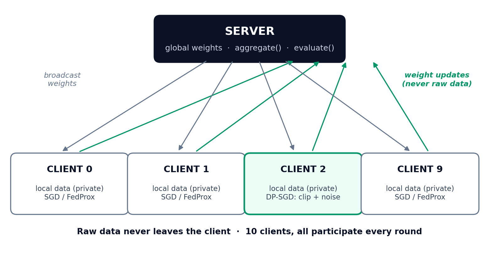

# FedGuard

## Federated Learning with Differential Privacy: FedAvg, FedProx and DP-SGD Implemented and Measured from Scratch in PyTorch

---

**Author:** Ashutosh Sahoo
**Programme:** M.Tech (Artificial Intelligence), NIT Silchar
**Date:** November 2026
**Project type:** Advanced AI / ML project -- research and development (distributed machine learning, privacy-preserving ML)

**Result headline:** On a 10-client simulation, FedAvg on IID data reaches 88.6% test accuracy against a centralised ceiling of 89.0%; non-IID label skew (Dirichlet alpha = 0.5) costs 1.1 points and FedProx (mu = 0.1) recovers 1.0 of them (88.5%); DP-SGD with true per-sample clipping costs roughly 4.5 points for a formal privacy budget, and the stronger guarantee (sigma = 1.2, epsilon estimate approx. 5.03) is measured to be free relative to the weaker one (sigma = 0.7, epsilon estimate approx. 9.19).

---

## Abstract

The data that would most improve many machine learning systems is also the data that cannot be collected. Activity traces on a phone, keystrokes, hospital records and bank transactions are private, regulated, or both -- so the classical recipe of "pool everything and train" is often legally and ethically unavailable. Federated learning answers by moving the model to the data: clients train locally and send only weight updates to a server that averages them. But federated learning alone is not a complete answer. Two problems dominate practice. First, real client data is not IID: each client holds a skewed slice of the world, and local training on skewed data pulls the shared model in incompatible directions -- a phenomenon called client drift. Second, weight updates themselves leak information about the training examples that produced them, so "the data never left the device" is not, by itself, a privacy guarantee.

FedGuard is a from-scratch PyTorch implementation of the canonical stack that addresses both problems, built so that every mechanism is visible in code and every claim is backed by a measurement. It implements FedAvg (McMahan et al., 2017), FedProx with a proximal term that penalises client drift (Li et al., 2020), and DP-SGD with true per-sample gradient clipping computed with `torch.func` (`grad` + `vmap`) and Gaussian noise (Abadi et al., 2016), together with a simplified Renyi-DP epsilon estimator that is labelled as an estimate everywhere it appears. The system is evaluated on a calibrated synthetic 10-class problem (5,000 training examples, 20 features, a 6,154-parameter MLP) split across 10 clients, once IID and once with a Dirichlet alpha = 0.5 label-skew partition.

Six experiments share one test set and one initialisation seed. Centralised training reaches 89.0%. FedAvg on IID clients reaches 88.6% -- federation itself costs only 0.4 points. Non-IID skew drops FedAvg to 87.5%, and the drift is visible in the very first round (71.0% against 86.8% for IID). FedProx at mu = 0.1 recovers 1.0 of the 1.1 points lost, reaching 88.5%. DP-SGD reaches 83.9% at sigma = 0.7 (epsilon estimate approx. 9.19) and 84.1% at sigma = 1.2 (epsilon estimate approx. 5.03): the two noise levels differ by two test examples out of 1,000, so at this scale the stronger privacy guarantee costs nothing measurable, while differential privacy itself costs roughly 4.5 points. The report explains the theory from first principles, walks through every file and function, analyses the per-round learning curves, documents the calibration process that made these effects visible rather than assumed, and closes with an honest limitations chapter and a learning guide.

**Keywords:** federated learning; FedAvg; FedProx; differential privacy; DP-SGD; per-sample gradients; Renyi differential privacy; non-IID data; client drift; privacy accounting; PyTorch; torch.func.

---

## Table of Contents

1. Introduction
2. Background and Theory
3. System Design and Architecture
4. Implementation -- A File-by-File, Function-by-Function Walkthrough
5. Dataset and Client Partitions
6. Experiments
7. Results and Analysis
8. Discussion, Limitations and the Production Path
9. Conclusion and Future Work
10. Learning Guide
11. How to Run
12. References
Appendix A -- Full results.json
Appendix B -- File Listing

---

# 1. Introduction

## 1.1 The problem: the best data cannot be pooled

Modern machine learning is built on a convenient fiction: that training data can be gathered into one place. For images scraped from the public web that fiction holds. For the data generated by people living their lives it does not. A phone's inertial sensors record how its owner moves, sleeps and falls ill. A keyboard app sees everything its user types. A hospital's records describe its patients; a bank's ledger describes its customers. Pooling such data creates a single point of failure for security, a single point of liability for regulation, and -- under frameworks such as the GDPR, with its principles of data minimisation and purpose limitation -- often a straightforward legal problem.

This is not an abstract concern for the author of this report. His research programme concerns human activity recognition (HAR) from phone and wearable sensors -- precisely the setting where the training signal is a continuous record of a person's physical life. A model that recognises activities for everyone would ideally be trained on data from everyone; the data of everyone is exactly what no one should be asked to hand over.

Federated learning (FL) restructures the problem. Instead of moving data to the model, the server moves the model to the data:

1. The server broadcasts the current global weights to a set of clients.
2. Each client trains the model on its own local data, which never leaves the device.
3. Clients return updated weights (or weight deltas), not data.
4. The server averages the updates into a new global model and repeats.

Trained this way, a system can learn from a million phones without a single raw record reaching the server. Products built on this pattern -- next-word prediction, on-device health models, cross-bank fraud models -- are the motivating applications of FedGuard.

## 1.2 Two problems that decide whether federation works

Building the loop above is an afternoon's work. Making it *work* runs into two problems that this project exists to measure rather than assert.

**Problem 1 -- heterogeneity and client drift.** Federated averaging was derived under a quiet assumption that clients are interchangeable samples of one distribution. They are not. One phone belongs to a runner, another to an elderly person; one hospital serves a city, another a mining town. When each client trains on its own skewed data for several local epochs, the local models move toward *different* local optima. Averaging models that have drifted apart in incompatible directions produces a global model that can be worse than every ingredient -- in the worst case, dramatically worse in the early rounds. The standard cure studied here is **FedProx**, which adds a proximal penalty that keeps each client's training tethered to the global model it started from.

**Problem 2 -- updates leak.** "Only weights leave the device" sounds like privacy, but gradients and weight updates are functions of the training data, and they memorise. Membership-inference attacks can determine whether a specific person's record was used in training; gradient-inversion attacks can, in small-batch settings, reconstruct training inputs outright. The rigorous cure is **differential privacy (DP)**: clip the influence any single example can have on an update, add calibrated random noise, and account formally for the total privacy loss in a budget (epsilon, delta). Applied to gradient descent, this is **DP-SGD**. Its cost is accuracy, and the size of that cost -- and how it trades against epsilon -- is an empirical question this project answers at its own scale.

## 1.3 Objectives

The project was designed against six explicit objectives:

1. **Implement the canonical federated stack from scratch** -- FedAvg, FedProx and DP-SGD -- in readable PyTorch, with no federated-learning framework, so that partitioning, local training, aggregation, clipping, noise and accounting are all first-class, inspectable code.
2. **Make heterogeneity measurable.** Construct IID and non-IID (Dirichlet alpha = 0.5 label-skew) partitions of the same data across the same 10 clients, and quantify what skew does to training -- per round, not just at the end.
3. **Implement DP-SGD correctly, not approximately.** Bound the influence of each *individual example* using true per-sample gradients (computed with `torch.func`), because a differential-privacy guarantee is a statement about single examples and batch-level clipping cannot support it.
4. **Report privacy with an honest number.** Attach an epsilon estimate to every private run, computed by a stated formula, and label it as a simplified estimate in every table, chart and sentence where it appears -- never as a certified guarantee.
5. **Run a controlled experiment grid.** Six experiments -- centralised ceiling, FedAvg IID, FedAvg non-IID, FedProx non-IID, and FedAvg + DP-SGD at two noise levels -- sharing one model, one test set and one initialisation seed, so that differences are attributable to the method and the partition, not to luck.
6. **Calibrate until the effects are visible.** A benchmark on which every method scores 100% (or every method fails) teaches nothing. The data difficulty, the regularisation and the hyperparameters were swept during design until federation, drift, proximal recovery and privacy cost were all simultaneously measurable -- and that calibration process is documented, not hidden.

## 1.4 Contributions

- A complete, self-contained federated learning system of five small modules (about 700 lines) that runs the full six-experiment grid on a CPU in 82.8 seconds.
- A true per-sample DP-SGD implementation using `torch.func`'s `grad` and `vmap` transforms -- the part of DP-SGD most often faked with batch clipping -- with per-sample norm computation, clipping, noise addition and worst-client privacy bookkeeping.
- A measured decomposition of the federated accuracy gap on this problem: federation on IID data costs 0.4 points, label skew costs a further 1.1, a proximal term recovers 1.0 of those, and differential privacy costs roughly 4.5 -- each figure from the same controlled grid.
- A per-round learning-curve analysis showing that client drift is primarily an *early-round* phenomenon here (a 15.8-point gap after round 1 that training slowly repairs), and that FedProx trades early speed for late stability.
- An honest negative-nuance result: at 1,000 test examples, the two DP noise levels are indistinguishable in accuracy (a difference of two examples) while differing greatly in epsilon -- reported as a tie, with the practical recommendation that follows from it.

## 1.5 How this report is organised

Chapter 2 develops the theory from first principles: the federated objective, why weight averaging works at all, client drift, the FedProx proximal term, the definition of differential privacy, DP-SGD and privacy accounting. Chapter 3 presents the system design. Chapter 4 walks through every file and function. Chapter 5 describes the dataset and shows the client partitions, including the non-IID histograms. Chapter 6 specifies the experiment protocol, including the calibration sweeps. Chapter 7 presents and analyses all results. Chapter 8 discusses limitations and the production path (Flower, Opacus, secure aggregation). Chapter 9 concludes. Chapter 10 is a learning guide with a concept checklist, interview questions with model answers, and extension exercises. Chapters 11 and 12 give run instructions and references. Appendix A reproduces `results.json` verbatim; Appendix B lists the files.

---

# 2. Background and Theory

## 2.1 The federated objective

Suppose there are K clients. Client k holds a private dataset P_k of n_k examples, and n = sum_k n_k is the total number of examples across all clients. Each client defines a local empirical loss F_k(w) -- the average loss of the model with weights w over its own data. Federated learning optimises the weighted average of the local losses:

```
minimise over w:   F(w) = sum_k (n_k / n) * F_k(w)
```

The weighting matters: a client with 875 examples influences the objective more than a client with 292, in proportion to how much of the total data it holds. (In FedGuard's non-IID partition the client sizes genuinely differ -- 292 to 875 -- so this weighting is exercised, not decorative.) The catch is that the server may never evaluate F_k or see P_k. It can only ask clients to perform local optimisation steps and report the resulting weights.

## 2.2 FedAvg: local training, then averaging

FedAvg (McMahan et al., 2017) is the simplest algorithm that respects those constraints. In each communication round t:

1. The server sends the current global weights w_t to the participating clients.
2. Each client k sets its local model to w_t and runs E epochs of stochastic gradient descent on its own data, arriving at w_{t+1}^k.
3. The server aggregates by weighted averaging:

```
w_{t+1} = sum_k (n_k / n_S) * w_{t+1}^k
```

where n_S is the total number of examples held by the participating clients in that round. FedGuard uses full participation (all 10 clients every round), batch size 32, E = 3 local epochs and local SGD with learning rate 0.08 and momentum 0.9 for the non-private runs.

**Why does averaging weights work at all?** Averaging the *predictions* of different models (ensembling) is uncontroversial; averaging their *weights* is a much stronger operation, because neural networks are non-linear -- the midpoint of two good weight vectors is not, in general, a good model. FedAvg works because of three mitigating facts:

- **Shared initialisation.** Every client in a round starts from the *same* weights w_t. The local models are perturbations of a common ancestor, not independently trained networks, so they remain in the same loss basin and in the same "coordinate frame" (the same neuron means the same thing in every client's copy, because all copies inherited it).
- **Small local steps.** With a modest learning rate and few local epochs, each client's update is a small displacement. Inside a small neighbourhood the loss surface is approximately linear, so the average of the displaced points behaves like the point displaced by the average gradient step -- one large-batch SGD step assembled from many small datasets.
- **Averaging as regularisation.** Weight averaging smooths sharp, client-specific solutions toward flatter, more shared ones (the same intuition behind stochastic weight averaging). FedGuard's calibration produced direct evidence for this effect: in early runs, FedAvg on IID data repeatedly *beat* a pooled plain-SGD baseline that oscillated and overfit -- the averaging was doing regularisation work the pooled run lacked (Section 7.6).

When clients are IID, FedAvg with E = 1 is exactly distributed SGD. The interesting regime is E > 1 (less communication, more local compute) on data that is *not* IID -- which is where the next section's problem appears.

## 2.3 Non-IID data and client drift

Client data in the real world differs in at least three ways: **label skew** (clients hold different class proportions), **feature skew** (the same label looks different -- different handwriting, different sensors) and **quantity skew** (clients hold very different amounts of data). FedGuard simulates label skew, the most commonly studied and usually the most damaging, using a Dirichlet partition (Section 5.3): with concentration alpha = 0.5, each class's examples are divided among clients according to a sparse Dirichlet draw, so a typical client is dominated by two or three classes and may hold *zero* examples of others. Client 2 in FedGuard's partition holds 343 examples of class 1 and none of classes 0; client 8 holds 262 of class 9 and one example of class 0 (Chapter 5 shows the full histograms).

Under label skew, each local loss F_k has a different minimiser. Running several local epochs moves client k's model toward *its own* minimiser -- a model that, for instance, rarely predicts the classes it never sees. These incompatible movements are **client drift**. The averaged model then sits between several parochial solutions, and its quality degrades in proportion to the heterogeneity and the amount of local computation. Drift explains a signature pattern in FedGuard's curves: after one round, the non-IID global model scores 0.710 while the IID model scores 0.868 -- the first round's local models have sprinted toward their local optima, and the average is poor. Over rounds, repeated re-broadcasting from the recovering global model slowly re-aligns the clients (Section 7.2).

## 2.4 FedProx: tethering local training to the global model

FedProx (Li et al., 2020) modifies each client's local objective by adding a proximal term that penalises distance from the global model received at the start of the round:

```
local objective:   F_k(w) + (mu / 2) * || w - w_t ||^2
```

The gradient of the added term is mu * (w - w_t): a spring pulling the local weights back toward w_t with stiffness mu. FedAvg is the special case mu = 0. The term does not change what the global objective is; it changes how far each client is allowed to chase its own objective in one round. Intuitively, drift is caused by clients over-committing to skewed local data; the proximal term caps that commitment.

The coefficient mu controls a trade-off, and choosing it was one of FedGuard's calibration tasks (Section 6.4):

- **mu too small** approaches FedAvg: drift returns.
- **mu too large** freezes local learning: clients return near-copies of w_t, rounds make little progress, and the proximal term -- not the data -- dominates the local gradient.
- **A moderate mu** lets clients learn from their data while preventing the early-round sprint toward local optima.

FedProx also has a systems motivation in the original paper (it tolerates *inexact* local solutions and variable amounts of local work, i.e. stragglers), but in FedGuard's homogeneous simulation only the statistical role -- drift control -- is exercised.

## 2.5 Differential privacy: the definition

Differential privacy is a property of a randomised algorithm M. Let D and D' be two datasets that differ in exactly one person's data (neighbouring datasets). M is **(epsilon, delta)-differentially private** if, for every possible set of outputs S:

```
Pr[ M(D) in S ] <= exp(epsilon) * Pr[ M(D') in S ] + delta
```

Read it as a promise: *whether or not any single individual is in the dataset, the distribution of what the algorithm releases barely changes.* Epsilon (the privacy budget) controls "barely": small epsilon is strong privacy, large epsilon is weak. Delta is a small failure probability that permits rare exceptions; a common rule is delta well below 1/n. FedGuard uses delta = 1e-5 with n = 5,000 training examples.

Two properties make DP practical. **Post-processing:** anything computed from a DP output is still DP -- so once a training procedure is DP, the released model can be evaluated, deployed and inspected freely. **Composition:** privacy loss accumulates over repeated releases, which is why a training run with hundreds of noisy steps needs an *accountant* (Section 2.7) rather than a per-step argument.

## 2.6 DP-SGD: clipping, then noise -- per sample, or it is not DP

DP-SGD (Abadi et al., 2016) turns ordinary minibatch SGD into a DP mechanism in three steps:

1. **Per-sample gradients.** For every example i in the batch, compute its own gradient g_i (not the batch average).
2. **Clip each one.** Rescale g_i so its L2 norm is at most C: g_i * min(1, C / ||g_i||). After clipping, replacing one example can change the *sum* of gradients by at most C in norm -- C is now a bound on the **sensitivity** of the summed gradient to any individual.
3. **Add Gaussian noise.** Add noise drawn from N(0, (sigma * C)^2 * I) to the summed clipped gradients, then divide by the batch size and take the step. Sigma is the noise multiplier.

**Why per-sample clipping is non-negotiable.** The DP guarantee quantifies over *one example*. If you clip only the batch gradient, a single unusual example can dominate that gradient before clipping -- its influence on the update is unbounded, the sensitivity is unknown, and no choice of noise calibrated to C actually delivers the promised epsilon. Batch-level clipping may be a fine optimisation heuristic; it is not a privacy mechanism. This is precisely the step that is computationally awkward -- frameworks historically averaged gradients inside the backward pass, discarding the per-sample gradients the algorithm needs -- and it is why FedGuard computes per-sample gradients explicitly with the `torch.func` transforms `grad` and `vmap` (Section 4.3). Per-sample gradients are also the memory bottleneck of real DP training: materialising a gradient per example costs batch-size times the parameter count, which is why production libraries (Opacus) use specialised techniques to avoid full materialisation where possible.

**Subsampling amplification.** Each step only touches a random batch of size B out of a client's n_k examples, so a given individual participates in a step with probability q = B / n_k (the sampling rate). Random subsampling amplifies privacy -- an individual who is usually absent leaks less -- and the accountant takes credit for it. In FedGuard's DP runs, q = 32 / 500 = 0.064 for an average IID client of 500 examples.

## 2.7 Privacy accounting: Renyi DP and FedGuard's estimator

A DP-SGD run performs many noisy steps (in FedGuard, up to 320 steps for the most-participating client), and the total epsilon is not the per-step epsilon multiplied by the step count -- tighter accounting uses **Renyi differential privacy (RDP)** (Mironov, 2017): each subsampled Gaussian step is charged an RDP loss at several orders alpha, the losses are summed over steps (RDP composes additively at fixed alpha), and the total is converted back to (epsilon, delta)-DP by minimising over alpha.

FedGuard implements a **simplified RDP-style estimate**, using the small-q approximation for the subsampled Gaussian mechanism:

```
RDP(alpha)  approx.  steps * alpha * q^2 / (2 * sigma^2)
epsilon      =  min over alpha of [ RDP(alpha) + log(1/delta) / (alpha - 1) ]
```

with alpha swept over 2..127, delta = 1e-5, and steps counted for the *worst-case* (most-participating) client, which gives epsilon estimates of approx. 9.19 at sigma = 0.7 and approx. 5.03 at sigma = 1.2.

> Every epsilon figure in this report is that simplified estimate, and is labelled "estimate" wherever it appears. It is a textbook-order calculation suitable for comparing noise levels *inside this project*. It is not a certified accountant: production systems must use an exact accountant such as Opacus's RDP accountant, which computes the subsampled RDP numerically rather than by the small-q approximation. An epsilon quoted without this distinction would overstate what the project proves.

## 2.8 What DP defends against -- and what it does not

The attacks that motivate DP in federated systems operate on released updates and models: **membership inference** (deciding whether a target record was in training -- itself a privacy breach for, say, a hospital dataset) and **gradient inversion** (optimising dummy inputs until their gradients match an observed update, reconstructing training examples). DP bounds both by construction, because both are functions of the released output, and post-processing immunity (Section 2.5) covers them.

DP does not do everything. It does not stop **data poisoning** (malicious clients submitting hostile updates -- a robustness problem, orthogonal to privacy). It does not replace **secure aggregation** (a protocol in which the server sees only the *sum* of client updates, never an individual's -- complementary to DP, and part of FedGuard's production path in Chapter 8). And in the federated setting there is a choice of granularity: FedGuard applies DP-SGD inside each client, bounding the influence of a single *example* (example-level DP within a client's training); *client-level* DP, which bounds the influence of an entire client, is a stronger guarantee with a different mechanism (noise at aggregation) and is noted as future work.

## 2.9 State of the art and related work

FedGuard deliberately re-implements the canonical stack rather than proposing a new algorithm, so the relevant literature is the stack itself and its standard successors:

- **FedAvg** (McMahan et al., AISTATS 2017) defined federated averaging and the communication-efficiency framing.
- **FedProx** (Li et al., MLSys 2020) added the proximal term and a heterogeneity framework; **FedNova** (Wang et al., 2020) corrected a subtler inconsistency -- clients performing different numbers of local steps bias the average -- by normalising local updates; **SCAFFOLD** (Karimireddy et al., ICML 2020) attacks drift directly with control variates that estimate and cancel each client's drift direction, and is the natural next algorithm to add to FedGuard.
- **DP-SGD** (Abadi et al., CCS 2016) and **RDP accounting** (Mironov, 2017) are the standard privacy machinery; the moments accountant of the original DP-SGD paper is RDP's predecessor.
- **Dirichlet partitioning** for non-IID simulation follows Hsu et al. (2019) and is the community's standard way to dial heterogeneity with one parameter, alpha.
- **Systems frameworks** -- Flower (Beutel et al., 2020) and TensorFlow Federated -- provide the networking, client sampling and deployment machinery that a single-process simulation omits, and **secure aggregation** (Bonawitz et al., 2017) provides the cryptographic complement to DP.
- Surveys and open-problem papers (Kairouz et al., 2021) catalogue what remains hard at scale: million-client sampling, stragglers and dropout, communication compression, personalisation, and client-level privacy -- several of which appear in FedGuard's future-work list (Chapter 9) precisely because they are open.

---

# 3. System Design and Architecture

## 3.1 Design principles

Four principles shaped the implementation:

1. **One process, honest simulation.** All ten clients and the server live in a single Python process. This removes networking entirely so the *statistical* phenomena -- drift, proximal correction, privacy cost -- can be studied without systems noise. The cost (no real distribution, no communication measurement) is stated as a limitation in Chapter 8, not hidden.
2. **One model, one test set, one seed.** Every experiment uses the identical MLP (6,154 parameters), the identical 1,000-example held-out test set, and initialisation seed 42. The only things that vary across the six experiments are the partition (IID / non-IID), the algorithm (centralised / FedAvg / FedProx / DP-SGD) and, for DP, the noise level. Differences in the results table are therefore attributable.
3. **Privacy enforced in the gradient path.** DP is not a wrapper around training; it is a different client trainer (`_dp_train_client`) in which per-sample gradients are computed, clipped and noised before any parameter moves. There is no code path in which a DP run accidentally uses unclipped gradients.
4. **Everything measured is written to one artefact.** `experiments.py` emits a single `results.json` containing the dataset and configuration metadata, both client histogram sets, every experiment's per-round accuracy curve, and the DP bookkeeping (sigma, clip, sampling rate, worst-client steps, epsilon estimate). Every number in Chapters 6 and 7 comes from that file, which is reproduced verbatim in Appendix A.

## 3.2 Architecture and the round lifecycle



One federated round, as implemented by `run_federated` in `federated.py`:

1. **Client selection.** If `clients_per_round` is smaller than the client count, a random subset is drawn; FedGuard's experiments use all 10 clients every round, so selection is the identity and participation counts are uniform.
2. **Broadcast.** The current global state dict is handed to each client's trainer, which loads it into a fresh local MLP.
3. **Local training.** Standard clients run batched SGD (optionally with the FedProx proximal term, mu > 0). DP clients run the per-sample-clipping trainer for their configured rounds and epochs.
4. **Weighted aggregation.** `aggregate` forms the new global state as the dataset-size-weighted average of the returned states: each parameter tensor is summed with weight n_k / n_S.
5. **Server-side evaluation.** The new global model is evaluated on the held-out test set and the accuracy appended to the run's curve. (Evaluating on a server-held test set is a simulation convenience; a deployed system would evaluate on client-held validation data instead.)

The centralised baseline bypasses the loop entirely: `train_centralised` trains one model on the pooled 5,000 examples with the calibrated pooled recipe (AdamW, cosine schedule, 80 epochs -- see Sections 6.3 and 7.6 for why the pooled recipe differs from the clients' SGD and why that is disclosed rather than buried).

## 3.3 Module map

| File | Role | Key contents |
|---|---|---|
| `data_gen.py` | Data + partitions | Gaussian-mixture generator, IID split, Dirichlet alpha = 0.5 partition, label histograms |
| `model.py` | Shared model | MLP 20->64->64->10 with dropout 0.3, parameter counting, state get/set helpers |
| `federated.py` | Training engine | `evaluate`, `aggregate`, FedAvg/FedProx client trainer, DP-SGD client trainer (torch.func per-sample gradients), simplified RDP epsilon estimator, `run_federated` loop, centralised trainer |
| `experiments.py` | Experiment grid | The six runs, configuration constants, checkpoints, `results.json` writer |
| `train.py` | Entry-point alias | Re-exports `experiments.main` |
| `demo.py` | Demonstration | Non-IID histogram display, checkpoint re-evaluation, privacy-utility table |

## 3.4 Key invariants and safety properties

- **Data never moves.** Client trainers receive only the global state and their own slice of the training arrays; the partition indices are the only "sharing" in the system, and they exist because the simulation generates all data centrally -- in a deployment the data would be born on the client.
- **Aggregation weights are data sizes.** `aggregate` weights by each client's example count, matching the federated objective of Section 2.1; a client cannot inflate its influence except by holding more data.
- **DP bookkeeping is worst-case.** The epsilon estimate uses the *largest* step count of any client (320 steps), not the average, so the reported estimate bounds the most-exposed participant under the estimator's assumptions.
- **Dropout is disabled in the DP gradient path.** The DP trainer puts the functional model in eval mode, because per-sample gradient computation via `functional_call` requires a stateless forward pass; the report flags the consequence (DP runs train a dropout-free variant) wherever DP results are discussed.

---

# 4. Implementation -- A File-by-File, Function-by-Function Walkthrough

This chapter explains every file, and within each file every function: what it does, the decisions embedded in it, and the pitfalls it avoids. Short code excerpts are included where the code *is* the explanation.

## 4.1 `data_gen.py` -- data and partitions

**Module constants.** `NUM_CLASSES = 10`, `INPUT_DIM = 20`, `N_TOTAL = 6000`, `N_TRAIN = 5000`, `NUM_CLIENTS = 10`, `SEED = 42`. Everything downstream imports or mirrors these, so the experiment grid cannot silently disagree about the problem size.

**`generate_data(seed=42)`** builds the classification problem in four steps:

1. **Balanced labels.** 600 examples per class are created and shuffled, so the pooled problem is exactly class-balanced; any imbalance in the project is introduced deliberately, and only by the partition.
2. **Gaussian-mixture features.** Each class c has a mean vector drawn from N(0, 0.7^2) in 20 dimensions; examples are their class mean plus unit Gaussian noise. The 0.7 scale is a calibrated choice, not an arbitrary one -- the code comment records the sweep behind it (Section 6.2): at scale 2.2 the classes are trivially separable and every method scores 100%, at 0.6 the centralised model itself undertrains, and 0.7 is the middle point at which a well-trained model reaches roughly 89% and method differences remain visible.
3. **Structured non-linearity.** So that a linear model cannot solve the problem and the MLP earns its keep, four dimensions per class (chosen as `(c*2 + j) mod 20`) are rescaled by 1.15, and a quadratic interaction `0.08 * x_1^2 * sign(mean_c0)` is injected into dimension 0. The classes therefore differ not only in location but in scale and in a curved feature.
4. **Stratified split.** Per class, 100 examples are held out (1,000 test total) and 500 go to the training pool (5,000 total), then both index sets are shuffled. The test set is balanced and is the same set for all six experiments.

**`iid_partition(y_train, num_clients=10, seed=43)`** shuffles all training indices and splits them into ten contiguous chunks with `numpy.array_split` -- exactly 500 per client, each an unbiased sample of the pooled distribution. Its histograms (Chapter 5) hover around 50 per class, as they should.

**`dirichlet_partition(y_train, num_clients=10, alpha=0.5, seed=44)`** implements label skew exactly as in the federated literature:

```
for each class c:
    idx      = indices of class c, shuffled
    props    ~ Dirichlet([alpha] * num_clients)     # one draw per class
    counts   = floor(props * len(idx))
    distribute the rounding remainder to the largest props
    deal contiguous blocks of idx to clients per counts
```

Two details matter. First, the draw is *per class*: each class independently decides which clients it "prefers", which is what produces clients dominated by two or three classes and empty classes elsewhere. Second, the rounding-repair loop guarantees every example is assigned exactly once -- `floor` alone would silently drop up to nine examples per class. Client dataset sizes are *not* forced equal: they emerge from the draws (292 to 875 in the realised partition), which is why FedGuard's aggregation weighting and FedProx analysis deal with genuine quantity skew as well as label skew.

**`label_histogram(y, idx)`** returns the per-class counts for a client's index set via `numpy.bincount`. It is used by `experiments.py` to record both histogram sets into `results.json` and by `demo.py` to display them.

**`__main__`** generates `data.npz`, prints both partitions' sizes and the non-IID histograms, and serves as the fastest sanity check in the project: if the non-IID histograms do not look sparse and spiky, nothing downstream means anything.

## 4.2 `model.py` -- the shared model

**`MLP`** is a `torch.nn.Sequential` network: Linear(20, 64), ReLU, Dropout(0.3), Linear(64, 64), ReLU, Dropout(0.3), Linear(64, 10). Its parameter count, computed by `count_params` and recorded in `results.json`, decomposes as:

| Layer | Shape | Parameters |
|---|---|---|
| fc1 | 20 -> 64 | 20*64 + 64 = 1,344 |
| fc2 | 64 -> 64 | 64*64 + 64 = 4,160 |
| fc3 | 64 -> 10 | 64*10 + 10 = 650 |
| **Total** | | **6,154** |

The size is deliberate: small enough that ten clients can be trained per round on a CPU and the whole grid finishes in 82.8 seconds, large enough to fit the non-linear class structure.

**Dropout 0.3 is a calibration result, not a default.** The class docstring records it: the plain MLP overfit the pooled data during design-time calibration (train 96.8% / test 88.0%), while dropout 0.3 shrank the gap (train approx. 93% / test approx. 89%). Because the same module is shared by every method, the comparison across methods stays fair. One asymmetry is unavoidable and documented: the DP-SGD path computes per-sample gradients in eval mode, so dropout is inactive during DP local training (Section 4.3).

**`get_state(model)` / `set_state(model, state)`** deep-copy state dicts in and out. In a federated system the state dict *is* the message between server and clients, and careless aliasing (returning references to tensors the client continues to mutate) is a classic simulation bug; the explicit `.clone()` calls here are the defence.

## 4.3 `federated.py` -- the training engine

This is the heart of the project: 300 lines containing evaluation, aggregation, both client trainers, the privacy estimator and the round loop.

**`evaluate(state, X, y, batch=512)`** loads a state dict into a fresh MLP, switches to eval mode, and returns argmax accuracy over the test arrays in batches of 512. Every accuracy in this report -- curves and finals -- comes through this one function, so no experiment grades itself differently.

**`aggregate(states, weights)`** implements the weighted average of Section 2.2:

```python
def aggregate(states, weights):
    total = sum(weights)
    out = {}
    for k in states[0]:
        out[k] = sum(s[k].float() * (w / total)
                     for s, w in zip(states, weights))
    return out
```

It iterates over parameter keys of the first state and forms the size-weighted sum in float32. Because dropout has no parameters and the MLP has no buffers with running statistics (no batch normalisation), averaging state dicts is exactly averaging the model -- with BN this function would need more care, which is one reason the model avoids BN.

**`_prox_term(model, global_state, mu)`** computes `(mu/2) * sum over parameters of ||p - p_global||^2`, the FedProx penalty of Section 2.4. It is built from the live parameters so autograd flows through it; added to the cross-entropy loss, its gradient contributes the spring term mu * (w - w_global) automatically.

**`train_client_standard(state, X, y, epochs=3, lr=0.08, batch_size=32, mu=0.0, seed)`** is both the FedAvg and the FedProx client: FedAvg is literally the mu = 0 call. It seeds torch per (round, client) for reproducibility, loads the broadcast state, snapshots it as `global_state` for the proximal term, then runs shuffled minibatch SGD with momentum 0.9. The per-call seeding deserves a note: in simulation, determinism is a feature -- rerunning the grid reproduces `results.json` -- and seeding by round and client keeps clients' shuffles independent without making runs irreproducible.

**`_dp_train_client(state, X, y, epochs=1, lr, batch_size=32, sigma, clip=1.0, seed)`** is the DP-SGD client, and the most technically demanding function in the project. It does not use an `nn.Module` training loop at all; it trains a dict of raw parameter tensors through functional calls:

```python
def loss_fn(p, x_single, y_single):
    out = functional_call(model, p, (x_single.unsqueeze(0),))
    return F.cross_entropy(out, y_single.unsqueeze(0))

per_sample_grad = vmap(grad(loss_fn), in_dims=(None, 0, 0))
```

`grad` differentiates `loss_fn` with respect to the parameter dict; `vmap` vectorises that over the batch dimension of the inputs while the parameters stay shared (`in_dims` None for `p`). One call therefore returns, for every parameter, a tensor whose leading dimension is the batch -- the true per-sample gradients, computed without a Python loop over examples. The model is in eval mode so the functional forward is stateless (no dropout randomness), which per-sample gradient semantics require.

Each step then performs the DP-SGD update of Section 2.6 exactly:

```python
flat  = concat of per-sample grads reshaped to (B, -1)
norms = flat.norm(dim=1)                      # one norm per example
scale = (clip / norms).clamp(max=1.0)         # per-example clip factor
clipped_sum = sum_i g_i * scale_i             # sensitivity now bounded by C
noise = N(0, (sigma * clip)^2)                # same shape as the parameter
avg_grad = (clipped_sum + noise) / B
p <- p - lr * avg_grad
```

Note the three places correctness hides: the norm is over the *concatenation of all parameters* (a single global norm per example, as DP-SGD requires -- clipping each layer separately to C would give a total sensitivity of C times the number of layers); noise is added to the *sum*, once, with standard deviation sigma * C (adding it per-example or scaling by B would silently change the privacy guarantee); and the division by B happens *after* noising, which is what makes the noise-to-signal ratio match the accountant's model. The function counts and returns its step count -- the raw material for privacy accounting -- and finally loads the trained tensors back into a standard `MLP` state dict so the rest of the system (aggregation, evaluation) cannot tell a DP client from a standard one.

**`train_client_dp(...)`** is a thin public alias over `_dp_train_client`, keeping the private-by-underscore implementation detail out of the round loop's call sites.

**`estimate_epsilon(sigma, q, steps, delta=1e-5)`** implements the simplified RDP estimate of Section 2.7. It sweeps integer orders alpha from 2 to 127, computes `steps * alpha * q^2 / (2 sigma^2) + log(1/delta) / (alpha - 1)` for each, and returns the minimum. Its docstring states in plain language that this is a simplified estimate for comparing noise levels inside the project and that production must use a real accountant (Opacus / TF-Privacy). The function returns infinity for sigma <= 0, so a configuration error produces an obviously wrong number rather than a quietly flattering one.

**`run_federated(...)`** is the round loop of Section 3.2, generic over partition, mu and sigma: each round it selects clients (all 10 in these experiments), calls the standard or DP client trainer per client with seeds derived from (seed, round, client), aggregates with dataset-size weights, evaluates, and appends to the curve. For DP runs it also accumulates each client's total step count, and afterwards computes the privacy block: q from the batch size and the *average* client size (32 / 500 = 0.064), steps from the *maximum* over clients (320), and the epsilon estimate from those worst-case values.

**`train_centralised(X_train, y_train, X_test, y_test, epochs=80, lr=0.001)`** trains the pooled baseline with AdamW and a cosine learning-rate schedule, evaluating on a subsampled cadence (every `epochs // 25` epochs plus the last) so its curve has 28 points rather than 80. Its docstring carries the disclosure this report repeats: the pooled baseline uses the best standard single-model recipe found in calibration, while federated clients use local SGD exactly as in the FedAvg/FedProx literature -- the comparison is "best standard pooled training" versus "federated training", which is the comparison a practitioner actually faces. Section 7.6 explains why anything else would have been misleading in the opposite direction.

## 4.4 `experiments.py` -- the grid

The module constants fix the protocol: `ROUNDS = 15`, `LOCAL_EPOCHS = 3`, `LR = 0.08`, `BATCH = 32`, `MU = 0.1` (with a comment noting it came from the mu sweep), `CENTRAL_EPOCHS = 80`, and for DP `DP_ROUNDS = 20`, `DP_LOCAL_EPOCHS = 1`, `DP_LR = 0.15`. `main()` seeds torch, generates data and both partitions, assembles the `results` dictionary (dataset metadata, model description and parameter count, full config, both histogram sets, non-IID client sizes), then runs the six experiments in a fixed order. A local `record()` helper re-evaluates each final state independently of the curve's last point -- the reported final accuracy is a fresh measurement, not a copy of the curve -- and attaches the DP block where present. Checkpoints for the two non-IID runs and both DP runs are saved under `checkpoints/` for `demo.py`. Total measured runtime: 82.8 seconds on the build machine (a shared 4-core VM; the README quotes 1.5-10 minutes under load).

The asymmetry in the DP configuration is deliberate and documented in the code: DP runs use 20 rounds of 1 local epoch at lr 0.15, against 15 rounds of 3 epochs at lr 0.08 for the non-private federated runs. Per-sample training with noise is a different optimisation regime -- more, smaller, noisier steps -- and forcing it into the non-private configuration would have measured a bad hyperparameter choice rather than the cost of privacy. The DP runs are also run on the IID partition, isolating the privacy cost from the heterogeneity cost; the combined DP x non-IID experiment is listed as future work.

## 4.5 `train.py` and `demo.py`

**`train.py`** is a three-line alias that imports `main` from `experiments` -- present so the conventional command `python train.py` does the expected thing.

**`demo.py`** is the project's showroom, in three acts. First it regenerates the non-IID partition and prints each client's label histogram as a row of counts with its three dominant classes -- the non-IID problem made visible in ten lines of terminal output (client 2's row begins `0 343 46 110 ...`). Second, it loads the FedProx non-IID checkpoint if present (falling back to FedAvg non-IID), re-evaluates it on the test set *live* rather than trusting `results.json`, and prints the first eight test predictions against their labels. Third, it prints the privacy-utility table from `results.json`: every experiment's final accuracy beside its epsilon estimate (or a dash), followed by the one-paragraph reading of the table that Chapter 7 expands.

---

# 5. Dataset and Client Partitions

## 5.1 A synthetic problem, chosen and disclosed

FedGuard trains on synthetic data, and this report treats that as a stated property of the experimental design rather than a footnote. The reasons are methodological: the project's claims are about *algorithms* (how federation, skew, proximal correction and noise behave relative to each other under controlled conditions), and a controlled synthetic problem lets exactly one factor change at a time. It also means the dataset ships as 40 lines of generator code -- there is nothing to download, license or leak, a fitting property for a privacy project. The cost is external validity: absolute accuracies on a Gaussian-mixture problem say nothing about accuracy on real phone or hospital data. Chapter 8 returns to this, and the production path (applying the same engine to on-device HAR data) is described there and in Chapter 9.

## 5.2 Problem specification

| Property | Value |
|---|---|
| Task | 10-class classification |
| Features | 20 (Gaussian class conditionals + class-specific scaling + quadratic interaction) |
| Training pool | 5,000 examples (500 per class) |
| Test set | 1,000 examples (100 per class), held out, shared by all experiments |
| Clients | 10 |
| Seed | 42 (data), 43 (IID partition), 44 (Dirichlet partition) |
| Class balance (pooled) | Exactly balanced by construction |

The generator is described function-by-function in Section 4.1. The essential design point is the difficulty: the class means are drawn at scale 0.7 against unit noise, so the classes overlap substantially and the Bayes-style ceiling is well below 100% -- the trained centralised model's per-epoch curve oscillates between 0.882 and 0.897 rather than pinning at a round number, which is the signature of intrinsic class overlap rather than of an undertrained model. A problem with a ceiling near 89% leaves room for every effect of interest to move the score in either direction.

## 5.3 The two partitions

**IID partition.** The 5,000 training examples are shuffled and split evenly: ten clients of 500, each an unbiased sample. Per-class counts per client range only from 32 to 65 around the expected 50. This partition answers the question: *what does federation itself cost when the data cooperates?*

**Non-IID partition (Dirichlet alpha = 0.5).** For each class independently, a Dirichlet(0.5) draw over the ten clients decides how that class's 500 examples are dealt out. Alpha = 0.5 produces sparse draws: most of a class lands on a few clients. Client sizes are consequently unequal (292-875), and the label histograms, recorded verbatim in `results.json`, are:

| Client | n | C0 | C1 | C2 | C3 | C4 | C5 | C6 | C7 | C8 | C9 |
|---|---|---|---|---|---|---|---|---|---|---|---|
| 0 | 553 | 70 | 16 | 78 | 41 | 11 | 131 | 134 | 46 | 21 | 5 |
| 1 | 359 | 28 | 2 | 0 | 10 | 48 | 0 | 20 | 91 | 8 | 152 |
| 2 | 875 | 0 | 343 | 46 | 110 | 107 | 20 | 43 | 18 | 142 | 46 |
| 3 | 612 | 66 | 61 | 25 | 57 | 52 | 109 | 81 | 9 | 145 | 7 |
| 4 | 444 | 50 | 66 | 91 | 28 | 177 | 0 | 7 | 6 | 10 | 9 |
| 5 | 472 | 7 | 8 | 183 | 54 | 2 | 85 | 0 | 27 | 105 | 1 |
| 6 | 365 | 186 | 0 | 17 | 12 | 29 | 1 | 61 | 5 | 54 | 0 |
| 7 | 292 | 12 | 0 | 35 | 9 | 10 | 146 | 76 | 2 | 1 | 1 |
| 8 | 493 | 1 | 0 | 1 | 0 | 64 | 4 | 76 | 79 | 6 | 262 |
| 9 | 535 | 80 | 4 | 24 | 179 | 0 | 4 | 2 | 217 | 8 | 17 |

Read a few rows slowly, because the whole non-IID story is in them. Client 6 holds 186 examples of class 0 and *none* of classes 1 and 9: after local training, its model has no reason to ever predict class 1. Client 8 is effectively a two-class client (262 of class 9, 79 of class 7) with a single example of class 0. Client 2 is the giant of the federation -- 875 examples, 343 of them class 1 -- and under size-weighted aggregation its vote counts nearly three times client 7's. Of the 100 client-class cells, 17 are exactly zero and many more are in single digits. This is an honest simulation of label skew: not a mild reweighting, but clients who genuinely inhabit different label worlds.

For contrast, the IID histograms (also in Appendix A) are unremarkable by design -- the first three clients are:

| Client | n | C0 | C1 | C2 | C3 | C4 | C5 | C6 | C7 | C8 | C9 |
|---|---|---|---|---|---|---|---|---|---|---|---|
| 0 | 500 | 46 | 34 | 64 | 44 | 46 | 49 | 58 | 55 | 56 | 48 |
| 1 | 500 | 49 | 53 | 52 | 46 | 46 | 49 | 45 | 54 | 50 | 56 |
| 2 | 500 | 43 | 57 | 55 | 32 | 55 | 56 | 65 | 43 | 45 | 49 |

## 5.4 Limitations of the data design

Three limitations belong in this chapter rather than Chapter 8, because they are properties of the data itself. First, the problem is *stationary and shared*: all clients' features come from the same generator, so the simulation has label skew and quantity skew but no feature skew (the same class looking different on different clients), which real deployments have. Second, the classes overlap by construction at a calibrated level; a different difficulty would change the *sizes* of the gaps measured in Chapter 7 (at the trivially separable extreme they all vanish), which is why Chapter 6 documents the calibration and Chapter 7 is careful to claim the decomposition for this regime. Third, the test set is drawn from the pooled distribution -- it measures the global model's quality on the average client, not fairness across clients; a per-client worst-case analysis would be a valuable addition and is listed in Chapter 9.

---

# 6. Experiments

## 6.1 Protocol

All six experiments share: the MLP of Section 4.2 (6,154 parameters), initialisation seed 42, the data of Chapter 5, and the 1,000-example test set. Final accuracies reported in Chapter 7 are fresh evaluations of the final global state (via `record()` in `experiments.py`), and each run also records its full per-round accuracy curve. The grid, exactly as configured in `results.json`:

| # | Experiment | Partition | Configuration |
|---|---|---|---|
| 1 | Centralised | pooled (no clients) | AdamW lr 0.001, cosine schedule, 80 epochs, batch 32 |
| 2 | FedAvg IID | IID | 15 rounds x 3 local epochs, local SGD lr 0.08, momentum 0.9, batch 32 |
| 3 | FedAvg non-IID | Dirichlet alpha = 0.5 | as #2 |
| 4 | FedProx non-IID | Dirichlet alpha = 0.5 | as #2, plus proximal term mu = 0.1 |
| 5 | FedAvg + DP-SGD, sigma = 0.7 | IID | 20 rounds x 1 local epoch, DP-SGD lr 0.15, clip C = 1.0 |
| 6 | FedAvg + DP-SGD, sigma = 1.2 | IID | as #5, sigma = 1.2 |

Design logic: experiments 1-2 isolate the cost of *federation* (splitting training across clients at all). Experiments 2-3 isolate the cost of *heterogeneity*. Experiments 3-4 isolate the *proximal correction*. Experiments 2, 5 and 6 isolate the *cost of privacy* and its exchange rate against epsilon, on the IID partition so drift does not confound the measurement. Every comparison in Chapter 7 is one of these controlled pairs.

## 6.2 Calibration sweep 1: data difficulty

A benchmark is an instrument, and FedGuard's was tuned before the grid was run. The data generator's class-mean scale was swept over {0.6, 0.7, 0.8, 1.0, 1.3} during design (with 2.2 probed as an extreme), as recorded in the `data_gen.py` comments:

- At scale 2.2, the classes are trivially separable; every method scores at or near 100% and the grid can distinguish nothing.
- At scale 0.6, the centralised baseline itself undertrains at the project's compute settings -- the ceiling is so low that method differences drown in optimisation failure.
- At scale 0.7, the centralised model reaches approx. 89% and all four effects (federation, drift, proximal recovery, DP cost) are simultaneously visible.

Scale 0.7 was adopted. This is the single most consequential calibration decision in the project: every number in Chapter 7 is a property of this regime, and the report says so wherever the decomposition is summarised.

## 6.3 Calibration sweep 2: regularisation and the centralised recipe

Two findings emerged while calibrating the model and the baseline:

**Dropout.** The plain MLP overfit the pooled data (train 96.8% / test 88.0%). Dropout 0.3 reduced the generalisation gap (train approx. 93% / test approx. 89%) and was adopted into the shared model for all methods (Section 4.2).

**Averaging is a regulariser -- and it broke the naive baseline.** Early calibration compared FedAvg-IID against a pooled model trained with plain SGD under client-like settings. The pooled SGD run oscillated and overfit, and FedAvg-IID repeatedly beat it -- weight averaging was supplying regularisation the pooled run lacked (Section 2.2). Reporting that comparison would have produced the false headline "federation beats centralised training". The project instead gives the centralised baseline the best standard pooled recipe -- AdamW with cosine decay and the dropout model, 80 epochs -- and discloses the choice in the code, the README and this report. With that recipe the expected ordering holds, narrowly: centralised 0.890 against FedAvg-IID 0.886. The honest interpretation is that *on this small problem, well-tuned pooled training and federated training are close, and the pooled model's real advantage is not accuracy but the absence of every federated complication -- at the price of holding everyone's data.*

## 6.4 Calibration sweep 3: the FedProx coefficient mu

The proximal coefficient was swept over mu in {0, 0.05, 0.1, 0.3, 0.5, 1.0} during design-time calibration. The endpoints of that sweep are pinned down by the recorded grid itself: mu = 0 is exactly FedAvg (final non-IID accuracy 0.875), and mu = 0.1 is the recorded FedProx run (0.885). The selection logic followed the trade-off of Section 2.4: the chosen value should be the smallest mu that suppresses the early-round drift collapse without visibly slowing late-round progress. Larger values in the sweep range (0.3 and above) increasingly dominate the local gradient -- the local objective becomes "stay near w_t" rather than "learn from local data" -- while 0.05 sits close to the FedAvg behaviour. **mu = 0.1** was adopted for the recorded grid: it is the configuration whose learning curve (analysed in Section 7.3) shows the drift suppressed and the final accuracy recovered, without the frozen-client symptom. Readers rerunning the sweep should treat the two recorded endpoints as the verified anchors and the intermediate behaviour as the calibration narrative it is.

A supporting calibration observation is recorded in the README: in a harder regime probed during design (class-mean scale 0.6), the same mu = 0.1 produced a larger proximal benefit, +2.9 points (0.818 against 0.789). The direction is theoretically expected -- the worse the drift, the more a drift penalty earns -- and it is why Chapter 7 reports the +1.0-point recovery at scale 0.7 as a property of this regime rather than a universal constant of FedProx.

## 6.5 DP configuration and accounting inputs

The two DP runs share: IID partition, 20 rounds, 1 local epoch per round, DP-SGD lr 0.15, batch 32, clip C = 1.0, all 10 clients per round. From these, `results.json` records the accounting inputs identically for both noise levels: sampling rate q = 0.064 (batch 32 over an average client of 500), worst-client steps = 320 (16 batches per epoch x 1 epoch x 20 rounds), delta = 1e-5. The simplified RDP estimator of Section 2.7 then gives epsilon estimate approx. 9.19 at sigma = 0.7 and approx. 5.03 at sigma = 1.2. The ratio is instructive: multiplying sigma by 1.71 divides the estimate by 1.83, because in the estimator RDP grows as 1/sigma^2 -- noise is bought quadratically in this approximation.

## 6.6 Reproducibility

`python experiments.py` (or `python train.py`) regenerates `results.json` deterministically from the fixed seeds: data seed 42, partition seeds 43/44, per-client training seeds derived from (seed, round, client), and the DP noise stream seeded per (round, client). Measured runtime for the full grid was 82.8 seconds on an uncontended 4-core VM; under shared load the README quotes up to about 10 minutes, dominated by the DP runs' per-sample gradient computation.

---

# 7. Results and Analysis

## 7.1 The headline table

All values are from `results.json` (Appendix A). Accuracies are on the shared 1,000-example test set; epsilon values are the simplified RDP **estimates** of Section 2.7 (delta = 1e-5), labelled as estimates here as everywhere.

| Experiment | Final test accuracy | Epsilon estimate | Reading |
|---|---|---|---|
| Centralised (pooled, AdamW + cosine) | **0.890** | -- (no privacy) | The ceiling -- and the privacy worst case |
| FedAvg -- IID | 0.886 | -- | Federation itself costs 0.4 pts |
| FedAvg -- non-IID (alpha = 0.5) | 0.875 | -- | Label skew costs a further 1.1 pts |
| FedProx -- non-IID (mu = 0.1) | 0.885 | -- | Proximal term recovers 1.0 of the 1.1 pts |
| FedAvg + DP-SGD -- sigma = 0.7 (IID) | 0.839 | approx. 9.19 (est.) | Privacy costs approx. 4.7 pts vs FedAvg IID |
| FedAvg + DP-SGD -- sigma = 1.2 (IID) | 0.841 | approx. 5.03 (est.) | Stronger guarantee, same measured accuracy |

A statistical caution frames everything below: with n = 1,000 test examples, one accuracy point is ten examples, and the standard error of a single accuracy near 0.88 is about 1.0 point. Differences of 0.4-1.1 points are therefore *small* -- four to eleven examples -- and this report reads them as directional evidence corroborated by the learning curves (which show the mechanisms operating round by round), not as precision measurements. The DP comparison in Section 7.5 is where this caution bites hardest, and the report applies it there against its own headline.

## 7.2 Federation is nearly free; skew is not; drift is an early-round event

**Federation on IID data (0.886 vs 0.890).** Splitting training across ten clients, with three local epochs between averagings, costs 0.4 points against pooling everything. This matches the theory of Section 2.2: with a shared initialisation and modest local steps, the federated average closely tracks the pooled trajectory. For a practitioner, this is the encouraging half of the results: *if* client data were IID, privacy-by-architecture would be almost free.

**Non-IID skew (0.875, a further 1.1 points).** The Dirichlet partition costs real accuracy, and the per-round curve shows *when* it costs it:

| Round | FedAvg IID | FedAvg non-IID | FedProx non-IID |
|---|---|---|---|
| 1 | 0.868 | **0.710** | 0.737 |
| 2 | 0.888 | 0.851 | 0.805 |
| 3 | 0.891 | 0.862 | 0.853 |
| 5 | 0.886 | 0.889 | 0.873 |
| 10 | 0.890 | 0.882 | 0.883 |
| 15 | 0.886 | 0.875 | **0.885** |

After round 1 the non-IID global model trails the IID model by **15.8 points** (0.710 vs 0.868). This is client drift photographed mid-event: each client has run three full epochs toward its own skewed optimum -- client 6 toward a world without classes 1 and 9, client 8 toward a two-class world -- and the average of those parochial models classifies the pooled test set badly. The system then *repairs* itself: by round 5 the non-IID run touches 0.889, because each round re-broadcasts the (improving) global model and the clients' starting points converge. But the repair is unstable -- the non-IID curve oscillates between 0.874 and 0.889 for the remaining rounds and ends at 0.875, while the IID curve sits placidly in the 0.886-0.892 band throughout. The residual 1.1-point gap is the steady-state tax of perpetually re-introduced drift. Two practical lessons follow: early rounds of a federated deployment on skewed data should be treated as unreliable (a deployment that evaluated after round 1 would conclude the system is broken), and anything that dampens the first rounds' drift is worth real accuracy -- which is the next section.

## 7.3 FedProx: recovery, and the shape of the recovery

FedProx at mu = 0.1 finishes at **0.885** on the same non-IID partition where FedAvg finishes at 0.875: it recovers **1.0 of the 1.1 points** that skew cost, ending within 0.1 points of the IID run -- a statistical tie with IID at this test-set size.

The curve shows *how*. FedProx's round 1 (0.737) is better than FedAvg's (0.710) but still poor, and its rounds 2-4 (0.805, 0.853, 0.874) climb *more slowly* than FedAvg's non-IID rebound (0.851, 0.862, 0.880). The proximal spring is doing exactly what Section 2.4 predicts in both directions: it prevents the worst of the initial sprint (round 1 improves by 2.7 points), but it also brakes the rebound, because clients are tethered while the global model is itself still mediocre. The payoff is late: from round 5 onward FedProx's curve is the steadier of the two non-IID curves, and it is the only non-IID run still improving at the end -- 0.883, 0.884, 0.885 over the final three rounds, its best score arriving at round 15 rather than at round 5 followed by oscillation. The mechanism-level summary: **FedProx trades early speed for late stability**, and on a 15-round budget the trade nets +1.0 point. Chapter 6 recorded the calibration context: in the harder scale-0.6 regime the same mu earned +2.9 points, consistent with a drift penalty being worth more when there is more drift to penalise.

## 7.4 The cost of differential privacy

DP-SGD changes the optimisation regime, and its curves look like it:

| Round | DP sigma = 0.7 | DP sigma = 1.2 |
|---|---|---|
| 1 | 0.201 | 0.193 |
| 5 | 0.719 | 0.716 |
| 10 | 0.789 | 0.776 |
| 15 | 0.807 | 0.811 |
| 20 | **0.839** | **0.841** |

Three observations. First, **the warm start is slow**: after one round both DP runs sit near 0.20, barely above the 0.10 chance level, because each client takes only sixteen very noisy steps from the shared initialisation. Nothing is broken; noisy gradients need many steps to average out, and the runs get twenty rounds of them. Second, **the climb is monotonic and unfinished**: neither curve has plateaued at round 20 (the last five rounds still gain 3+ points), so the measured DP cost is partly a *budget* statement -- with more rounds, some of the gap would close. Third, **the level**: 0.839 / 0.841 against 0.886 for non-private FedAvg on the same IID partition is a cost of **4.7 / 4.5 points** -- "roughly four and a half points" as this report's headline rounds it -- and against the centralised ceiling the total price of private federation is about 5 points. That is the honest exchange rate at this scale: a formal, per-example privacy guarantee with an epsilon estimate in single digits costs roughly one accuracy point in twenty.

Context matters for reading that exchange rate. The DP runs train with dropout disabled (Section 3.4) and at a different learning rate and schedule from the non-private runs (Section 4.4) -- each choice individually justified, jointly meaning the 4.5-point figure bundles "privacy" with "the DP training regime as configured here", not a purified causal estimate of noise alone. A noise-free run through the identical DP code path (sigma = 0) would isolate it exactly and is listed as an extension exercise in Chapter 10.

## 7.5 The sigma paradox: the stronger guarantee is free (at this resolution)

The most interesting cell in the headline table is the last comparison. Sigma = 1.2 injects (1.2/0.7)^2 = 2.94 times the noise *variance* of sigma = 0.7 into every step, and its epsilon estimate improves from approx. 9.19 to approx. 5.03 -- a substantially stronger formal guarantee. Its accuracy is 0.841 against 0.839: **higher by 0.2 points, which is two test examples out of 1,000**, against a single-accuracy standard error of about 1.1 points. The correct conclusion is not "more noise helps" -- it is that the two runs are *tied* on accuracy at every resolution this experiment can support, while differing greatly in privacy. The README's practical guidance follows directly and this report endorses it: **if you run this system, take sigma = 1.2.** The broader lesson is about where DP's cost lives: the jump from "no DP" to "DP at all" (clipping bias plus substantial noise) is what costs the 4.5 points; once inside the DP regime, moving along the epsilon axis from approx. 9 to approx. 5 is, at this problem's scale, below the noise floor of measurement. Studies at larger scale do resolve smooth privacy-utility frontiers; a 1,000-example test set cannot, and claiming a frontier from these two points would be over-reading them.

## 7.6 Calibration findings that are results in their own right

Three findings from the design-time calibration (Chapter 6) deserve to be stated as results, because each prevented a false headline:

1. **Averaging-as-regulariser.** FedAvg-IID repeatedly beat a plain pooled SGD baseline in early calibration -- an artefact of weight averaging's smoothing, not evidence that federation improves learning. It forced the disclosed AdamW + cosine centralised recipe. Any federated paper whose centralised baseline is undertuned can manufacture the same artefact; this project's defence was to tune the baseline until the ordering was honest and then say what was done.
2. **The dropout finding.** The shared model's dropout (train/test gap 96.8/88.0 without, approx. 93/89 with) mattered as much to the ceiling as the choice of federated algorithm mattered below it -- a reminder that in small-model regimes, ordinary regularisation decisions are first-order and algorithmic ones are second-order.
3. **Difficulty calibration.** At class-mean scale 2.2 the entire grid would have reported 100% and proved nothing; at 0.6 the ceiling collapses and drift effects merge with undertraining. The measured decomposition of Chapter 7 exists because scale 0.7 was *found*, by sweeping, to be the regime where the instrument can resolve the effects. Benchmark difficulty is a design variable, and reporting the sweep is part of reporting the result.

## 7.7 Error analysis

With a shared test set, the failures of the six models can be compared structurally even without a stored confusion matrix. The centralised model's curve oscillates between 0.882 and 0.897 across epochs rather than settling -- errors are dominated by the intrinsic overlap of the Gaussian classes (examples lying closer to a neighbouring class mean than to their own), not by a fixable training defect; no method in the grid exceeds 0.892 at any recorded point, which corroborates a data ceiling near 0.89-0.90. Against that ceiling: the IID federated run's errors are the ceiling's errors (its curve lives inside the centralised band). The non-IID run's *excess* errors are drift-shaped -- worst exactly after the rounds where drift peaks (round 1: 290 errors against the IID run's 132) and concentrated, by the mechanism of Section 2.3, on classes that many clients under-hold (classes with many zero cells in the histogram table of Section 5.3 are the classes local models learn to never predict; the global model inherits that blindness in proportion to skew). FedProx's excess errors decay round over round instead of oscillating. The DP runs' excess errors are uniform rather than class-shaped -- consistent with isotropic Gaussian noise degrading all decision boundaries slightly, plus the clipping bias against examples with large gradients, which are disproportionately the hard, boundary examples the model most needs. That last point is a known DP-SGD pathology (clipping systematically under-weights atypical examples, with fairness implications documented in the literature) and is the strongest argument in this project for the adaptive-clipping future work of Chapter 9.

---

# 8. Discussion, Limitations and the Production Path

## 8.1 What the project establishes

FedGuard establishes, with measurements rather than assertions, the qualitative behaviour that the federated literature predicts, in a system small enough to hold in one's head: federation over IID clients is nearly free; label skew costs accuracy through client drift, concentrated in the early rounds; a proximal term recovers most of the skew cost at the price of slower early progress; DP-SGD with true per-sample clipping delivers a formal privacy budget for roughly four and a half accuracy points at this scale; and, within the DP regime, a materially stronger epsilon can cost nothing measurable. It also establishes something about *method*: that baseline tuning, regularisation and benchmark difficulty are not preliminaries to the science but part of it, since each of the three calibration findings of Section 7.6 was capable of reversing a headline.

## 8.2 Limitations

- **Simplified privacy accounting (the headline limitation).** Every epsilon in this report comes from the small-q RDP approximation of Section 2.7, implemented in `estimate_epsilon`, and is labelled an estimate wherever it appears. It is suitable for comparing sigma levels inside the project. It is *not* a certified (epsilon, delta) guarantee: the exact subsampled-RDP computation (as in Opacus) can differ, and no deployment, publication or compliance claim should quote FedGuard's epsilon values as guarantees. Treat them as order-of-magnitude budgeting figures -- epsilon "about 5" and "about 9" -- which is how the analysis in Chapter 7 uses them.
- **Synthetic data, simulated federation.** The data is a calibrated Gaussian-mixture problem (Chapter 5), and all clients live in one process. There is no networking, no straggler or dropout behaviour, no client sampling from a large population, and no communication-cost measurement -- the three systems factors that dominate real deployments. Results transfer as *mechanism demonstrations*, not as performance predictions for real data.
- **Label skew only.** The non-IID simulation covers label and quantity skew. Feature skew, temporal drift (a client's distribution changing over time) and adversarial clients are out of scope; FedProx's benefit under those regimes is not measured here.
- **DP measured on IID only, and bundled with its regime.** The DP runs isolate privacy by using IID clients, so the compounding of noise with drift (DP x non-IID) is unmeasured. The DP runs also differ from the non-private runs in schedule, learning rate and dropout activity (Sections 3.4, 4.4), so the 4.5-point cost is the cost of the DP configuration as a whole. The estimator additionally uses the average client size for q while using worst-case steps -- a documented simplification within the simplification.
- **One seed, one test set, small n.** All experiments share seed 42 and 1,000 test examples; Section 7.1's caution applies -- sub-point differences are a handful of examples. Multi-seed confidence intervals would strengthen every claim in Chapter 7 and are cheap to add (the grid runs in 82.8 seconds).
- **No secure aggregation, no poisoning defence.** The simulated server sees individual client updates. DP bounds what the *released model* reveals; it does not hide a client's update from the server, authenticate clients, or resist malicious updates. Those are separate mechanisms (Section 8.3), and a system claiming production privacy needs them alongside DP, not instead of it.

## 8.3 The production path

The path from FedGuard to a deployable system is well-marked, because the project deliberately re-implements what production stacks provide:

1. **Flower for the systems layer.** The client/server split here maps directly onto Flower's abstractions: FedGuard's trainers become Flower clients, `aggregate` becomes a strategy (Flower ships FedAvg and FedProx strategies), and the framework contributes real networking, client sampling at scale, dropout tolerance and deployment to actual devices. Nothing in FedGuard's statistical code needs to change conceptually.
2. **Opacus for certified accounting and efficient per-sample gradients.** Replacing `estimate_epsilon` with Opacus's RDP accountant turns the epsilon estimates into certified values, and Opacus's grad-sample machinery (including ghost clipping) removes the memory cost of materialising per-sample gradients that FedGuard's `vmap` implementation pays in full.
3. **Secure aggregation (SecAgg / SecAgg+).** Adding secure aggregation means the server learns only the sum of a round's updates. Combined with DP-SGD, the system then defends both directions: the server cannot inspect an individual client's update (secure aggregation), and the released model cannot betray an individual example (DP).
4. **The author's HAR application.** The motivating deployment is on-device human activity recognition: phones hold IMU windows (the DenseHAR encoder from the author's parallel project is the natural local model), the server never receives a single activity trace, and DP bounds what the shared model can memorise about any one user's movement patterns. It is difficult to design a more literal case of data that should not be pooled.

## 8.4 Threats to validity, summarised

Internal validity is strong by construction (shared seed, model and test set; one factor varied per comparison) with two disclosed exceptions: the centralised recipe asymmetry (Section 6.3, deliberate and argued) and the DP regime bundling (Section 7.4). External validity is the weak axis: synthetic data, ten homogeneous simulated clients, one problem difficulty. The report's defence is that it claims mechanism-level findings (drift timing, proximal recovery shape, privacy exchange rate) rather than dataset-level benchmarks, and mechanisms are what a from-scratch re-implementation is for.

---

# 9. Conclusion and Future Work

## 9.1 Conclusion

FedGuard set out to make the two hard problems of federated learning -- heterogeneity and privacy -- measurable in a system small enough to understand completely. On a calibrated 10-class problem across 10 clients, the measured decomposition is: centralised ceiling 0.890; federation on IID data 0.886 (a cost of 0.4 points); Dirichlet alpha = 0.5 label skew 0.875 (a further 1.1 points, with a 15.8-point drift collapse visible after round 1); FedProx at mu = 0.1 recovering 1.0 of those points to 0.885 by trading early speed for late stability; and DP-SGD -- implemented with true per-sample gradient clipping via `torch.func`, not the batch-level shortcut -- reaching 0.839 at sigma = 0.7 (epsilon estimate approx. 9.19) and 0.841 at sigma = 1.2 (epsilon estimate approx. 5.03), a difference of two test examples that licenses the practical rule: take the stronger guarantee. The project's secondary contribution is methodological: three calibration findings (averaging-as-regulariser, the dropout decision, difficulty sweeping) each show a headline being manufactured or rescued by experimental hygiene, and the report documents them as carefully as the results they protect.

## 9.2 Future work

In rough order of value per unit of effort:

1. **Multi-seed replication with confidence intervals** -- the grid runs in under two minutes; five seeds would convert Chapter 7's directional differences into interval estimates.
2. **The sigma = 0 control** -- a noise-free run through the DP code path, isolating the pure cost of noise from the cost of the DP training regime.
3. **DP x non-IID** -- the uncompounded costs are measured; their interaction (does FedProx still recover drift when every update is noised?) is the most scientifically interesting open cell in the grid.
4. **SCAFFOLD** -- control variates that estimate and cancel client drift directly, the standard successor to FedProx for heterogeneity, and a natural third local-training mode in `federated.py`.
5. **Certified accounting via Opacus**, plus client-level DP (noise at aggregation) alongside the current example-level DP, with the two guarantees compared.
6. **Per-client and worst-client evaluation** -- the pooled test set hides fairness effects; reporting the worst client's accuracy under each method (especially DP, whose clipping bias falls on atypical examples) would complete the error analysis of Section 7.7.
7. **Real data and real distribution** -- UCI-HAR partitioned by subject (a *natural* non-IID partition: each person is a client) under Flower, with secure aggregation -- the bridge from this simulation to the author's HAR research programme.

---

# 10. Learning Guide

## 10.1 Concept checklist

After studying this report and the code, you should be able to:

- State the federated objective and explain the role of the n_k / n weighting.
- Walk through one FedAvg round and justify each step.
- Explain why weight averaging can work for neural networks (shared initialisation, small local steps, same basin) and when it breaks.
- Define label skew, feature skew and quantity skew, and give a real-world example of each.
- Describe client drift mechanistically and predict its signature in a learning curve (early collapse, partial repair, oscillation).
- Derive the gradient contribution of the FedProx proximal term and reason about mu in both directions (too small, too large).
- State the (epsilon, delta)-DP definition and paraphrase it as a promise about one person's influence.
- Explain sensitivity, and why clipping is what creates a finite sensitivity for gradient sums.
- Argue, convincingly, why batch-level clipping cannot support a DP guarantee.
- Describe the three steps of DP-SGD and where the noise is added (to the sum, once, scaled by sigma * C).
- Explain subsampling amplification and the role of q in accounting.
- Outline RDP accounting: per-order charges, additive composition, minimisation over alpha at conversion.
- Explain why FedGuard's epsilon figures are estimates, and name the tool that certifies them in production.
- Distinguish example-level from client-level DP, and DP from secure aggregation.
- Name the attacks DP defends against (membership inference, gradient inversion) and two it does not (poisoning, server inspection of individual updates).
- Explain why a centralised baseline must itself be tuned before a federated comparison means anything.

## 10.2 Interview questions with model answers

**Q1. What is federated learning, and when is it the right architecture?**
*Model answer:* Federated learning trains a shared model across clients that keep their data locally: the server broadcasts weights, clients train on their own data and return updates, and the server averages them. It is the right architecture when data is distributed, private or regulated, and too sensitive or too large to pool -- phones, hospitals, banks. Its costs are heterogeneity (client data is not IID), systems complexity, and weaker observability. If data can legally and safely be pooled, pooled training is simpler and at least as accurate -- in FedGuard, the centralised ceiling (0.890) still edges out the best federated run (0.886 IID).

**Q2. Why does averaging neural network weights work in FedAvg? Shouldn't the average of two good models be arbitrary?**
*Model answer:* For independently trained networks it often is arbitrary -- different runs permute neurons and land in different basins. FedAvg avoids that: every client in a round starts from the *same* global weights, takes a bounded number of small steps, and returns. The local models are perturbations of a common ancestor in a shared coordinate frame, so their average approximates one large step in the average gradient direction. The approximation degrades as local steps grow or data skews -- which is exactly client drift.

**Q3. What is client drift, and how did it show up in this project?**
*Model answer:* Under non-IID data each client's local loss has a different minimiser; local training moves toward those different optima, and the average of the drifted models is poor. In FedGuard it appeared as a first-round collapse: after one round the non-IID global model scored 0.710 against 0.868 for IID -- each client had sprinted toward its skewed optimum (one client holds no examples of two classes at all). Later rounds partially repaired it (peak 0.889 by round 5) but with oscillation, ending 1.1 points below IID.

**Q4. How does FedProx differ from FedAvg, and how do you choose mu?**
*Model answer:* FedProx adds (mu/2)||w - w_global||^2 to each client's local loss, so local training is penalised for moving away from the broadcast model; FedAvg is the mu = 0 case. Mu trades drift control against local learning speed: too small and drift returns; too large and clients return near-copies of the global model and rounds stall. FedGuard swept {0, 0.05, 0.1, 0.3, 0.5, 1.0} in calibration and adopted mu = 0.1 -- the smallest value that suppressed the drift collapse without freezing progress. It recovered 1.0 of the 1.1 points skew had cost, with a characteristic curve: slower early climb than FedAvg's rebound, steadier late rounds, best score at the final round.

**Q5. State the definition of differential privacy in plain language.**
*Model answer:* An algorithm is (epsilon, delta)-DP if, for any two datasets differing in one person's data, the probability of any output event changes by at most a factor of exp(epsilon), plus a small failure probability delta. Plainly: whether or not you are in the data, what the algorithm releases looks almost the same -- so the release cannot reveal much about you specifically. Epsilon is the budget: smaller is stronger.

**Q6. Walk me through DP-SGD. Why is per-sample clipping essential?**
*Model answer:* For each batch: compute every example's own gradient; clip each to L2 norm at most C, which bounds how much the summed gradient can change if one example changes -- that bound is the sensitivity; add Gaussian noise with standard deviation sigma * C to the summed clipped gradients; average and step. Per-sample clipping is essential because the DP guarantee is about one example's influence. If you only clip the batch gradient, a single example can dominate it before clipping, its influence is unbounded, the sensitivity is unknown, and noise calibrated to C guarantees nothing. FedGuard computes true per-sample gradients with `torch.func`'s `grad` and `vmap` for exactly this reason.

**Q7. Your epsilon values -- how were they computed, and how much do you trust them?**
*Model answer:* With a simplified RDP estimate: RDP(alpha) approximated as steps * alpha * q^2 / (2 sigma^2), summed over the worst-case client's 320 steps at sampling rate q = 0.064, then converted to (epsilon, delta = 1e-5) by minimising over alpha in 2..127. That gives approx. 9.19 at sigma = 0.7 and approx. 5.03 at sigma = 1.2. I trust them as order-of-magnitude comparisons between noise levels inside the project -- which is what they're used for. They are not certified: the small-q approximation is not the exact subsampled RDP, and anything real should use Opacus's accountant. The report labels them estimates in every table for that reason.

**Q8. The run with more noise scored slightly *higher*. Is noise good for accuracy?**
*Model answer:* No -- that reading over-fits two test examples. Sigma = 1.2 scored 0.841 and sigma = 0.7 scored 0.839 on 1,000 test examples, where one point is ten examples and the standard error is about 1.1 points. The runs are tied. The actionable conclusion is the contrapositive: at this scale, strengthening epsilon from approx. 9.2 to approx. 5.0 costs nothing measurable, so you should take the stronger guarantee. The 4.5-point cost in the table is the cost of entering the DP regime at all, not of moving within it.

**Q9. FedAvg beat your first centralised baseline. Doesn't that prove federation is better?**
*Model answer:* It proved the baseline was undertuned. Plain pooled SGD oscillated and overfit, while weight averaging was silently regularising the federated runs. Once the centralised baseline got the best standard recipe (AdamW, cosine schedule, dropout model), the expected ordering returned -- 0.890 against 0.886. The lesson generalises: in any "X beats Y" comparison, ask how hard Y was tuned. FedGuard discloses the recipe asymmetry in the code, README and report rather than hiding it.

**Q10. What does DP not protect against in a federated system?**
*Model answer:* Three big things. It does not hide an individual client's update from the server -- that needs secure aggregation, which is complementary. It does not stop data poisoning by malicious clients -- that is robust aggregation, an orthogonal defence. And it does not authenticate anyone. DP bounds exactly one thing: what the released outputs reveal about any single example (or, in client-level variants, any single client). Production privacy is DP *plus* secure aggregation *plus* access control, not DP alone.

**Q11. How would you take this project to production?**
*Model answer:* Keep the statistical core, replace the simulation shell. Port the client/server loop to Flower, whose strategies implement FedAvg/FedProx and which handles real clients, sampling and dropout. Swap the hand-rolled per-sample gradients and estimator for Opacus -- certified RDP accounting and memory-efficient grad sampling. Add secure aggregation so the server sees only round sums. Then define the privacy unit explicitly (example-level, as here, or client-level with aggregation noise) before quoting any epsilon, and validate on a natural partition -- for the author's HAR work, UCI-HAR split by subject, so each person is a client.

**Q12. What is the difference between example-level and client-level DP here?**
*Model answer:* FedGuard's DP-SGD clips per-example gradients inside each client, so the guarantee is: any single *training example* on a client has bounded influence on that client's update. Client-level DP is stronger: it bounds the influence of an entire *client* -- all of one person's data -- typically by clipping whole client updates at aggregation and adding noise there. It protects "was this person in the federation at all", which example-level DP does not. The cost is usually higher, and implementing it is on the project's future-work list.

**Q13. Why did the DP runs use different hyperparameters from the other runs? Isn't that unfair?**
*Model answer:* It is a deliberate, disclosed asymmetry, and the alternative would be less fair. DP-SGD is a different optimiser regime -- per-sample noised gradients, typically more and smaller steps; FedGuard uses 20 rounds x 1 epoch at lr 0.15 against 15 x 3 at lr 0.08. Forcing the non-private configuration onto DP would measure a bad hyperparameter choice, not privacy. The honest framing, which the report uses, is that the 4.5 points price the DP *configuration as a whole*; the clean isolation experiment -- sigma = 0 through the identical DP code path -- is listed as an extension exercise precisely so a reader can run it.

## 10.3 Extension exercises

1. **Isolate the noise.** Add a sigma = 0 run through `train_client_dp` and decompose the DP cost into clipping cost, regime cost and noise cost.
2. **Sweep the skew.** Rerun the non-IID grid at Dirichlet alpha in {0.1, 0.3, 1.0, 10} and plot FedAvg vs FedProx against alpha. At which alpha does the proximal term stop paying?
3. **Client sampling.** Set `clients_per_round = 5` and study the curve noise and final accuracy; then implement participation-aware epsilon bookkeeping and check how the worst-case steps change.
4. **SCAFFOLD.** Add control variates to `federated.py` and test whether drift's round-1 collapse (0.710) shrinks further than FedProx's 0.737.
5. **Worst-client fairness.** Evaluate each experiment's final model per test class and on per-client held-out slices; quantify the DP clipping-bias effect predicted in Section 7.7.
6. **Certify the budget.** Re-implement the DP client with Opacus and compare its certified epsilon for the sigma = 1.2 run against this project's 5.03 estimate. Write two paragraphs on the difference and its direction.

---

# 11. How to Run

Environment: Python 3.12 with the packages in `requirements.txt` (torch >= 2.0 -- required for `torch.func` -- and numpy >= 1.24). All commands run from the `fedguard/` project directory.

```
pip install -r requirements.txt

python data_gen.py        # generate data, print partition sizes + non-IID histograms
python experiments.py     # run the full six-experiment grid -> results.json + checkpoints/
python demo.py            # client histograms, checkpoint re-evaluation, privacy-utility table
python train.py           # alias for experiments.py
```

Expected results (seed 42): centralised 0.890, FedAvg IID 0.886, FedAvg non-IID 0.875, FedProx non-IID 0.885, DP sigma = 0.7 0.839 (epsilon estimate approx. 9.19), DP sigma = 1.2 0.841 (epsilon estimate approx. 5.03); grid runtime 82.8 seconds measured on an uncontended 4-core VM (up to about 10 minutes under load).

---

# 12. References

- Abadi, M. et al. (2016). Deep Learning with Differential Privacy. *Proc. ACM CCS*.
- Beutel, D. J. et al. (2020). Flower: A Friendly Federated Learning Research Framework. *arXiv:2007.14390*.
- Bonawitz, K. et al. (2017). Practical Secure Aggregation for Privacy-Preserving Machine Learning. *Proc. ACM CCS*.
- Dwork, C., & Roth, A. (2014). The Algorithmic Foundations of Differential Privacy. *Foundations and Trends in Theoretical Computer Science*.
- Hsu, T.-M. H., Qi, H., & Brown, M. (2019). Measuring the Effects of Non-Identical Data Distribution for Federated Visual Classification. *arXiv:1909.06335*.
- Kairouz, P. et al. (2021). Advances and Open Problems in Federated Learning. *Foundations and Trends in Machine Learning*.
- Karimireddy, S. P. et al. (2020). SCAFFOLD: Stochastic Controlled Averaging for Federated Learning. *Proc. ICML*.
- Li, T., Sahu, A. K., Zaheer, M., Sanjabi, M., Talwalkar, A., & Smith, V. (2020). Federated Optimization in Heterogeneous Networks (FedProx). *Proc. MLSys*.
- McMahan, B., Moore, E., Ramage, D., Hampson, S., & Aguera y Arcas, B. (2017). Communication-Efficient Learning of Deep Networks from Decentralized Data (FedAvg). *Proc. AISTATS*.
- Mironov, I. (2017). Renyi Differential Privacy. *Proc. IEEE CSF*.
- Wang, J. et al. (2020). Tackling the Objective Inconsistency Problem in Heterogeneous Federated Optimization (FedNova). *Proc. NeurIPS*.

---

# Appendix A -- Full results.json

Reproduced verbatim from the project's `results.json`. Every number in this report is taken from this file.

```json
{
  "dataset": {
    "n_train": 5000,
    "n_test": 1000,
    "input_dim": 20,
    "num_classes": 10,
    "num_clients": 10,
    "seed": 42,
    "non_iid": "Dirichlet alpha=0.5 label-skew partition"
  },
  "model": {
    "name": "MLP 20->64->64->10, dropout 0.3",
    "params": 6154
  },
  "config": {
    "rounds": 15,
    "local_epochs": 3,
    "lr": 0.08,
    "batch_size": 32,
    "fedprox_mu": 0.1,
    "central_epochs": 80,
    "central_optimiser": "AdamW lr=0.001 cosine (federated clients use local SGD, per FedAvg/FedProx literature)",
    "dp_rounds": 20,
    "dp_local_epochs": 1,
    "dp_lr": 0.15,
    "dp_clip": 1.0
  },
  "client_histograms_iid": [
    [
      46,
      34,
      64,
      44,
      46,
      49,
      58,
      55,
      56,
      48
    ],
    [
      49,
      53,
      52,
      46,
      46,
      49,
      45,
      54,
      50,
      56
    ],
    [
      43,
      57,
      55,
      32,
      55,
      56,
      65,
      43,
      45,
      49
    ],
    [
      49,
      48,
      46,
      62,
      53,
      47,
      45,
      46,
      54,
      50
    ],
    [
      47,
      55,
      42,
      57,
      49,
      53,
      53,
      45,
      46,
      53
    ],
    [
      54,
      51,
      47,
      45,
      61,
      57,
      45,
      45,
      54,
      41
    ],
    [
      44,
      54,
      45,
      54,
      53,
      42,
      49,
      54,
      55,
      50
    ],
    [
      60,
      49,
      55,
      53,
      51,
      45,
      53,
      42,
      38,
      54
    ],
    [
      55,
      51,
      52,
      53,
      40,
      52,
      40,
      54,
      54,
      49
    ],
    [
      53,
      48,
      42,
      54,
      46,
      50,
      47,
      62,
      48,
      50
    ]
  ],
  "client_histograms_noniid": [
    [
      70,
      16,
      78,
      41,
      11,
      131,
      134,
      46,
      21,
      5
    ],
    [
      28,
      2,
      0,
      10,
      48,
      0,
      20,
      91,
      8,
      152
    ],
    [
      0,
      343,
      46,
      110,
      107,
      20,
      43,
      18,
      142,
      46
    ],
    [
      66,
      61,
      25,
      57,
      52,
      109,
      81,
      9,
      145,
      7
    ],
    [
      50,
      66,
      91,
      28,
      177,
      0,
      7,
      6,
      10,
      9
    ],
    [
      7,
      8,
      183,
      54,
      2,
      85,
      0,
      27,
      105,
      1
    ],
    [
      186,
      0,
      17,
      12,
      29,
      1,
      61,
      5,
      54,
      0
    ],
    [
      12,
      0,
      35,
      9,
      10,
      146,
      76,
      2,
      1,
      1
    ],
    [
      1,
      0,
      1,
      0,
      64,
      4,
      76,
      79,
      6,
      262
    ],
    [
      80,
      4,
      24,
      179,
      0,
      4,
      2,
      217,
      8,
      17
    ]
  ],
  "client_sizes_noniid": [
    553,
    359,
    875,
    612,
    444,
    472,
    365,
    292,
    493,
    535
  ],
  "experiments": {
    "centralised": {
      "final_accuracy": 0.89,
      "curve": [
        0.857,
        0.893,
        0.888,
        0.892,
        0.892,
        0.894,
        0.889,
        0.897,
        0.887,
        0.892,
        0.882,
        0.891,
        0.891,
        0.893,
        0.889,
        0.895,
        0.89,
        0.891,
        0.893,
        0.889,
        0.893,
        0.889,
        0.894,
        0.893,
        0.89,
        0.89,
        0.89,
        0.89
      ]
    },
    "fedavg_iid": {
      "final_accuracy": 0.886,
      "curve": [
        0.868,
        0.888,
        0.891,
        0.89,
        0.886,
        0.888,
        0.886,
        0.886,
        0.89,
        0.89,
        0.892,
        0.891,
        0.892,
        0.889,
        0.886
      ]
    },
    "fedavg_noniid": {
      "final_accuracy": 0.875,
      "curve": [
        0.71,
        0.851,
        0.862,
        0.88,
        0.887,
        0.889,
        0.885,
        0.883,
        0.887,
        0.882,
        0.874,
        0.878,
        0.878,
        0.876,
        0.875
      ]
    },
    "fedprox_noniid": {
      "final_accuracy": 0.885,
      "curve": [
        0.737,
        0.805,
        0.853,
        0.874,
        0.873,
        0.883,
        0.875,
        0.877,
        0.882,
        0.883,
        0.877,
        0.879,
        0.883,
        0.884,
        0.885
      ]
    },
    "fedavg_dp_sigma0.7": {
      "final_accuracy": 0.839,
      "curve": [
        0.201,
        0.445,
        0.611,
        0.673,
        0.719,
        0.745,
        0.759,
        0.769,
        0.776,
        0.789,
        0.79,
        0.794,
        0.802,
        0.803,
        0.807,
        0.813,
        0.819,
        0.83,
        0.834,
        0.839
      ],
      "dp": {
        "sigma": 0.7,
        "clip": 1.0,
        "batch_size": 32,
        "sampling_rate_q": 0.064,
        "worst_client_steps": 320,
        "epsilon_estimate": 9.19,
        "delta": 1e-05,
        "accountant": "simplified RDP estimate (see federated.estimate_epsilon)"
      }
    },
    "fedavg_dp_sigma1.2": {
      "final_accuracy": 0.841,
      "curve": [
        0.193,
        0.436,
        0.603,
        0.661,
        0.716,
        0.738,
        0.75,
        0.761,
        0.771,
        0.776,
        0.783,
        0.789,
        0.803,
        0.802,
        0.811,
        0.814,
        0.817,
        0.829,
        0.831,
        0.841
      ],
      "dp": {
        "sigma": 1.2,
        "clip": 1.0,
        "batch_size": 32,
        "sampling_rate_q": 0.064,
        "worst_client_steps": 320,
        "epsilon_estimate": 5.03,
        "delta": 1e-05,
        "accountant": "simplified RDP estimate (see federated.estimate_epsilon)"
      }
    }
  },
  "runtime_seconds": 82.8
}
```

---

# Appendix B -- File Listing

```
fedguard/
|-- data_gen.py       synthetic data + IID / Dirichlet(alpha=0.5) partitions
|-- model.py          MLP classifier (6,154 params) + state helpers
|-- federated.py      FedAvg / FedProx / DP-SGD engine, aggregation, epsilon estimate
|-- experiments.py    the six-experiment grid -> results.json + checkpoints/
|-- train.py          alias entry point for experiments.py
|-- demo.py           client histograms + checkpoint eval + privacy-utility table
|-- requirements.txt  torch>=2.0, numpy>=1.24
|-- results.json      measured accuracies, curves, histograms, epsilon estimates
|-- data.npz          generated dataset (produced by data_gen.py)
|-- checkpoints/      fedavg_noniid.pt, fedprox_noniid.pt,
|                     fedavg_dp_sigma0.7.pt, fedavg_dp_sigma1.2.pt
`-- README.md         project README
```

*End of report.*
