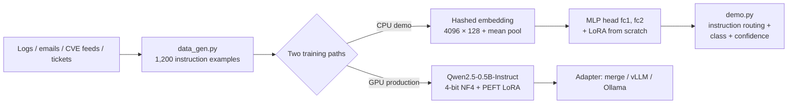

# Sentinel-LLM — LoRA Fine-Tuning for Cybersecurity Threat Intelligence

**Author:** Ashutosh Sahoo — M.Tech (AI), NIT Silchar
**Stack:** PyTorch (LoRA implemented from scratch) · PEFT / QLoRA · Transformers · MITRE ATT&CK

> A security operations centre (SOC) analyst drowns in logs, phishing emails, CVE feeds and incident tickets. Sentinel-LLM shows how to adapt a language model to that work — log triage, MITRE ATT&CK mapping, phishing detection, IOC extraction, CVE explanation and severity rating — using **LoRA (Low-Rank Adaptation)**, the parameter-efficient fine-tuning method that is current state-of-the-art practice for specialising LLMs, instead of full fine-tuning.

This repository contains **two complete, honest halves**:

1. **A locally runnable CPU demo** (`data_gen.py` → `train.py` → `demo.py`) that implements LoRA **from scratch in PyTorch**, trains it with a proper experimental protocol (validation-based hyperparameter sweep + full fine-tuning baseline), and reports **real measured numbers** (below).
2. **A production GPU script** (`train_lora_peft.py`) that QLoRA-fine-tunes a real instruction LLM (Qwen2.5-0.5B-Instruct) on the same dataset on Kaggle/Colab. *Its accuracy is not claimed anywhere in this README, because it has not been run yet — running it is a documented, copy-paste step, not a marketing number.*

---

## Results (measured locally, CPU — from `results.json`)

Dataset: **1,200** synthetic instruction examples, 6 tasks, **27 labels**, stratified split **829 train / 180 validation / 191 test**.

| Model | Trainable params | Val accuracy | **Test accuracy** |
|---|---|---|---|
| Untrained classifier | — | — | 3.66% (≈ chance, 3.70%) |
| Base model, brief training (1 epoch, all params) | 564,251 (100%) | 82.78% | 83.25% |
| **Full fine-tuning baseline** (8 more epochs, all params) | **564,251 (100%)** | 99.44% | **100.00%** |
| **LoRA — best config (r=16, α=32, lr 8e-3)** | **10,672 (1.86%)** | 99.44% | **100.00%** |

**The headline:** LoRA matches full fine-tuning exactly (100.00% test) while training **10,672 parameters instead of 564,251 — 52.9× fewer (1.86% vs 100%)**. That parity-at-a-fraction-of-the-cost is precisely why LoRA/QLoRA displaced full fine-tuning in practice. Against the briefly-trained base, LoRA adds **+16.75 points** (83.25% → 100.00%).

### Per-task test accuracy

| Task | Brief base | LoRA (best) | Full FT |
|---|---|---|---|
| Log triage | 71.88% | 100% | 100% |
| MITRE mapping | 62.50% | 100% | 100% |
| Phishing detection | 100% | 100% | 100% |
| IOC extraction | 100% | 100% | 100% |
| CVE explanation | 66.67% | 100% | 100% |
| Incident severity | 100% | 100% | 100% |

### Hyperparameter sweep (selected on validation, 10 epochs each)

| Rank r | α | LR | Trainable | Val accuracy | Val loss |
|---|---|---|---|---|---|
| 4 | 8 | 8e-3 | 2,668 (0.47%) | 99.44% | 0.0475 |
| 8 | 16 | 8e-3 | 5,336 (0.94%) | 99.44% | 0.0230 |
| **16** | **32** | **8e-3** | **10,672 (1.86%)** | **99.44%** | **0.0065** ✅ selected |
| 8 | 16 | 3e-3 | 5,336 (0.94%) | 99.44% | 0.0426 |

**Sweep findings (genuine, and more interesting than a clean win):** every rank saturates validation *accuracy* at 179/180 — a single validation example is missed by all configs — so rank buys **confidence, not accuracy**, on this dataset: val loss falls monotonically with rank (0.0475 → 0.0230 → 0.0065). At fixed rank, lr 8e-3 clearly beats 3e-3 (loss 0.0230 vs 0.0426). Selection rule: best val accuracy, tie-broken by lower val loss, then fewer parameters. Even the smallest adapter (r=4, **0.47%** of parameters) reaches parity — the practical pick if adapter size matters most.

*Timing honesty:* the full pipeline (base + full-FT baseline + 4-config sweep) took 1,309 s wall-clock on a shared VM CPU concurrently running four other builds; a single epoch takes ~3 s on an idle CPU, so expect the whole run in a few minutes on a normal laptop.

---

## The 6 tasks

| Task | What it does | Example labels |
|---|---|---|
| `log_triage` | Classify auth/system logs | benign, brute_force, port_scan, malware_beacon, sql_injection |
| `mitre_mapping` | Map behaviour → MITRE ATT&CK technique | T1110, T1046, T1071, T1190, T1566, T1059 |
| `phishing_detection` | Phishing vs legitimate email | phishing, legitimate |
| `ioc_extraction` | Pull IPs / domains / hashes / URLs from intel text | ip_ioc, domain_ioc, hash_ioc, url_ioc, multiple_ioc |
| `cve_explanation` | Classify + explain a CVE type in plain language | rce, sqli, xss, priv_esc, info_disclosure |
| `incident_severity` | Rate an incident P1–P4 | sev_critical, sev_high, sev_medium, sev_low |

Every example is instruction-formatted JSONL — `{instruction, input, output, task, label}` — the same format used to instruction-tune real LLMs, so the dataset drops straight into the GPU script.

## Architecture



**Local demo model:** tokens are hashed (MD5, stable across runs) into a 4,096-word embedding table (dim 128), mean-pooled, and classified by a 2-layer MLP (128→256→27). The MLP's linear layers (`fc1`, `fc2`) are the LoRA target layers — the direct analogue of targeting attention/MLP projections in a transformer.

**Demo detail worth noticing:** the classifier is trained on *(instruction + input)* pairs, like an instruction-tuned LLM. `demo.py` therefore performs **instruction routing** — it scores your text under all six task instructions and reports the best-fitting frame. Using the wrong instruction measurably wrecks predictions (a phishing email scored under the log-triage instruction is classified as a log threat), which is the same prompt-conditioning behaviour production LLMs exhibit.

## LoRA, briefly

For a frozen pretrained weight $W_0 \in \mathbb{R}^{d_{out} \times d_{in}}$, LoRA learns a low-rank update instead of touching $W_0$:

$$h = W_0x + \frac{\alpha}{r}\,BAx, \qquad A \in \mathbb{R}^{r \times d_{in}},\; B \in \mathbb{R}^{d_{out} \times r},\; r \ll \min(d_{in}, d_{out})$$

- `A` is randomly initialised, `B` is initialised to **zero**, so ΔW = 0 at step 0 — training starts exactly from the base model (verified by a unit check in `lora.py`).
- Trainable parameters drop from $d_{in} \cdot d_{out}$ to $r(d_{in} + d_{out})$: for this model's `fc1` at r=16, that is 6,144 vs 32,768.
- At inference, adapters can be merged ($W = W_0 + \frac{\alpha}{r}BA$, see `LoRALinear.merged_weight()`) for zero added latency, or swapped per task — one base model, many cheap specialisations. *(Hu et al., ICLR 2022.)*

## How this maps to SOTA practice

- **QLoRA (Dettmers et al., NeurIPS 2023):** the GPU script loads the base model in **4-bit NF4 with double quantisation**, trains LoRA adapters in bf16, and uses a cosine schedule with warmup — the standard recipe that made LLM fine-tuning possible on a single consumer GPU.
- **Rank/α convention:** α = 2r and targeting **all linear layers** (`q/k/v/o` + `gate/up/down` projections), per current PEFT practice; the local sweep shows how to *choose* r empirically (validation loss, not vibes) rather than copying a default.
- **Instruction tuning format:** examples are rendered through the model's chat template with a system prompt ("You are Sentinel, a cybersecurity analyst assistant…") — the same instruction-tuning approach used by recent open cybersecurity LLMs (CyberLLM / SecurityLLM-style efforts and security-tuned Llama/Qwen variants), which specialise general LLMs on SOC tasks such as log analysis, threat-intel extraction and ATT&CK mapping.
- **Evaluation discipline:** stratified held-out validation for model selection, a test set touched once per finished model, a full-fine-tuning baseline, and per-task breakdowns — the protocol a reviewer expects, applied here at small scale.
- **The real LLM result** comes from the Kaggle run below. Expected scale: Qwen2.5-0.5B has ~494M parameters; QLoRA r=16 on all linear layers trains on the order of 1% of them, and the adapter is a few tens of MB. **No accuracy is quoted for it until it is actually run and evaluated** — that is deliberate.

## Run it locally (CPU, a few minutes)

```bash
pip install -r requirements.txt        # torch, numpy, pandas only
python data_gen.py                     # -> dataset.jsonl (1,200 examples, seed 42)
python lora.py                         # LoRA self-test (shapes + zero-init check)
python train.py                        # base -> full-FT baseline -> LoRA sweep -> results.json + sentinel_lora.pt
python evaluate.py                     # held-out test: 191/191 with the shipped checkpoint
python demo.py                         # 6 built-in samples, instruction routing
python demo.py "Failed password for root from 91.2.3.4, attempt 87 of 200"
```

Verified demo output (shipped checkpoint): brute-force log → `brute_force` 99.92% · phishing email → `phishing` 100% · ransomware incident → `sev_critical` 100% · Log4Shell text → `rce` 99.93% · IOC report → `ip_ioc` 99.95%.

## Run the full LLM fine-tune (Kaggle / Colab, GPU)

```bash
# On a T4/P100 notebook:
pip install -r requirements_gpu.txt    # transformers, peft, trl, datasets, bitsandbytes, accelerate
python data_gen.py
python train_lora_peft.py --epochs 3 --output_dir ./sentinel-qlora-out
# -> adapter in ./sentinel-qlora-out/adapter; merge with PeftModel.merge_and_unload()
#    or serve base + adapter with vLLM. Evaluate by generating on the held-out
#    split and matching the predicted class / technique / IOCs.
```

## Files

| File | Purpose |
|---|---|
| `data_gen.py` | Synthetic-but-realistic dataset generator (seed-fixed, randomised IPs/users/domains/hashes/CVEs) |
| `lora.py` | **LoRA from scratch**: `LoRALinear`, model injection, freeze/count utilities |
| `model.py` | Hashed-embedding classifier (vocab 4096, dim 128, MLP head) |
| `train.py` | Full protocol: brief base → full-FT baseline → LoRA sweep (val-selected) → checkpoint + `results.json` |
| `evaluate.py` | Reproduces the exact test split and scores the shipped checkpoint |
| `demo.py` | CLI demo with instruction routing (class + confidence + top-3) |
| `train_lora_peft.py` | Production QLoRA fine-tune of Qwen2.5-0.5B-Instruct (GPU, not run locally) |
| `results.json` | Every number in this README, machine-readable |

## Skills demonstrated

Parameter-efficient fine-tuning (LoRA/QLoRA) implemented from first principles · PyTorch internals (custom modules, freezing, parameter accounting) · instruction-dataset design for security tasks · MITRE ATT&CK, IOC and CVE domain modelling · rigorous ML experimentation (stratified splits, validation-based selection, full-FT baselines, per-task metrics) · production LLM tooling (Transformers, PEFT, TRL SFT, bitsandbytes) · honest reporting of synthetic-data limits.

## Limitations (read this before quoting the numbers)

- **Synthetic, templated data.** The generator's templates have strong keyword signals, which is *why* the test accuracy hits 100% — this demonstrates the pipeline and the LoRA efficiency effect, **not** real-world SOC performance. Real logs are noisier, adversarial and heavily imbalanced; expect substantially lower accuracy there.
- **The local model is a small classifier, not a generative LLM.** It proves the LoRA mechanics, protocol and parameter accounting end-to-end on CPU. Generative abilities (free-text CVE explanations, novel IOC extraction) come only from the GPU LLM run.
- **The GPU LLM has not been run.** No metric for it is claimed anywhere in this project.
- One validation example is missed by every configuration, and free-form paraphrases far outside the templates can be misclassified — both are visible in the artifacts, not hidden.

## Roadmap

1. Run `train_lora_peft.py` on Kaggle; evaluate generation quality on the held-out split (exact-match on labels/techniques, IOC precision/recall) and publish the adapter + eval table.
2. Replace/augment synthetic data with public corpora (e.g. UNSW-NB15 / CIC-IDS logs, real CVE descriptions from NVD, phishing corpora) and re-run the same protocol.
3. Multi-adapter serving: one base LLM + per-task LoRA adapters with a router (the production analogue of `demo.py`'s instruction routing).
4. Add calibration + abstention (low-confidence → human analyst), and a streaming log-triage service wrapper.

## References

- Hu et al., *LoRA: Low-Rank Adaptation of Large Language Models*, ICLR 2022.
- Dettmers et al., *QLoRA: Efficient Finetuning of Quantized LLMs*, NeurIPS 2023.
- MITRE ATT&CK® knowledge base — technique IDs used in `mitre_mapping`.
