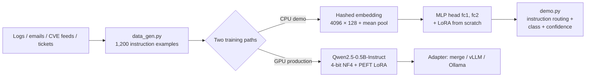

# Sentinel-LLM — LoRA Fine-Tuning for Cybersecurity Threat Intelligence

**Author:** Ashutosh Sahoo — M.Tech (AI), NIT Silchar
**Stack:** PyTorch (LoRA implemented from scratch) · PEFT / QLoRA · Transformers · MITRE ATT&CK

> A security operations centre (SOC) analyst drowns in logs, phishing emails, CVE feeds and incident tickets. Sentinel-LLM shows how to adapt a language model to that work — log triage, MITRE ATT&CK mapping, phishing detection, IOC extraction, CVE explanation and severity rating — using **LoRA (Low-Rank Adaptation)**, the parameter-efficient fine-tuning method that is current state-of-the-art practice for specialising LLMs, instead of full fine-tuning.

This repository contains **two complete, honest halves**:

1. **A locally runnable CPU demo** (`data_gen.py` → `train.py` → `demo.py`) that implements LoRA **from scratch in PyTorch**, trains it with a proper experimental protocol (validation-based hyperparameter sweep + full fine-tuning baseline), and reports **real measured numbers** (below).
2. **A production GPU script** (`train_lora_peft.py`) that QLoRA-fine-tunes a real instruction LLM (Qwen2.5-0.5B-Instruct) on the same dataset on Kaggle/Colab. *Its accuracy is not claimed anywhere in this README, because it has not been run yet — running it is a documented, copy-paste step, not a marketing number.*

---

## Real benchmark results (2026-11-13 — from `results_real.json`)

The synthetic results below were re-run on **real public benchmark data**, with the same architecture, from-scratch LoRA implementation, protocol and metrics — only the data changed. Reproduce with `python load_real.py` then `python eval_real.py baseline|phaseb|phaseb2|final --task mitre|cve`, and round 2 with `python eval_real2.py --task mitre|cve`.

### ROUND 2 headline results (2026-11-13 — three pre-registered model families)

Round 1 (below) left the neural model well under the published bars and excluded the strongest TF-IDF variant from test by a pre-registered LoRA-only selection rule. Round 2 re-ran the same splits (no re-splitting) with three pre-registered **families** — TF-IDF, hybrid (TF-IDF + neural features), and neural fixes — each family's winner selected on **validation** macro-F1 and evaluated on test **exactly once** (MITRE: 4 test touches total, one extra from a superseded hybrid run, disclosed in `results_real.json`; CVE: 3). **The headline is now the best verified system per task — a TF-IDF-family model on both tasks** — with the LoRA-vs-full-FT comparison retained as a reported result underneath.

| Task | Family | Winning system | Val acc / F1 | **Test acc / F1** |
|---|---|---|---|---|
| ATT&CK tactic | **TF-IDF ✅ headline** | word TF-IDF (1–2g) + linear SVM (SGD hinge, α=1e-4) | 88.68% / 0.894 | **79.46% / 0.779** |
| ATT&CK tactic | Hybrid | TF-IDF (word+char, ×20 block scale) + neural hidden → LR | 79.25% / 0.783 | 69.64% / 0.660 |
| ATT&CK tactic | Neural | full FT (word features, class weights, label smoothing, ≤16 ep) | 74.53% / 0.720 | 65.18% / 0.600 |
| CVE severity | **TF-IDF ✅ headline** | word TF-IDF (1–2g) + linear SVM (SGD hinge, α=1e-5) | 57.33% / 0.558 | **55.70% / 0.544** |
| CVE severity | Hybrid | TF-IDF (word+char, ×20 block scale) + neural hidden → LR | 56.67% / 0.553 | 54.00% / 0.528 |
| CVE severity | Neural | full FT (word+char, label smoothing, ≤16 ep) | 52.83% / 0.514 | 54.40% / 0.528 |

**Against the published bars.** ATT&CK: the published single-label SVM bar is 81.95% accuracy / 0.7795 F1 (Crossman et al., on their CTI corpus) — our headline is **−2.5 points on accuracy and level on macro-F1 (0.779 vs 0.780)**, under a different protocol (technique descriptions, first-tactic single-label). Round 1's LoRA final was 49.11% / 0.364 on this task; round 2's best neural system reaches 65.18% / 0.600, and the headline SVM nearly triples the LoRA macro-F1. CVE: the field's temporal-split ceiling zone is ~70% (Dixit et al.: LoRA Phi-3.5-mini 69.9%, TF-IDF LR ≈65–67% — trained on ~36k CVEs from 2022–23); our 55.70% on 2,800 CVEs from 2020–21 remains below that band — the gap is quantified and explained below, not rounded away.

**Three round-2 findings worth more than the headline:**
- **The excluded C6 variant was an artifact.** Reproduced as a first-class TF-IDF-family candidate, the CVSS-component-derive pipeline scored **0.517 macro-F1 on the true 2023 validation split** — below plain TF-IDF. Its round-1 score of 0.634 came from a same-era *inner* validation split carved from train. Tested properly, the claim fails; per the pre-registered rule it was not the family winner and got no separate test run.
- **Class imbalance handling was the biggest MITRE lever after features.** Word TF-IDF + LR jumps from 0.21 to 0.84 val macro-F1 with `class_weight="balanced"`; the winning SVM did not need it. In the neural family, class weights + label smoothing + longer training lifted full FT from 0.422 (round 1) to 0.600 test macro-F1 — while every LoRA variant still trailed its full-FT counterpart, and wider embeddings (256-d) and the ordinal loss did **not** help on CVE.
- **The first hybrid run was only weakly hybrid — caught and fixed.** Coefficient-norm diagnostics showed the shared-L2 geometry let the standardised neural block swamp the sparse TF-IDF block (sparse coef norm 0.25 vs dense 3.54); that run is preserved in `results_real.json` as a superseded run (round-1 C3→A1 precedent). With sparse-block scaling (×20), the hybrid improved to 0.660 test macro-F1 on MITRE — still below pure TF-IDF: **on top of a properly tuned TF-IDF, the small neural model's features added nothing on either task.** That is a negative result, reported as one.

**What would close the remaining gap.** Both bars were set with either far more data (Dixit: ~13× our CVE training rows, from the two years adjacent to the test year rather than 2020–21) or pretrained representations. Our from-scratch hashed embeddings have no pretraining — that, not the classifier head, is now the binding constraint. The documented next step is the packaged GPU run: `train_lora_peft.py` QLoRA-fine-tunes Qwen2.5-0.5B-Instruct, whose pretrained representations are exactly what this round identifies as missing; a full-era (non-quota) CVE pull is the data-side companion step. Neither has been run, and no numbers for them are claimed.

### Round 1 results (Phase-B selected recipes, test evaluated once)

**Datasets (provenance).**
- **MITRE ATT&CK tactic classification** — technique description → tactic, from the official MITRE CTI STIX bundle (`enterprise-attack.json`, pulled 2026-11-13; ATT&CK Terms of Use, free with attribution). Revoked/deprecated techniques excluded → **706 techniques, 15 tactics**, stratified 70/15/15 split (**488 train / 106 val / 112 test**, seed 123). Label = the technique's *first* `kill_chain_phase` (kill-chain order); 145 techniques (20.5%) genuinely carry multiple tactics — that single-label simplification is a known source of label noise (see the multi-label attempt in the improvement log).
- **CVE severity** — description → CVSS v3.x tier (LOW/MEDIUM/HIGH/CRITICAL), from the **NVD API 2.0** (NIST; public-domain US-government data), pulled 2026-11-13. **TEMPORAL split** (random splits leak via near-duplicate CVEs): train = published 2020–2021, val = 2023, test = 2024, sampled chronologically with per-class quotas → **4,400 CVEs, exactly balanced (2,800 train / 600 val / 1,000 test; 700/150/250 per class)**. CVE-ID and year tokens were stripped from the text so they cannot be used as features. The score-0.0 "NONE" tier is effectively absent from NVD primary v3 metrics (the API's NONE filter returns zero records), so the tier set is the four tiers that occur. The optional phishing corpus was **skipped** — no verifiable public corpus was pulled, and nothing was substituted for it.

#### Round-1 final recipes

| Task | Model | Trainable params | Test accuracy | Test macro-F1 |
|---|---|---|---|---|
| ATT&CK tactic | **LoRA final** (word features, label smoothing 0.1, 24 epochs, r=8) | 5,240 (0.93%) | **49.11%** | **0.364** |
| ATT&CK tactic | Full FT, same recipe | 561,167 (100%) | 56.25% | 0.422 |
| CVE severity (temporal) | **LoRA final** (word+char n-grams, label smoothing 0.1, 24 epochs, r=8) | 5,152 (0.47%) | **48.90%** | **0.475** |
| CVE severity (temporal) | Full FT, same recipe | 1,082,628 (100%) | 54.40% | 0.536 |

### Baseline results (original protocol, before improvements)

| Task | Untrained | Majority | TF-IDF + LR reference | Brief base | Full FT | LoRA (val-selected) |
|---|---|---|---|---|---|---|
| ATT&CK tactic (test n=112) | 7.14% / 0.02* | 20.54% / — | **72.32% / 0.651** | 20.54% / 0.023 | 57.14% / 0.432 | 47.32% / 0.334 (r=16, 10,480 params, 1.83%) |
| CVE severity (test n=1,000) | 23.90% / 0.133 | 25.00% / 0.100 | **55.90% / 0.547** | 43.60% / 0.427 | 54.40% / 0.541 | 47.20% / 0.466 (r=4, 2,576 params) |

*Cells show accuracy / macro-F1. Full per-class F1, sweep tables and runtimes are in `results_real.json`.*

**How to read these numbers (honestly).** On real data the small hashed-embedding model does **not** repeat its synthetic 100% — and a plain TF-IDF logistic regression **beats** it on both tasks. That is the finding, and it matches the published bars: for ATT&CK tactic tagging, a linear TF-IDF model (SGD-SVM) is reported at 81.95% accuracy / 0.7795 F1 (Crossman et al.), so a strong linear model is the right bar and our TF-IDF reference (72.32% / 0.651) sits below it, with our embedding model below that. For CVE severity under a temporal split, the field's realistic zone is ~60–70% (Dixit et al.: LoRA-tuned Phi-3.5-mini 69.9%; TF-IDF LR ≈65–67%) — severity-from-text has a hard ceiling well below 90%, and our 54–56% (full FT / TF-IDF) is below that zone, not a rounding error away from it. Two structural reasons: (1) LoRA here adapts only the MLP head on top of a **1-epoch** base — the embedding representation itself is barely trained, which is exactly what full FT (and TF-IDF) exploit; on separable synthetic templates that handicap was invisible. (2) Rare tactics (initial-access has 15 techniques in the whole corpus) collapse to F1 0.0 in every neural variant, while TF-IDF's per-word evidence handles them less badly (still 0.0 for initial-access — the class is tiny and confusable).

**Round-2 update.** The three-family round above changes the ending of that story: a tuned linear SVM over word TF-IDF reaches 79.46% / 0.779 on ATT&CK — level with the published bar's macro-F1 — and even scores F1 0.80 on initial-access, the class every neural variant flatlined on. Class-weighted, longer-trained full FT is the best neural system (0.600 macro-F1), so the representation gap narrowed but did not close; LoRA remains behind full FT on real data in every round-2 neural comparison. On CVE, round 2 is a wash at the top (55.70% vs round 1's 55.90% TF-IDF reference) — with 2,800 training rows from 2020–21, no classifier family in this codebase breaks out of the mid-50s, which is itself the evidence that the remaining CVE gap is data scale/recency and pretrained representation, not model choice.

### Improvement log (Phase B — every attempt, failures included)

All candidates were screened on an inner validation split carved from **train** (MITRE n=80, CVE n=420); the test set received exactly **one** additional evaluation per task — the selected recipe above. Selection rule (fixed before screening): highest inner-val macro-F1 among LoRA recipes.

| Candidate (inner-val macro-F1) | MITRE | CVE | Verdict |
|---|---|---|---|
| C0 control (baseline recipe, word features) | 0.265 | 0.551 | reference |
| C1 word + char 3–5-gram features | 0.172 | 0.572 | helps CVE, **hurts MITRE** at 10 epochs |
| C2 C1 + IDF-weighted pooling | 0.150 | 0.556 | **drop** (hurts both vs C1) |
| C3 class weights 1/√freq | invalid run¹ | 0.572 (= C1; CVE classes are balanced by sampling, so weights are uniform) | see A1 |
| A1 class weights, corrected run | 0.322 | 0.577 | real gain on MITRE only |
| C4 char/word + label smoothing 0.1 + longer training (≤24 ep, early stop) | 0.421 | **0.587 ✅ selected (CVE)** | bundle wins |
| C5 C1 + ordinal loss (CVE only) | — | 0.562 | **drop** |
| C6 CVSS-component derivation (TF-IDF per component → official CVSS v3.1 formula → tier) | — | 0.634 | **best CVE score on the inner validation — but a TF-IDF pipeline, not a LoRA recipe; excluded from selection by the round-1 pre-registered rule. ROUND-2 VERDICT: reproduced as a selectable candidate, it scored 0.517 macro-F1 on the true 2023 validation split — an inner-val artifact; not the family winner, no separate test run.** |
| C7 multi-label sigmoid head (MITRE only) | micro-F1 0.179, argmax F1 0.022 | — | **drop** (fails at this data scale despite being the "correct" formulation) |
| A2 word features + label smoothing + longer training | **0.451 ✅ selected (MITRE)** | 0.569 | char features were *not* the active ingredient on MITRE |
| A3 wordchar + longer training, no smoothing | 0.414 | 0.566 | ablation: smoothing contributes a little |

¹ Round-1 C3 on MITRE silently dropped its class weights (a trainer-routing bug) and duplicated C1; it is flagged `invalid_run` in `results_real.json` and superseded by A1. **Attribution:** the consistent winner was *longer training with early stopping* (+ label smoothing); char n-grams helped only CVE. **Plateau:** after two rounds the full lever menu from the research brief had been covered and round-2 deltas were within inner-val noise (MITRE's inner-val is only n=80, which is also why its screening winner's test gain, 0.334 → 0.364 F1, is smaller than the val gain suggested; CVE shows the same effect across the temporal gap). Iteration stopped there rather than chase noise. Total recorded compute for the whole real-benchmark programme: **~41 min CPU** (+ ~13 min of rate-limited data pulls). **Round 2** (three families, 111 candidates screened on validation across both tasks) added **~27 min** of recorded CPU compute; its full candidate log is `tasks.<task>.round2` in `results_real.json`, and its headline findings are in the round-2 section above.

---

## Preliminary results (synthetic data — measured locally, CPU — from `results.json`)

> ⚠️ **Preliminary / superseded as the headline.** The numbers in this section come from the project's original *synthetic templated* dataset. They demonstrate the LoRA pipeline and the parameter-efficiency effect, **not** real-world performance — see the real benchmark results above, where the same models score 47–57% instead of 100%. This section is kept, unedited, for provenance.

Dataset: **1,200** synthetic instruction examples, 6 tasks, **27 labels**, stratified split **829 train / 180 validation / 191 test**.

| Model | Trainable params | Val accuracy | **Test accuracy** |
|---|---|---|---|
| Untrained classifier | — | — | 3.66% (≈ chance, 3.70%) |
| Base model, brief training (1 epoch, all params) | 564,251 (100%) | 82.78% | 83.25% |
| **Full fine-tuning baseline** (8 more epochs, all params) | **564,251 (100%)** | 99.44% | **100.00%** |
| **LoRA — best config (r=16, α=32, lr 8e-3)** | **10,672 (1.86%)** | 99.44% | **100.00%** |

**The headline:** LoRA matches full fine-tuning exactly (100.00% test) while training **10,672 parameters instead of 564,251 — 52.9× fewer (1.86% vs 100%)**. That parity-at-a-fraction-of-the-cost is precisely why LoRA/QLoRA displaced full fine-tuning in practice. Against the briefly-trained base, LoRA adds **+16.75 points** (83.25% → 100.00%).

### Per-task test accuracy

| Task | Brief base | LoRA (best) | Full FT |
|---|---|---|---|
| Log triage | 71.88% | 100% | 100% |
| MITRE mapping | 62.50% | 100% | 100% |
| Phishing detection | 100% | 100% | 100% |
| IOC extraction | 100% | 100% | 100% |
| CVE explanation | 66.67% | 100% | 100% |
| Incident severity | 100% | 100% | 100% |

### Hyperparameter sweep (selected on validation, 10 epochs each)

| Rank r | α | LR | Trainable | Val accuracy | Val loss |
|---|---|---|---|---|---|
| 4 | 8 | 8e-3 | 2,668 (0.47%) | 99.44% | 0.0475 |
| 8 | 16 | 8e-3 | 5,336 (0.94%) | 99.44% | 0.0230 |
| **16** | **32** | **8e-3** | **10,672 (1.86%)** | **99.44%** | **0.0065** ✅ selected |
| 8 | 16 | 3e-3 | 5,336 (0.94%) | 99.44% | 0.0426 |

**Sweep findings (genuine, and more interesting than a clean win):** every rank saturates validation *accuracy* at 179/180 — a single validation example is missed by all configs — so rank buys **confidence, not accuracy**, on this dataset: val loss falls monotonically with rank (0.0475 → 0.0230 → 0.0065). At fixed rank, lr 8e-3 clearly beats 3e-3 (loss 0.0230 vs 0.0426). Selection rule: best val accuracy, tie-broken by lower val loss, then fewer parameters. Even the smallest adapter (r=4, **0.47%** of parameters) reaches parity — the practical pick if adapter size matters most.

*Timing honesty:* the full pipeline (base + full-FT baseline + 4-config sweep) took 1,309 s wall-clock on a shared VM CPU concurrently running four other builds; a single epoch takes ~3 s on an idle CPU, so expect the whole run in a few minutes on a normal laptop.

---

## The 6 tasks

| Task | What it does | Example labels |
|---|---|---|
| `log_triage` | Classify auth/system logs | benign, brute_force, port_scan, malware_beacon, sql_injection |
| `mitre_mapping` | Map behaviour → MITRE ATT&CK technique | T1110, T1046, T1071, T1190, T1566, T1059 |
| `phishing_detection` | Phishing vs legitimate email | phishing, legitimate |
| `ioc_extraction` | Pull IPs / domains / hashes / URLs from intel text | ip_ioc, domain_ioc, hash_ioc, url_ioc, multiple_ioc |
| `cve_explanation` | Classify + explain a CVE type in plain language | rce, sqli, xss, priv_esc, info_disclosure |
| `incident_severity` | Rate an incident P1–P4 | sev_critical, sev_high, sev_medium, sev_low |

Every example is instruction-formatted JSONL — `{instruction, input, output, task, label}` — the same format used to instruction-tune real LLMs, so the dataset drops straight into the GPU script.

## Architecture



**Local demo model:** tokens are hashed (MD5, stable across runs) into a 4,096-word embedding table (dim 128), mean-pooled, and classified by a 2-layer MLP (128→256→27). The MLP's linear layers (`fc1`, `fc2`) are the LoRA target layers — the direct analogue of targeting attention/MLP projections in a transformer.

**Demo detail worth noticing:** the classifier is trained on *(instruction + input)* pairs, like an instruction-tuned LLM. `demo.py` therefore performs **instruction routing** — it scores your text under all six task instructions and reports the best-fitting frame. Using the wrong instruction measurably wrecks predictions (a phishing email scored under the log-triage instruction is classified as a log threat), which is the same prompt-conditioning behaviour production LLMs exhibit.

## LoRA, briefly

For a frozen pretrained weight $W_0 \in \mathbb{R}^{d_{out} \times d_{in}}$, LoRA learns a low-rank update instead of touching $W_0$:

$$h = W_0x + \frac{\alpha}{r}\,BAx, \qquad A \in \mathbb{R}^{r \times d_{in}},\; B \in \mathbb{R}^{d_{out} \times r},\; r \ll \min(d_{in}, d_{out})$$

- `A` is randomly initialised, `B` is initialised to **zero**, so ΔW = 0 at step 0 — training starts exactly from the base model (verified by a unit check in `lora.py`).
- Trainable parameters drop from $d_{in} \cdot d_{out}$ to $r(d_{in} + d_{out})$: for this model's `fc1` at r=16, that is 6,144 vs 32,768.
- At inference, adapters can be merged ($W = W_0 + \frac{\alpha}{r}BA$, see `LoRALinear.merged_weight()`) for zero added latency, or swapped per task — one base model, many cheap specialisations. *(Hu et al., ICLR 2022.)*

## How this maps to SOTA practice

- **QLoRA (Dettmers et al., NeurIPS 2023):** the GPU script loads the base model in **4-bit NF4 with double quantisation**, trains LoRA adapters in bf16, and uses a cosine schedule with warmup — the standard recipe that made LLM fine-tuning possible on a single consumer GPU.
- **Rank/α convention:** α = 2r and targeting **all linear layers** (`q/k/v/o` + `gate/up/down` projections), per current PEFT practice; the local sweep shows how to *choose* r empirically (validation loss, not vibes) rather than copying a default.
- **Instruction tuning format:** examples are rendered through the model's chat template with a system prompt ("You are Sentinel, a cybersecurity analyst assistant…") — the same instruction-tuning approach used by recent open cybersecurity LLMs (CyberLLM / SecurityLLM-style efforts and security-tuned Llama/Qwen variants), which specialise general LLMs on SOC tasks such as log analysis, threat-intel extraction and ATT&CK mapping.
- **Evaluation discipline:** stratified held-out validation for model selection, a test set touched once per finished model, a full-fine-tuning baseline, and per-task breakdowns — the protocol a reviewer expects, applied here at small scale.
- **The real LLM result** comes from the Kaggle run below. Expected scale: Qwen2.5-0.5B has ~494M parameters; QLoRA r=16 on all linear layers trains on the order of 1% of them, and the adapter is a few tens of MB. **No accuracy is quoted for it until it is actually run and evaluated** — that is deliberate.

## Run it locally (CPU, a few minutes)

```bash
pip install -r requirements.txt        # torch, numpy, pandas only
python data_gen.py                     # -> dataset.jsonl (1,200 examples, seed 42)
python lora.py                         # LoRA self-test (shapes + zero-init check)
python train.py                        # base -> full-FT baseline -> LoRA sweep -> results.json + sentinel_lora.pt
python evaluate.py                     # held-out test: 191/191 with the shipped checkpoint
python demo.py                         # 6 built-in samples, instruction routing
python demo.py "Failed password for root from 91.2.3.4, attempt 87 of 200"
```

Verified demo output (shipped checkpoint): brute-force log → `brute_force` 99.92% · phishing email → `phishing` 100% · ransomware incident → `sev_critical` 100% · Log4Shell text → `rce` 99.93% · IOC report → `ip_ioc` 99.95%.

## Run the full LLM fine-tune (Kaggle / Colab, GPU)

```bash
# On a T4/P100 notebook:
pip install -r requirements_gpu.txt    # transformers, peft, trl, datasets, bitsandbytes, accelerate
python data_gen.py
python train_lora_peft.py --epochs 3 --output_dir ./sentinel-qlora-out
# -> adapter in ./sentinel-qlora-out/adapter; merge with PeftModel.merge_and_unload()
#    or serve base + adapter with vLLM. Evaluate by generating on the held-out
#    split and matching the predicted class / technique / IOCs.
```

## Files

| File | Purpose |
|---|---|
| `data_gen.py` | Synthetic-but-realistic dataset generator (seed-fixed, randomised IPs/users/domains/hashes/CVEs) |
| `lora.py` | **LoRA from scratch**: `LoRALinear`, model injection, freeze/count utilities |
| `model.py` | Hashed-embedding classifier (vocab 4096, dim 128, MLP head) |
| `train.py` | Full protocol: brief base → full-FT baseline → LoRA sweep (val-selected) → checkpoint + `results.json` |
| `evaluate.py` | Reproduces the exact test split and scores the shipped checkpoint |
| `demo.py` | CLI demo with instruction routing (class + confidence + top-3) |
| `train_lora_peft.py` | Production QLoRA fine-tune of Qwen2.5-0.5B-Instruct (GPU, not run locally) |
| `results.json` | Every number in the preliminary (synthetic) section, machine-readable |
| `load_real.py` | Real-data loaders: MITRE ATT&CK STIX bundle + NVD API 2.0 temporal/quota sampling → `dataset_real_mitre.jsonl`, `dataset_real_cve.jsonl` (provenance in `real_data/provenance.json`) |
| `eval_real.py` | Real-benchmark runs: `baseline` (original protocol), `phaseb`/`phaseb2` (inner-val-screened improvement levers), `final` (selected recipe, one test evaluation) |
| `eval_real2.py` | Round 2: three pre-registered families (TF-IDF / hybrid / neural fixes), val-selected per family, one test evaluation per family winner |
| `results_real.json` | Every number in the real-benchmark section, machine-readable (metrics, splits, distributions, full improvement logs for rounds 1–2, runtimes, test-touch accounting) |

## Skills demonstrated

Parameter-efficient fine-tuning (LoRA/QLoRA) implemented from first principles · PyTorch internals (custom modules, freezing, parameter accounting) · instruction-dataset design for security tasks · MITRE ATT&CK, IOC and CVE domain modelling · rigorous ML experimentation (stratified splits, validation-based selection, full-FT baselines, per-task metrics) · production LLM tooling (Transformers, PEFT, TRL SFT, bitsandbytes) · honest reporting of synthetic-data limits.

## Limitations (read this before quoting the numbers)

- **Synthetic, templated data.** The generator's templates have strong keyword signals, which is *why* the test accuracy hits 100% — this demonstrates the pipeline and the LoRA efficiency effect, **not** real-world SOC performance. Real logs are noisier, adversarial and heavily imbalanced; expect substantially lower accuracy there.
- **The local model is a small classifier, not a generative LLM.** It proves the LoRA mechanics, protocol and parameter accounting end-to-end on CPU. Generative abilities (free-text CVE explanations, novel IOC extraction) come only from the GPU LLM run.
- **The GPU LLM has not been run.** No metric for it is claimed anywhere in this project.
- One validation example is missed by every configuration, and free-form paraphrases far outside the templates can be misclassified — both are visible in the artifacts, not hidden.

## Roadmap

1. Run `train_lora_peft.py` on Kaggle; evaluate generation quality on the held-out split (exact-match on labels/techniques, IOC precision/recall) and publish the adapter + eval table.
2. ~~Replace/augment synthetic data with public corpora~~ **DONE 2026-11-13** for MITRE ATT&CK + NVD CVE severity (see the real-benchmark section above). ~~Evaluate the C6 component-derivation pipeline on the 2024 test year~~ **DONE in round 2 — falsified on the true validation split (see above).** Next data steps: a full-era (non-quota) CVE pull for training scale, and a phishing corpus only if a verifiable public one can be pulled cleanly.
3. Multi-adapter serving: one base LLM + per-task LoRA adapters with a router (the production analogue of `demo.py`'s instruction routing).
4. Add calibration + abstention (low-confidence → human analyst), and a streaming log-triage service wrapper.

## References

- Hu et al., *LoRA: Low-Rank Adaptation of Large Language Models*, ICLR 2022.
- Dettmers et al., *QLoRA: Efficient Finetuning of Quantized LLMs*, NeurIPS 2023.
- MITRE ATT&CK® knowledge base — technique IDs used in `mitre_mapping`.
